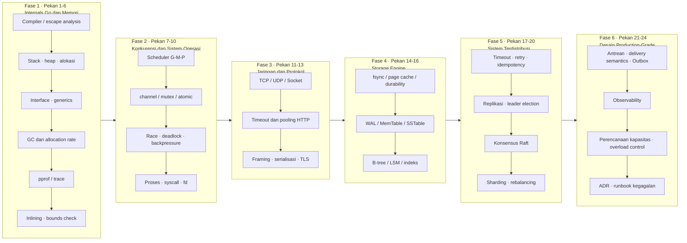
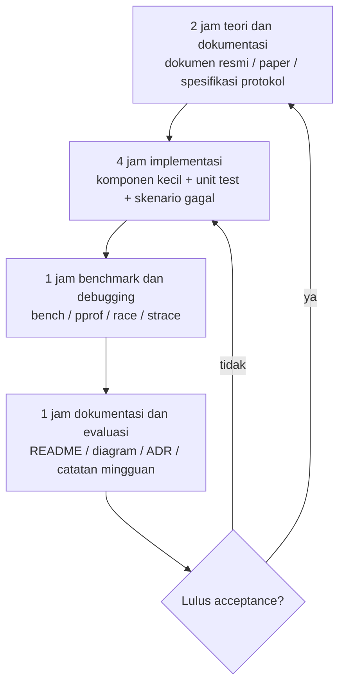
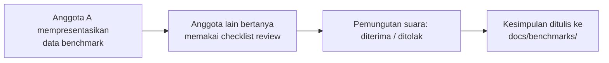

# Panduan Engineering Go Tingkat Lanjut: Low-Level dan Desain Sistem (24 Pekan)

> Tujuannya bukan sekadar "bisa menulis REST API dengan Go", melainkan **bisa menjelaskan kenapa sistem bekerja seperti itu, bisa membuktikan dengan data bahwa optimasi efektif, dan bisa mempertanggungjawabkan trade-off saat terjadi kegagalan**.
>
> Untuk siapa: engineer backend yang sudah punya pengalaman Python / Go / Docker / database. 8 jam per pekan, total 24 pekan.

---

## 0. Supaya jelas: masalah apa yang dipecahkan materi ini

Ada tiga alasan klasik kenapa program peningkatan kemampuan teknis tim gagal. Materi ini dirancang untuk menjawab ketiganya satu per satu.

| Masalah umum | Gejala khas | Cara materi ini menangani |
| --- | --- | --- |
| Belajar framework, bukan prinsip | Ganti library langsung bingung; ada masalah cuma bisa restart | Setiap materi menuntut "bisa menjelaskan mekanismenya", tidak boleh berhenti di "yang penting jalan" |
| Optimasi berdasarkan feeling | "Menurut saya pakai pointer lebih cepat" | Semua kesimpulan performa wajib disertai bukti `benchstat` / `pprof` |
| Tidak ada loop penjaminan kualitas | Gaya kode masing-masing, review cuma membahas penamaan | Disediakan checklist review yang bisa dipakai, quality gate CI, dan Definition of Done (lihat `docs/08-*`) |

**Satu aturan yang berlaku di seluruh materi: tanpa pengukuran, tidak ada kesimpulan.** Setiap klaim "cara ini lebih cepat / lebih aman" wajib disertai satu eksperimen yang bisa direproduksi.

---

## 1. Peta jalur lengkap



**Kenapa urutannya begini?** Semakin ke depan, semakin tidak bisa dilewati:

1. **Memori dan GC** menentukan apakah Anda bisa membaca flame graph `pprof`. Kalau tidak paham alokasi, profiling cuma seperti melihat gambar berwarna.
2. **Konkurensi dan Linux** menentukan apakah Anda bisa menjawab "kenapa CPU tidak penuh tapi latensi melonjak".
3. **Jaringan dan storage** menentukan apakah Anda paham apa yang sebenarnya terjadi di bawah abstraction framework.
4. **Sistem terdistribusi** dibangun di atas tiga hal sebelumnya. Bug distributed pada dasarnya adalah tumpukan dari "konkurensi + jaringan + persistensi".

> Jangan melompat. Orang yang langsung mengerjakan Raft tanpa melewati Fase 2 dan 3 akan menghadapi tiga jenis bug sekaligus: scheduling, framing, dan persistensi. Waktu debugging-nya naik secara eksponensial.

---

## 2. Ritme tetap 8 jam per pekan

Belajar baru berkelanjutan kalau ritmenya tetap. Kalau tidak, repository akan jadi museum di pekan ketiga.



| Slot | Yang dikerjakan | Artefak (wajib tersimpan di repo) |
| --- | --- | --- |
| 2 jam teori | Baca dokumentasi resmi, paper, spesifikasi protokol | Ringkasan konsep di `notes.md` + **minimal 3 hal yang tadinya Anda pahami salah** |
| 4 jam implementasi | Komponen kecil + unit test + failure case | Kode yang bisa dikompilasi + `*_test.go` (termasuk failure case) |
| 1 jam pengukuran | benchmark, profiling, race, strace | Output `benchstat`, file profile, atau kesimpulan dalam bentuk teks |
| 1 jam evaluasi | README, diagram, ADR, catatan mingguan | `README.md`, `docs/`, catatan mingguan `week-XX.md` |

**Template catatan mingguan** ada di `docs/10-templates.md`. Catatan mingguan bukan buku harian. Isinya cuma empat hal: **apa yang dikerjakan, apa yang terukur, mana yang salah, apa yang diperbaiki minggu depan**.

---

## 3. Cara tim menjalankannya: mengubah "belajar individu" jadi "kapasitas tim"

Selesai belajar sendiri tidak membuat tim jadi lebih kuat. Berikut empat hal yang mengubah kemampuan individu menjadi aset tim.

### 3.1 Review teknis 90 menit setiap pekan



Aturannya:

- **Tidak menerima "menurut saya"**. Presenter wajib memberi perintah yang bisa direproduksi.
- Penanya wajib mengutip nomor item dari `docs/08-code-review-and-quality-gates.md`, supaya diskusi tidak melebar ke urusan penamaan.
- Penolakan bukan penghinaan, itu proses. Penolakan harus menyebutkan jelas "bukti nomor apa yang kurang".

### 3.2 Tiga level quality gate

| Level | Yang diperiksa | Tool | Konsekuensi kalau gagal |
| --- | --- | --- | --- |
| L1 lokal | format, vet, unit test | `gofmt` `go vet` `go test` | tidak boleh commit |
| L2 CI | race, coverage, lint, regresi benchmark | `go test -race` `golangci-lint` `benchstat` | tidak boleh merge |
| L3 manual | kebenaran konkurensi, jalur gagal, pelepasan resource, argumen trade-off | Checklist review | belum bisa disebut "selesai" |

### 3.3 Struktur repository bersama tim

```
advanced-go-systems/
├── 01-go-internals/        # Fase 1: escape analysis, GC, eksperimen layout memori
├── 02-memory-benchmarks/   # Fase 1: pustaka baseline benchstat (disimpan jangka panjang)
├── 03-concurrency/         # Fase 2: go-worker-pool
├── 04-tcp-protocol/        # Fase 3: go-kv-protocol
├── 05-storage-engine/      # Fase 4: gostore
├── 06-distributed-kv/      # Fase 5: go-distributed-kv
├── 07-job-queue/           # Fase 6: outbox + DLQ
├── 08-observability/       # Fase 6: OTel / Prometheus / Grafana
├── docs/
│   ├── architecture/       # diagram arsitektur (sumber mermaid + PNG)
│   ├── adr/                # architecture decision record
│   ├── benchmarks/         # data mentah dan kesimpulan tiap benchmark
│   └── failure-analysis/   # eksperimen fault injection dan runbook pemulihan
├── Makefile
├── .golangci.yml
└── README.md
```

Setiap sub-proyek **minimal** punya:

- `README.md`: tujuan, arsitektur, cara menjalankan, **keterbatasan yang diketahui** (poin ini paling sering dilewat, padahal paling penting)
- `*_test.go`: unit test + test skenario gagal
- `*_bench_test.go`: benchmark bila relevan
- `docs/`: diagram + keputusan desain

### 3.4 Matriks penilaian kemampuan (dipakai sekali per kuartal)

| Dimensi | L1 pemula | L2 mandiri | L3 bisa membimbing |
| --- | --- | --- | --- |
| Memori dan GC | tahu GC itu ada | bisa memakai pprof untuk menemukan hotspot alokasi dan menurunkan B/op | bisa menjelaskan interaksi GC Pacer dan GOMEMLIMIT lalu menetapkan parameternya |
| Konkurensi | bisa pakai `go func` | bisa menulis komponen konkuren tanpa race, bisa dibatalkan, tidak bocor | bisa merancang backpressure dan strategi overload, serta menjelaskan memory model |
| Jaringan | bisa menulis HTTP handler | bisa menangani timeout, connection pool, half-close, framing dengan benar | bisa merancang protokol sendiri dan mengargumentasikan skema framing serta kompatibilitasnya |
| Storage | bisa pakai ORM | bisa mengimplementasikan WAL + recovery, paham semantik fsync | bisa mengargumentasikan trade-off LSM vs B-tree dan strategi kompaksi |
| Terdistribusi | pernah dengar CAP | bisa mengimplementasikan replikasi + timeout + retry + idempotency | bisa mengimplementasikan / men-debug konsensus, menjelaskan penyebab split-brain dan stale read |
| Kualitas engineering | menulis test | punya quality gate CI, ADR, baseline benchmark | bisa menyusun standar untuk tim dan melakukan review yang efektif |

---

## 4. Tabel cepat 24 pekan

| Pekan | Topik | Deliverable utama | Bukti kunci |
| --- | --- | --- | --- |
| 1 | Compiler dan build | Laporan escape analysis | Output `-gcflags="-m=2"` |
| 2 | Stack/heap/pointer/layout | Benchmark pointer vs value, pertumbuhan slice, layout struct | `ns/op` `B/op` |
| 3 | Interface, method set, generics | Kontainer generik + benchmark interface vs tipe konkret | Perbandingan benchstat |
| 4 | GC, allocation rate, GC pressure | Program dengan alokasi tinggi + analisis GC | `GODEBUG=gctrace=1` |
| 5 | Profiling CPU/heap/alokasi | Laporan pprof + perbandingan sebelum/sesudah optimasi | Flame graph + alloc_space |
| 6 | Optimasi compiler | Perbandingan sebelum/sesudah inlining / BCE | objdump + benchmark |
| 7 | Scheduler G-M-P | Eksperimen scaling goroutine | Kurva `GOMAXPROCS` |
| 8 | channel/mutex/atomic | Concurrent counter dengan beberapa strategi | `-race` + benchmark |
| 9 | Race/deadlock/backpressure | `go-worker-pool` | Tanpa race, tanpa kebocoran |
| 10 | Proses dan I/O Linux | Laporan pengamatan strace//proc/lsof | Ringkasan `strace -c` |
| 11 | TCP/UDP/DNS | TCP echo server/client | `ss` `tcpdump` |
| 12 | Timeout dan pooling HTTP | HTTP server/client yang diperkeras | Uji matriks timeout |
| 13 | Framing dan serialisasi | `go-kv-protocol` | Uji pesan setengah / rusak / putus koneksi |
| 14 | Filesystem dan fsync | append-only log + recovery | Uji pemulihan setelah crash |
| 15 | WAL/MemTable/SSTable | `gostore` v1 | Data utuh setelah restart |
| 16 | B-tree/LSM/indeks | Indeks terurut + benchmark baca/tulis | Throughput baca acak |
| 17 | Timeout/retry/idempotency | Service dengan deadline + idempotency key | Eksperimen retry storm |
| 18 | Replikasi dan konsistensi | KV primary-replica | Penjelasan level konsistensi |
| 19 | Konsensus Raft | Election + replikasi log | Uji partisi / crash |
| 20 | Sharding dan rebalancing | Routing shard + desain migrasi | Uji migrasi yang terputus |
| 21 | Semantik antrean / Outbox | job queue + DLQ | Uji pengiriman ganda |
| 22 | Observability | OTel + Prometheus + tracing | Satu sesi troubleshooting end-to-end |
| 23 | Kapasitas dan overload | Laporan vegeta + lokalisasi bottleneck | Kurva throughput/latensi |
| 24 | Trade-off arsitektur dan produksi | ADR + runbook + evaluasi akhir | Paket deliverable lengkap |

Detailnya ada di `docs/07-weekly-schedule-24w.md`.

---

## 5. Acceptance milestone (6 Gate)

| Gate | Pekan | Syarat lulus (semua harus terpenuhi) |
| --- | --- | --- |
| G1 | 1-6 | Ada benchmark memori + minimal 1 laporan profiling + bisa menjelaskan kapan sebuah value escape dan cara memverifikasinya |
| G2 | 7-10 | worker pool lolos `-race`, tanpa kebocoran goroutine, perilaku backpressure sudah didokumentasikan |
| G3 | 11-13 | Protokol mampu menangani pesan setengah, pesan rusak, pesan terlalu besar, dan klien yang putus koneksi |
| G4 | 14-16 | KV store datanya utuh setelah restart + ada benchmark baca/tulis + semantik fsync ditulis jelas |
| G5 | 17-20 | Bisa menginjeksi crash/partisi node dan menjelaskan jaminan konsistensi serta kondisi terjadinya stale read / split-brain |
| G6 | 21-24 | Laporan load test + observability + ADR + runbook pemulihan kegagalan |

---

## 6. Navigasi dokumen

| File | Isi |
| --- | --- |
| `docs/01-phase1-go-internals.md` | Compiler, escape analysis, layout memori, GC, profiling, optimasi compiler |
| `docs/02-phase2-concurrency-os.md` | Scheduler, primitif sinkronisasi, memory model, race, proses dan I/O Linux |
| `docs/03-phase3-networking.md` | TCP/UDP, timeout dan connection pool HTTP, framing protokol, TLS |
| `docs/04-phase4-storage-engine.md` | fsync/page cache, WAL, MemTable/SSTable, B-tree vs LSM |
| `docs/05-phase5-distributed-systems.md` | Failure model, timeout-retry-idempotency, replikasi, Raft, sharding |
| `docs/06-phase6-production-design.md` | Semantik antrean, Outbox, observability, perencanaan kapasitas, ADR |
| `docs/07-weekly-schedule-24w.md` | Tugas per pekan selama 24 pekan, pembagian 8 jam, kriteria acceptance |
| `docs/08-code-review-and-quality-gates.md` | Checklist review, quality gate, konfigurasi CI, rubrik penilaian |
| `docs/09-tooling-cheatsheet.md` | Cheatsheet lengkap tooling (compiler/profiling/Linux/jaringan/load test) |
| `docs/10-templates.md` | Template ADR, laporan benchmark, catatan mingguan, runbook kegagalan |
| `engineering-scaffold/` | Makefile / golangci / konfigurasi CI yang bisa langsung disalin |

---

## 7. Tentang versi Go

Roadmap menyebut "Go 1.27". **Ikuti rilis stabil aktual di <https://go.dev/dl>**, jangan membuat asumsi dari nomor versi. Contoh di panduan ini bisa berjalan di **Go 1.21+** (`log/slog` butuh 1.21, `for range int` dan `math/rand/v2` butuh 1.22+).

Tiga saran untuk menyamakan versi di tim:

1. Tulis versi minimum di `go.mod`: `go 1.22`
2. Jalankan matriks **dua versi, `latest` dan `oldstable`** di CI (Go resmi hanya merawat dua rilis mayor terakhir)
3. Kunci toolchain memakai `.tool-versions` atau image Docker, supaya tidak ada lagi alasan "di mesin saya lolos"

---

## 8. Satu catatan terakhir

Setelah 24 pekan, ukuran keberhasilannya **bukan berapa banyak dokumen yang Anda baca**, melainkan:

- Apakah Anda bisa mengeluarkan sebuah benchmark, menjelaskan "kenapa versi ini lebih cepat", dan membuat orang lain bisa mereproduksinya;
- Apakah Anda bisa melihat kebocoran goroutine dan dalam 10 menit menemukan siapa yang tidak menutup channel;
- Apakah Anda bisa berkata di review arsitektur: "saya pilih A, karena hasil pengukuran B di P99 tiga kali lebih buruk, dengan biaya ...".

Kalau tiga hal itu belum tercapai, 24 pekan ini cuma berarti README yang penuh.
