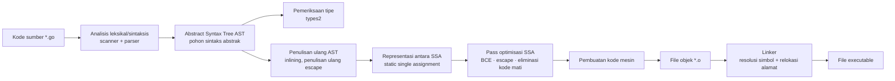
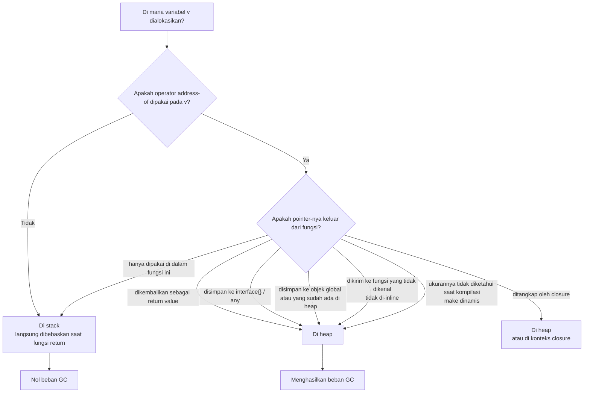
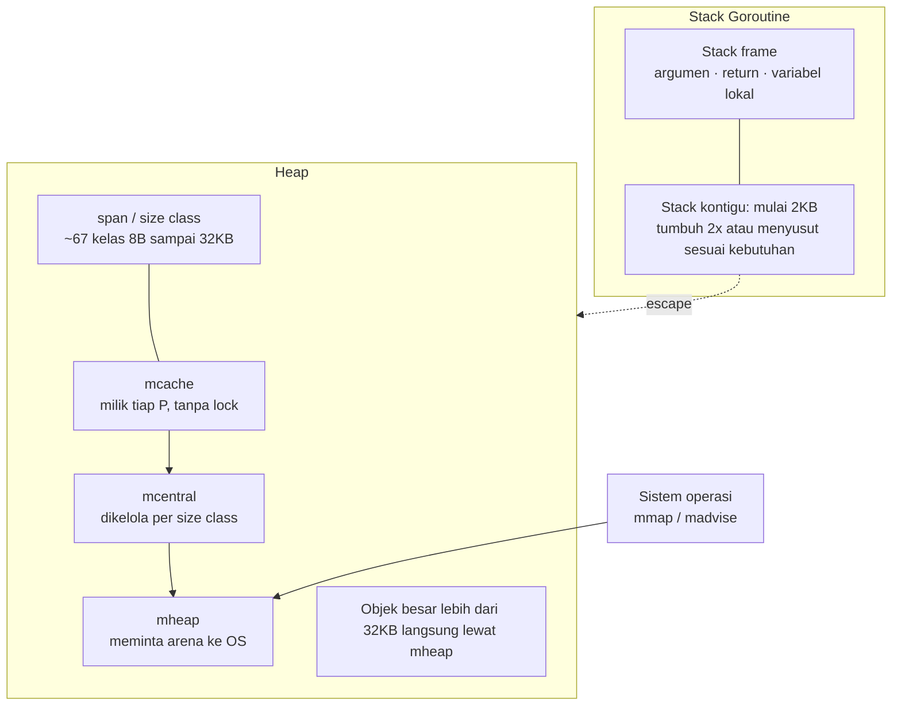
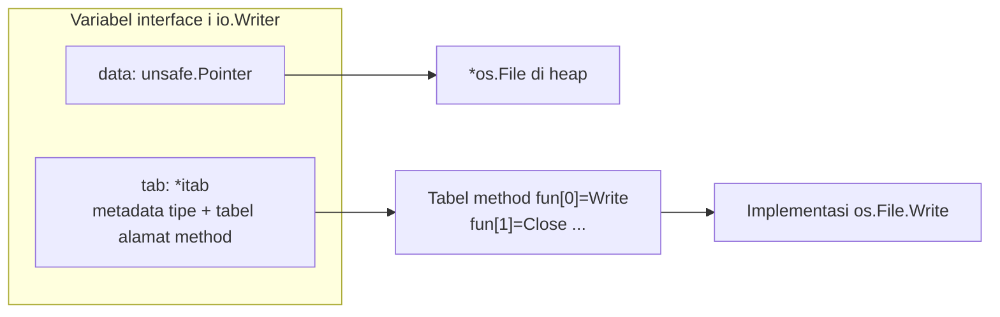
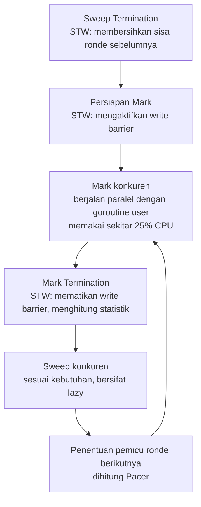
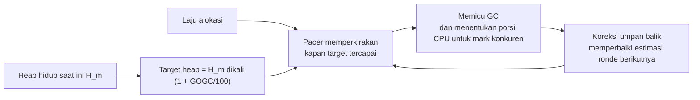
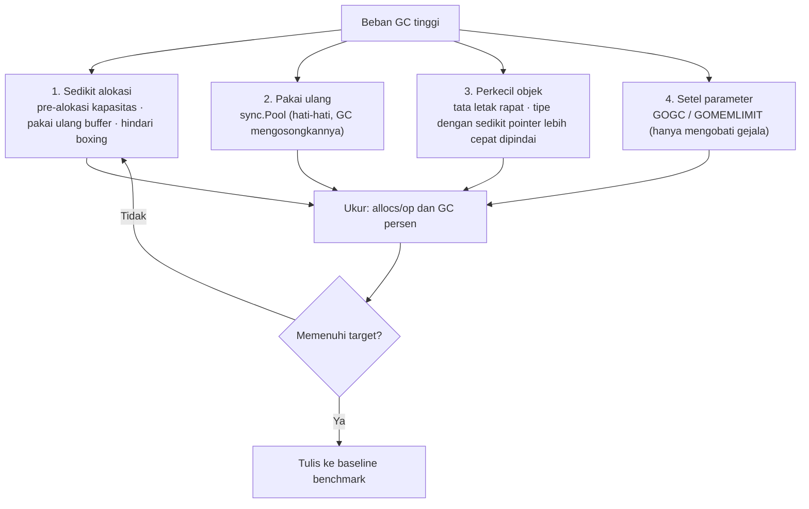
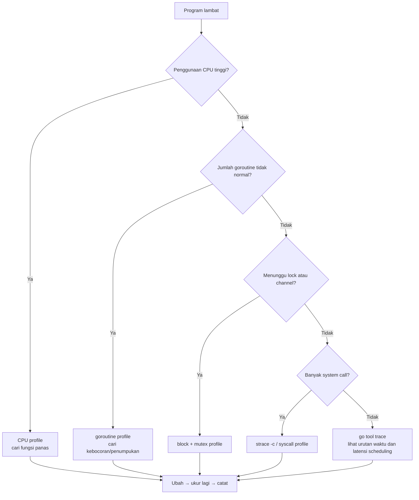
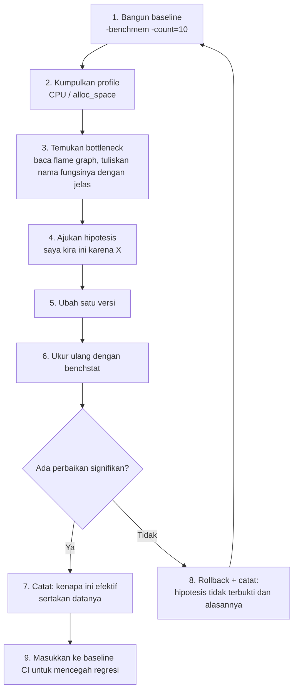

# Fase 1 · Go Internals, Compiler, dan Memori (Minggu 1–6)

> Keluaran dari fase ini hanya satu kalimat: **mulai sekarang, setiap penilaian Anda tentang performa harus punya bukti.**

---

## Tujuan Fase

Setelah menyelesaikan 6 minggu ini, Anda seharusnya bisa:

1. Melihat satu potong kode Go, lalu **memprediksi** value mana yang akan escape ke heap, dan memverifikasinya dengan compiler;
2. Menjelaskan apa sebenarnya yang dialokasikan oleh `make([]byte, 0, 100)` dan kapan dibebaskan;
3. Membaca output `pprof`, menunjukkan "fungsi ini menghasilkan 200MB sampah per detik", lalu memperbaikinya;
4. Menjelaskan satu siklus GC secara lengkap, dan menyebutkan dengan jelas apa yang masing-masing dikendalikan oleh `GOGC` dan `GOMEMLIMIT`;
5. Menulis setiap optimisasi lengkap dengan perbandingan `benchstat` sebelum dan sesudahnya.

### Acceptance Fase (G1)

- [ ] Minimal 3 set benchmark, laporannya memuat `ns/op`, `B/op`, `allocs/op`
- [ ] Minimal 1 analisis CPU profile + 1 analisis heap profile (ada kesimpulannya, bukan cuma tempel gambar)
- [ ] Satu "catatan escape analysis": ≥10 kasus, masing-masing dibuktikan dengan output `-gcflags="-m=2"`
- [ ] Minimal 1 catatan "optimisasi yang gagal" — Anda kira akan jadi lebih cepat tapi ternyata tidak, beserta penjelasan alasannya

---

## Minggu 1 · Compiler, Proses Build, Binary, dan Dasar Assembly

### 1.1 Tujuan Pembelajaran

| Level | Target |
| --- | --- |
| Bisa menjelaskan | Tahapan apa saja yang dilalui `go build` dari kode sumber sampai file executable |
| Bisa melakukan | Mengamati escape dan inlining dengan `-gcflags`; melihat instruksi aslinya dengan `go tool objdump` |
| Bisa mengukur | Membandingkan ukuran binary dan waktu startup pada berbagai parameter build |

### 1.2 Pipeline Kompilasi



Pemahaman kunci: **compiler Go itu single-pass, self-hosting, dan mengejar kecepatan kompilasi**. Ia tidak melakukan optimisasi agresif puluhan ronde seperti Clang/GCC. Artinya, "menuliskan manual unrolling loop" di Go sering kali manfaatnya kecil — ukur dulu baru bicara.

### 1.3 Escape Analysis: Inti Minggu Ini

**Definisi satu kalimat**: kalau masa hidup sebuah variabel **tidak bisa dipastikan berakhir di dalam stack frame pada saat kompilasi**, compiler akan menempatkannya di heap untuk diklaim kembali oleh GC. Ini disebut "escape".



#### Praktik: Mengamati Escape

```go
// escape.go
package main

type Point struct{ X, Y int64 }

func stack() int64 {          // kasus 1: murni di stack
    p := Point{X: 1, Y: 2}
    return p.X + p.Y
}

func heap() *Point {          // kasus 2: mengembalikan pointer → escape
    p := Point{X: 1, Y: 2}
    return &p
}

func box() any {              // kasus 3: di-boxing jadi interface → escape
    v := int64(42)
    return v
}

func closure() func() int64 { // kasus 4: ditangkap closure → escape
    v := int64(7)
    return func() int64 { return v }
}

func main() {
    _ = stack()
    _ = heap()
    _ = box()
    _ = closure()
}
```

```bash
go build -gcflags="-m=2" ./escape.go 2>&1 | head -60
```

Anda akan melihat semacam ini:

```
./escape.go:8:6: can inline stack
./escape.go:17:2: p escapes to heap:
./escape.go:17:2:   flow: ~r0 = &p:
./escape.go:17:2:     from &p (address-of) at ./escape.go:18:9
...
./escape.go:23:2: v escapes to heap:
./escape.go:23:2:   flow: ~r0 = &v:
... boxed
```

**Cara membacanya**:
- `moved to heap: p` — pasti escape
- `escapes to heap` + rantai `flow:` — ini **jalur escape** yang diberikan compiler; ikuti alurnya dan Anda akan menemukan akar masalahnya
- `does not escape` — tetap di stack
- `can inline` / `inlining call to` — keputusan inlining

#### Daftar Skenario Escape yang Sering Muncul (sering ditanyakan ke tim)

| Skenario | Escape? | Alasan |
| --- | --- | --- |
| Mengembalikan pointer ke variabel lokal | Ya | Masa hidupnya melebihi stack frame |
| Disimpan ke `interface{}` / `any` | Ya | Interface menyimpan pointer di dalamnya (kecuali nilainya 0 atau berbentuk pointer yang bisa disimpan langsung) |
| Dikirim ke fungsi yang tidak di-inline (parameternya `any`) | Ya | Compiler tidak bisa melihat apa yang dilakukan pemanggil |
| Ditangkap closure lalu keluar | Ya | Konteks closure harus hidup sampai closure dipanggil |
| `make([]T, n)`, n berupa variabel | Biasanya escape | Ukuran tidak bisa ditentukan saat kompilasi |
| `make([]T, 100)`, konstanta literal dan tidak keluar | Mungkin tidak escape | Jadi array di stack (ada batas ukuran, sekitar 64KB, dan dipengaruhi inlining) |
| Ditulis ke channel | Ya | Datanya harus diserahkan ke goroutine lain |
| Argumen `fmt.Sprintf("%d", x)` | Ya | Tipe parameternya `...any` |
| Objek besar yang melewati batas stack | Ya | Stack maksimal 1GB, tapi satu stack frame yang terlalu besar juga dipindah ke heap |

> **Pengingat penting**: escape bukanlah "kesalahan". Alokasi di stack itu murah, tapi yang jadi masalah adalah **escape ke tempat yang tidak bisa Anda kendalikan**. Constructor yang mengembalikan pointer itu sangat wajar. Masalah yang sebenarnya adalah **boxing dan objek sementara yang tidak ada gunanya di hot path**.

### 1.4 Binary dan Assembly

```bash
# Melihat kode mesin akhirnya
go build -o app . && go tool objdump -s "main.heap" ./app

# Melihat hasil setiap pass SSA (untuk debugging optimisasi)
GOSSAFUNC=heap go build ./escape.go   # menghasilkan ssa.html

# Ukuran binary dan simbol
go tool nm ./app | head -30
go build -ldflags="-s -w" -o app-slim .   # membuang tabel simbol dan DWARF
ls -l app app-slim
```

**Latihan**: bandingkan selisih ukuran `app` dan `app-slim`, dan pahami bahwa biaya dari `-s -w` adalah **tidak bisa debug dengan dlv dan informasi stack frame saat panic jadi lebih buruk**.

### 1.5 Deliverable

- `01-go-internals/week01/README.md`: diagram pipeline kompilasi + catatan escape analysis (≥10 contoh)
- `01-go-internals/week01/escape/`: kumpulan contoh escape yang bisa dikompilasi
- Catatan: `go tool nm | wc -l`, ukuran sebelum dan sesudah `-s -w`

---

## Minggu 2 · Stack, Heap, Pointer, Alokasi, dan Siklus Hidup Objek

### 2.1 Lapisan Memori di Go



**Poin penting**:

- **Stack**: tiap goroutine punya sendiri, awalnya 2KB, tumbuh dengan cara "segmented stack → stack kontinu yang disalin". Saat tumbuh, batas stack dicek (morestack) dan seluruh stack disalin — jadi **rekursi dalam + stack frame besar** ada biayanya.
- **Heap**: dialokasikan per **size class** (kelas ukuran), objek kecil diambil dari free list di `mcache`, **tanpa lock**; hanya kalau melintasi P barulah masuk ke `mcentral`/`mheap`.
- **Alokasi bukan berarti system call**: Go meminta satu blok besar ke OS sekaligus (arena, biasanya kelas 64MB), lalu memotong-motongnya di user space. Jadi "alokasi lambat" biasanya lambat di **pemindaian GC**, bukan di `mmap`.

### 2.2 Eksperimen 1: Pointer vs Value (berlawanan dengan intuisi)

Banyak orang mengira "pointer pasti lebih cepat". **Untuk struct kecil, biasanya justru sebaliknya**, karena pointer memaksa escape + menambah satu kali indirect addressing + membuat GC harus memindai.

```go
// bench_test.go
package bench

import "testing"

type Small struct{ A, B int64 }   // 16B
type Big   struct{ D [4096]byte } // 4KB

//go:noinline
func SumSmallVal(v Small) int64 { return v.A + v.B }

//go:noinline
func SumSmallPtr(p *Small) int64 { return p.A + p.B }

//go:noinline
func SumBigVal(v Big) byte { return v.D[0] }

//go:noinline
func SumBigPtr(p *Big) byte { return p.D[0] }

var sink int64
var bsink byte

func BenchmarkSmallVal(b *testing.B) {
    v := Small{1, 2}
    for i := 0; i < b.N; i++ { sink = SumSmallVal(v) }
}
func BenchmarkSmallPtr(b *testing.B) {
    v := &Small{1, 2}
    for i := 0; i < b.N; i++ { sink = SumSmallPtr(v) }
}
func BenchmarkBigVal(b *testing.B) {
    v := Big{}
    for i := 0; i < b.N; i++ { bsink = SumBigVal(v) }
}
func BenchmarkBigPtr(b *testing.B) {
    v := &Big{}
    for i := 0; i < b.N; i++ { bsink = SumBigPtr(v) }
}
```

```bash
go test -bench=. -benchmem -count=10 ./... | tee new.txt
benchstat new.txt
```

**Wajib dicatat**: `ns/op`, `B/op`, `allocs/op`. Kesimpulan tipikal: struct 16B **lebih cepat dilewatkan by value dan nol alokasi**; struct 4KB **jelas lebih cepat pakai pointer** (menyalin 4KB terlalu mahal).

> Itu sebabnya jawaban untuk "pakai pointer atau value" adalah **lihat ukuran dan semantiknya, bukan lihat keyakinan**. Ambang batas praktis: struct yang ukurannya tidak lebih dari beberapa machine word (sekitar 32–64B) pakai value; pakai pointer kalau perlu menyatakan "opsional / bisa diubah / dibagi bersama".

### 2.3 Eksperimen 2: Biaya Tersembunyi dari Pertumbuhan Slice

```go
func BenchmarkSliceNoPrealloc(b *testing.B) {
    for i := 0; i < b.N; i++ {
        s := []int{}
        for j := 0; j < 1000; j++ { s = append(s, j) }
        sink += int64(len(s))
    }
}
func BenchmarkSlicePrealloc(b *testing.B) {
    for i := 0; i < b.N; i++ {
        s := make([]int, 0, 1000)
        for j := 0; j < 1000; j++ { s = append(s, j) }
        sink += int64(len(s))
    }
}
```

**Fakta yang harus Anda tahu**: strategi pertumbuhan `append` di Go adalah **slice kecil digandakan, slice besar sekitar 1,25x** (sejak Go 1.18 dibuat lebih mulus, bukan lagi ambang batas yang kaku). Setiap kali tumbuh = alokasi baru + menyalin data lama + array lama jadi sampah. Karena itu:

- Kalau kapasitasnya bisa diperkirakan, pakai `make(..., 0, n)`
- Saat memakai ulang slice, pakai `s = s[:0]` (hati-hati: ini mempertahankan array dasarnya, bisa menyebabkan **memori besar tertahan tanpa sengaja**, lihat di bawah)

#### Tiga Jebakan Memori yang Sering Terjadi

```go
// Jebakan 1: slice besar dipotong lalu disimpan lama → kebocoran memori
func leak() []byte {
    big := make([]byte, 10<<20)  // 10MB
    return big[:10]              // cuma mengembalikan 10B, tapi array 10MB di bawahnya masih direferensi!
}
// Perbaikannya
func fixed() []byte {
    big := make([]byte, 10<<20)
    out := make([]byte, 10)
    copy(out, big[:10])
    return out
}

// Jebakan 2: memakai ulang buffer tapi lupa dibatasi → tumbuh tanpa batas
var pool = sync.Pool{New: func() any { return new(bytes.Buffer) }}
func reuse() {
    buf := pool.Get().(*bytes.Buffer)
    buf.Reset()               // Reset tidak mengosongkan array dasarnya
    if buf.Cap() > 1<<20 {    // kalau lewat batas, buang saja, biar pool tidak penuh benda raksasa
        pool.Put(new(bytes.Buffer))
    } else {
        pool.Put(buf)
    }
}

// Jebakan 3: append berbagi array dasar → data terkontaminasi diam-diam
a := []int{1, 2, 3}
b := a[:2]
b = append(b, 99)   // cap masih cukup → langsung mengubah a[2]!
// sekarang a adalah [1 2 99]
// Perbaikan: b := append(a[:2:2], 99)  // slice tiga indeks, memaksa alokasi baru
```

### 2.4 Eksperimen 3: Urutan Field Struct dan Tata Letak Memori

```go
type Bad struct {
    A bool    // 1B + 7B padding
    B int64   // 8B
    C bool    // 1B + 7B padding
}               // 24B

type Good struct {
    B int64   // 8B
    A bool    // 1B
    C bool    // 1B + 6B padding
}               // 16B
```

Verifikasi dengan `unsafe.Sizeof` / `unsafe.Alignof` / `unsafe.Offsetof`.

```go
fmt.Println(unsafe.Sizeof(Bad{}), unsafe.Sizeof(Good{}))
```

**Kenapa ini penting**:
- Sedikit padding = lebih sedikit memori = lebih sedikit cache line = lebih cepat (terutama di dalam array/slice, manfaatnya dikali N)
- Tapi **jangan mengorbankan keterbacaan demi menghemat 8 byte** — lakukan ini hanya kalau datanya sangat besar (jutaan objek)

**Eksperimen cache line**: mengiterasi `[]Struct` vs `[]*Struct`

```go
// AoS (Array of Struct): memori kontigu, ramah terhadap prefetch
type Row struct{ ID int64; Age int32 }
rows := make([]Row, 1_000_000)

// Array pointer: setiap akses harus melompat sekali, cache hit rate rendah
ptrs := make([]*Row, 1_000_000)
```

Benchmarknya: menjumlahkan dengan iterasi `rows` vs iterasi `ptrs`. Di skala jutaan, selisihnya biasanya cukup jelas (bisa puluhan persen atau lebih). **Ukur sendiri.**

### 2.5 Deliverable

- `02-memory-benchmarks/ptr_vs_value_bench_test.go`
- `02-memory-benchmarks/slice_growth_bench_test.go`
- `02-memory-benchmarks/layout_test.go` (berisi asersi Sizeof)
- `docs/benchmarks/week02.md`: output benchstat + kesimpulan + minimal satu catatan "saya salah menebak"

---

## Minggu 3 · Interface, Method Set, Representasi Interface, dan Generics

### 3.1 Representasi Interface di Level Bawah

```go
type iface struct {   // interface non-kosong
    tab  *itab        // tipe + tabel method
    data unsafe.Pointer // menunjuk ke data sebenarnya
}
type eface struct {   // interface kosong any
    _type *_type
    data  unsafe.Pointer
}
type itab struct {
    inter *interfacetype
    _type *_type
    hash  uint32
    _     [4]byte
    fun   [1]uintptr  // sebenarnya tabel method dengan panjang variabel
}
```



**Kesimpulan kunci**:

1. **Variabel interface = dua word (16B)**. Mengoper interface sebagai argumen berarti dua kali penyalinan + satu kali lompatan pointer.
2. **Pemanggilan method itu dynamic dispatch**: lewat `itab.fun[i]`, **tidak bisa di-inline** (Go 1.21+ punya optimisasi PGO / devirtualisasi spekulatif untuk "inlining method interface", tapi jangan berharap).
3. **Boxing bisa memicu alokasi**: menaruh value non-pointer ke dalam interface butuh menyalin value itu ke heap (kecuali ia berupa word yang bisa disimpan langsung).
4. `itab` punya cache global, jadi type assertion `v.(T)` adalah **pencarian tabel hash**, bukan menelusuri tipe satu per satu.

### 3.2 Method Set (aturan yang paling sering bikin tersandung)

| Deklarasi receiver | Method set dari value `T` | Method set dari pointer `*T` |
| --- | --- | --- |
| `func (t T) M()` | memuat M | memuat M |
| `func (t *T) M()` | **tidak memuat** M | memuat M |

Konsekuensinya: apakah `var i Iface = someValue` bisa dikompilasi bergantung pada apakah method set dari **value**-nya mencakup interface itu.

```go
type Speaker interface{ Speak() }
type Dog struct{}
func (d *Dog) Speak() {}

var d Dog
var s Speaker = d    // ❌ error kompilasi: Dog tidak punya Speak (cuma pointer-nya)
var s2 Speaker = &d  // ✅
```

**Saran standar tim**: pada satu tipe, **jangan mencampur** receiver value dan receiver pointer. Semuanya value (objek value kecil yang immutable), atau semuanya pointer (punya state, berisi mutex, perlu diubah). Mencampur keduanya adalah tanda desainnya berantakan.

### 3.3 Generics: Kapan Benar-Benar Berguna

```go
type Ordered interface {
    ~int | ~int8 | ~int16 | ~int32 | ~int64 |
    ~uint | ~uint8 | ~uint16 | ~uint32 | ~uint64 | ~float32 | ~float64 | ~string
}

type Ring[T any] struct {
    buf  []T
    head int
    n    int
}

func NewRing[T any](cap int) *Ring[T] { return &Ring[T]{buf: make([]T, cap)} }

func (r *Ring[T]) Push(v T) {
    r.buf[(r.head+r.n)%len(r.buf)] = v
    if r.n < len(r.buf) { r.n++ } else { r.head = (r.head + 1) % len(r.buf) }
}
```

**Biaya dan manfaat generics (wajib diukur sendiri)**:

- Generics di Go adalah campuran **"kamus + template"** (GCShape stenciling): tipe dengan bentuk dasar yang sama berbagi satu salinan kode + kamus di runtime.
- Kesimpulannya biasanya: **generics di container/algoritma jauh lebih cepat daripada `interface{}` (tanpa boxing, tanpa alokasi), mendekati kode konkret yang ditulis manual, tapi kadang sedikit lebih lambat**.
- Generics akan **menambah waktu kompilasi** dan ukuran binary (beberapa stencil).

#### Eksperimen: Perbandingan Tiga Implementasi

```go
func SumIntsGeneric[T int64 | float64](s []T) T {
    var t T
    for _, v := range s { t += v }
    return t
}
func SumIntsConcrete(s []int64) int64 {
    var t int64
    for _, v := range s { t += v }
    return t
}
func SumIntsIface(s []any) int64 {
    var t int64
    for _, v := range s { t += v.(int64) }  // type assertion + kemungkinan alokasi
    return t
}
```

Ekspektasinya: `Concrete ≈ Generic >> Iface`. **Tapi kalau hasil ukur Anda menunjukkan Generic 10% lebih lambat dari Concrete**, itu normal — catat angkanya dan jelaskan (overhead stencil/kamus, inlining yang terbatas).

### 3.4 Pertanyaan Self-Check Minggu Ini (yang biasa ditanyakan senior)

1. Kenapa `var x any = 42` melakukan alokasi, sedangkan `var x any = (*int)(nil)` tidak?
2. Dari mana overhead `errors.Is` dan `errors.As` berasal? Bagaimana cara menghindarinya di hot path?
3. Kapan kita **sebaiknya tidak** memakai generics? (petunjuk: hanya ada 1–2 tipe yang diinstansiasi; butuh refleksi; bikin API jadi sulit dipahami)
4. Kenapa `New` pada `sync.Pool` mengembalikan `any`? Apakah itu menyebabkan alokasi?

### 3.5 Deliverable

- `01-go-internals/week03/generic/ring.go` + tes (mencakup tiga batasan: kosong / penuh / overwrite)
- `01-go-internals/week03/iface_bench_test.go`
- `docs/benchmarks/week03.md`: perbandingan tiga arah antara interface vs konkret vs generics

---

## Minggu 4 · Garbage Collection, Laju Alokasi, dan Beban GC

### 4.1 Apa Itu GC di Go

Go memakai collector **concurrent tri-color mark & sweep** (penandaan dan pembersihan tiga warna yang berjalan konkuren):

- **Non-generational** (tidak ada young generation / old generation)
- **Non-moving** (tidak merapikan memori, alamat objek tidak berubah — ini sangat ramah untuk cgo dan aritmetika pointer)
- **Konkuren**: fase mark berjalan bersamaan dengan kode user, hanya ada STW (Stop-The-World) yang sangat singkat



**Abstraksi tiga warna**:
- Putih: belum dikunjungi, kemungkinan adalah sampah
- Abu-abu: sudah dikunjungi, tapi objek yang direferensinya belum selesai dipindai
- Hitam: sudah dikunjungi dan semua referensinya sudah dipindai, pasti hidup

**Write barrier**: karena kode user dan penandaan berjalan konkuren, ada kemungkinan "objek putih" digantungkan di bawah "objek hitam". Write barrier menjamin modifikasi semacam itu tidak membuat objek yang masih hidup ikut dibuang (hybrid write barrier, Yuasa + Dijkstra, sejak Go 1.8, yang menghilangkan STW untuk memindai ulang stack).

### 4.2 Kapan GC Dipicu: Pacer

Pacer adalah sebuah **pengontrol umpan balik**, targetnya: saat GC berikutnya selesai, ukuran heap kira-kira `1 + GOGC/100` kali ukuran saat ini.



Tombol penyetelan:

| Parameter | Arti | Kapan dipakai |
| --- | --- | --- |
| `GOGC=100` (default) | Picu GC setiap heap tumbuh 100% | Skenario umum |
| `GOGC=off` | Tidak ada GC otomatis sama sekali | Batch job berumur pendek; dipasangkan dengan `runtime.GC()` manual; **berisiko OOM** |
| `GOMEMLIMIT=4GiB` | Batas memori lunak | Kalau di container ada memory limit, **sangat disarankan untuk diset** |
| `debug.SetGCPercent()` | Mengubah GOGC saat runtime | Penyesuaian sementara di fase tertentu |
| `debug.SetMemoryLimit()` | Mengubah GOMEMLIMIT saat runtime | Sama seperti di atas |
| `GODEBUG=gctrace=1` | Mencetak satu baris setiap kali GC | Untuk diagnosis, jangan dibiarkan menyala lama di produksi (ada overhead) |
| `GODEBUG=inittrace=1` | Mencetak durasi init tiap package | Menyelidiki startup yang lambat |

```bash
GODEBUG=gctrace=1 ./app
```

Cara membaca outputnya:

```
gc 5 @0.421s 3%: 0.031+2.1+0.015 ms clock, 0.25+1.2/3.0/0.5+0.12 ms cpu,
12->13->7 MB, 14 MB goal, 8 P
```

| Field | Arti |
| --- | --- |
| `gc 5` | GC ke-5 |
| `@0.421s` | Berapa lama setelah program mulai |
| `3%` | Persentase CPU yang dipakai GC sejauh ini (**kalau lebih dari 10% harus diselidiki**) |
| `0.031+2.1+0.015 ms clock` | Waktu wall clock untuk STW(awal) + mark konkuren + STW(akhir) |
| `12->13->7 MB` | Heap sebelum GC → heap saat GC selesai → heap yang hidup |
| `14 MB goal` | Ukuran target heap untuk kali ini |
| `8 P` | GOMAXPROCS |

**Rumus diagnosis**:
- `heap yang hidup` besar → kebocoran memori atau cache terlalu besar
- `heap sebelum GC - heap yang hidup` besar → laju alokasi terlalu tinggi (sampah terlalu banyak)
- `3%` tinggi → GC terlalu sering, pertimbangkan menurunkan laju alokasi atau menyetel GOGC

### 4.3 Eksperimen: Menciptakan Beban GC lalu Memperbaikinya

```go
// Versi buruk: setiap permintaan mengalokasi banyak objek sementara
func HandleBad(n int) []string {
    out := []string{}
    for i := 0; i < n; i++ {
        out = append(out, fmt.Sprintf("item-%d", i))  // setiap Sprintf melakukan alokasi
    }
    return out
}

// Versi baik: pre-alokasi + strconv (menghindari boxing ke interface)
func HandleGood(n int) []string {
    out := make([]string, n)
    for i := 0; i < n; i++ {
        out[i] = "item-" + strconv.Itoa(i)   // atau strconv.AppendInt ke buffer bersama
    }
    return out
}
```

```bash
go test -bench=BenchmarkHandle -benchmem -count=10 ./... | tee w4.txt
benchstat w4.txt
GODEBUG=gctrace=1 go test -bench=BenchmarkHandleBad -benchtime=10s ./...
```

### 4.4 Empat Senjata untuk Menurunkan Beban GC (urut berdasarkan prioritas)



**Kenyataan tentang `sync.Pool`**:
- Ia bukan "obat mujarab untuk semua object pool". Setiap kali GC terjadi, objek di dalam pool dipindah ke victim cache, dan **baru dibebaskan benar-benar pada GC berikutnya** (ini by design: supaya GC tetap bisa mengklaimnya kembali, sekaligus menghindari semuanya dialokasi ulang tepat setelah GC selesai). Jadi **jangan berharap objek yang masuk ke Pool bisa hidup lama**.
- Ia dipecah per P, sehingga get/put biasanya tanpa lock.
- Cocok untuk: **buffer besar, encoder sementara, struct besar**. Tidak cocok untuk: objek kecil (alokasinya sendiri sudah murah), koneksi yang punya state (lebih jelas kalau Anda yang mengatur siklus hidupnya sendiri).
- Wajib dipanggil `Reset()`, kalau tidak akan bocor data (data permintaan sebelumnya terbawa ke permintaan berikutnya — ini sumber insiden keamanan yang nyata).

### 4.5 Deliverable

- `01-go-internals/week04/gcpressure/`: dua implementasi (buruk/baik) + benchmark
- `docs/benchmarks/week04-gc.md`: perbandingan `gctrace` sebelum/sesudah + kesimpulan (jumlah GC, GC%, `B/op`)
- Satu paragraf penjelasan: kalau Anda menaikkan `GOGC` jadi 400, berapa throughput dan memori yang berubah? (**harus disertai angka**)

---

## Minggu 5 · Profiling CPU / Heap / Alokasi

### 5.1 Perbedaan Empat Jenis Profile

| Jenis | Cara pengumpulan | Pertanyaan yang dijawab |
| --- | --- | --- |
| CPU | Sampling stack panggilan (default ~100Hz) | Fungsi mana yang **sedang** menghabiskan CPU |
| Heap | Sampling titik alokasi | Bagian mana yang **menahan** memori (inuse) / yang **pernah mengalokasi** secara kumulatif (alloc) |
| Goroutine | Snapshot | Sekarang ada berapa goroutine, dan mentok di mana |
| Block / Mutex | Sampling peristiwa pemblokiran | CPU tidak penuh tapi lambat → lihat di sini |
| Trace | Aliran peristiwa | Urutan waktu goroutine/GC/system call selama satu periode |

> **CPU profile tidak bisa menangkap pemblokiran.** Program lambat tapi CPU profile-nya rata? Itu berarti I/O, lock, atau menunggu channel → pakai block/mutex profile atau `go tool trace`. Ini kesalahan diagnosis yang paling sering dilakukan pemula.

### 5.2 Cara Mengumpulkan

```bash
# 1) Menghasilkan profile langsung dari benchmark (paling praktis)
go test -bench=BenchmarkHot -benchmem \
    -cpuprofile=cpu.out -memprofile=mem.out -o bench.test
go tool pprof -http=:8080 cpu.out

# 2) Menanam pprof di dalam program (paling umum di server)
import _ "net/http/pprof"
go func() { log.Println(http.ListenAndServe("localhost:6060", nil)) }()
```

```bash
# Mengambil profile dari layanan yang sedang berjalan
go tool pprof -http=:8080 http://localhost:6060/debug/pprof/profile?seconds=30
go tool pprof -http=:8080 http://localhost:6060/debug/pprof/heap
go tool pprof -http=:8080 http://localhost:6060/debug/pprof/goroutine?debug=2
```

### 5.3 Dua Sudut Pandang pada Memory Profile (perbedaan yang krusial)

```bash
go tool pprof -sample_index=inuse_space  mem.out  # yang masih hidup sekarang (cari kebocoran)
go tool pprof -sample_index=alloc_space  mem.out  # yang pernah dialokasikan (cari beban GC)
go tool pprof -sample_index=alloc_objects mem.out # jumlah alokasi kumulatif
```

**Untuk mencari kebocoran pakai inuse, untuk mengoptimalkan GC pakai alloc.** Salah memilih sudut pandang akan menghasilkan kesimpulan yang sepenuhnya keliru.

### 5.4 Perintah pprof yang Sering Dipakai

```bash
go tool pprof -top -nodecount=20 cpu.out          # Top dalam bentuk teks
go tool pprof -web cpu.out                        # flame graph / call graph (butuh graphviz)
go tool pprof -http=:8080 cpu.out                 # browser: flame graph + graf + disassembly
# Interaktif
(pprof) top
(pprof) top --cum            # berdasarkan waktu kumulatif (mencari "siapa yang menyebabkan rantai panggilan ini")
(pprof) list HandleRequest   # melihat biaya per baris dalam fungsi
(pprof) peek mutex           # melihat hulu dan hilir suatu simbol
(pprof) traces               # mencetak semua stack yang tersampling
(pprof) web
```

**Cara membaca flame graph**:
- Lebar = proporsi sampel pada frame tersebut (= waktu CPU)
- Membaca dari bawah ke atas adalah rantai panggilannya
- **Cari "atap datar"** (lebar tapi dangkal, langsung berakhir di bagian atas) → itu fungsi daun yang benar-benar bekerja
- Menara tinggi tapi puncaknya `runtime.mallocgc` → masalah alokasi, lihat alloc_space

### 5.5 `go tool trace`

`pprof` adalah **tampilan agregat** (informasi waktunya hilang), sedangkan `trace` adalah **tampilan linimasa**. Kalau masalahnya muncul sebagai "kadang nge-lag sebentar", Anda wajib memakai trace.

```bash
# Dihasilkan dari tes
go test -run TestX -trace=trace.out ./pkg
go tool trace trace.out

# Dihasilkan dari dalam program
f, _ := os.Create("trace.out"); runtime/trace.Start(f); defer runtime/trace.Stop()
```

Yang perlu dilihat di dalam trace:
- **Goroutine analysis**: ada berapa goroutine yang berstatus `running` / `runnable` / `blocked`
- **Network blocking profile / Sync blocking / Syscall blocking**: mencari titik pemblokiran
- **Scheduler latency**: berapa lama G menunggu dari runnable ke running (P kurang atau GOMAXPROCS terlalu kecil)
- **Batang peristiwa GC**: berapa lama STW-nya



### 5.6 Membangun Baseline Benchmark yang Berkelanjutan (aset tim)

```bash
# Menyimpan baseline (sebelum diubah)
git stash
go test -bench=. -benchmem -count=10 ./... > base.txt
git stash pop

# Setelah diubah
go test -bench=. -benchmem -count=10 ./... > new.txt

# Membandingkan (-alpha mengontrol ambang signifikansi)
benchstat -alpha=0.05 base.txt new.txt
```

Contoh output `benchstat`:

```
name            old time/op    new time/op    delta
Hot-8            1.20µs ± 2%    0.85µs ± 1%   -29.17%  (p=0.000 n=10+10)
name            old alloc/op   new alloc/op   delta
Hot-8             128B ± 0%       0B ± 0%    -100.00%  (p=0.000 n=10+10)
```

**Aturan tim**: `-count` minimal 5 kali (disarankan 10), dan **mesinnya harus tenang** (tutup browser, jangan menjalankan Docker build). `p=0.000` berarti signifikan secara statistik; `±` adalah variansinya, **kalau variansinya lebih dari 10% berarti lingkungannya tidak bersih dan kesimpulannya tidak bisa dipercaya**.

### 5.7 Deliverable

- `docs/benchmarks/week05-profile.md`: satu catatan lengkap "menemukan bottleneck → optimisasi → ukur ulang"
- File profile dan tangkapan layar flame graph
- Target `Makefile`: `make bench`, `make profile`, `make compare`

---

## Minggu 6 · Optimisasi Compiler: Inlining dan Bounds Check Elimination

### 6.1 Inlining

Inlining = menempelkan langsung badan fungsi yang dipanggil ke titik pemanggilannya, sehingga biaya pemanggilan dihilangkan, **dan membuka optimisasi lintas fungsi lebih lanjut** (escape analysis, constant propagation, dan sebagainya).

Inlining di Go **berbasis "anggaran biaya"** (setiap node AST punya cost, anggaran default-nya 80).

```bash
go build -gcflags="-m=2" ./... 2>&1 | grep -E "inline"
go build -gcflags="-l" ./...          # menonaktifkan inlining sepenuhnya (untuk perbandingan)
go build -gcflags="-l -l" ./...       # penonaktifan lebih kuat (mencegah inlining di package ini)
```

Contoh output:

```
./main.go:10:6: can inline add with cost 4 as: func(int, int) int { return a + b }
./main.go:18:14: inlining call to add
```

**Situasi umum yang tidak bisa di-inline**:

| Situasi | Alasan |
| --- | --- |
| Badan fungsi berisi `select` / `go` / `defer` (dan `for` pada sebagian versi) | Batasan bahasa/compiler; **patokan yang benar adalah output `-m=2` pada versi Go yang Anda pakai**, jangan mengandalkan ingatan |
| Fungsi rekursif | Tidak bisa dibuka |
| Badan fungsi terlalu besar (melebihi anggaran 80) | Model biaya |
| `//go:noinline` | Dilarang secara eksplisit |
| Mengandung aliran kontrol kompleks seperti `recover` | Batasan implementasi |

**Saran praktis**:
- Jangan memecah fungsi demi inlining — biarkan **keterbacaan** yang menentukan, dan biarkan compiler yang memutuskan.
- Untuk fungsi kecil di hot path yang benar-benar butuh inlining, konfirmasi dengan `-m=2`; kalau tidak di-inline, cek apakah anggarannya kelewatan.
- Parameter debug seperti `-gcflags="-d=pctab=pctospadj"` hanya dipakai saat menyelidiki bug compiler.

#### Eksperimen: Efek Rantai Inlining terhadap Escape

```go
func consume(p *T) { ... }        // tidak di-inline → mengoper pointer membuatnya escape
func consumeInlinedCost(p *T) { _ = p.X }  // cukup kecil untuk di-inline → mungkin tidak escape
```

Kesimpulannya: **inlining membuat escape analysis melihat lebih banyak konteks, sehingga mengurangi escape**. Ini salah satu alasan tersembunyi kenapa "fungsi kecil itu lebih cepat".

### 6.2 Bounds Check Elimination (BCE)

Setiap kali Anda menulis `s[i]`, Go akan memeriksa `0 <= i < len(s)`, dan panic kalau gagal. Inilah sumber keamanan memori di Go, tapi ada biayanya. Compiler akan memakai **SSA prove pass** untuk menyimpulkan situasi yang "pasti aman" dan menghilangkan pemeriksaannya.

```go
// Versi A: setiap akses diperiksa
func SumA(s []int64) int64 {
    var t int64
    for i := 0; i < len(s); i++ { t += s[i] }   // kondisi loop sudah membuktikan i < len(s) → biasanya bisa dihilangkan
    return t
}

// Versi B: membangun invarian lebih awal untuk membantu compiler membuktikannya
func SumB(s []int64) int64 {
    if len(s) == 0 { return 0 }
    _ = s[len(s)-1]        // kuncinya: buktikan dulu bahwa len(s)-1 itu sah
    var t int64
    for i := 0; i < len(s); i++ { t += s[i] }
    return t
}
```

Cara memverifikasi:

```bash
# Lihat apakah di assembly ada panggilan panicBounds / panicIndex
go build -gcflags="-S" ./... 2>&1 | grep -E "panicBounds|panicIndex"

# Menyalakan output debug prove pass (opsional, eksperimental)
go build -gcflags="-d=ssa/prove/debug=2" ./...
```

**Cara verifikasi yang lebih bisa diandalkan adalah benchmark**: manfaat BCE biasanya 5–20%, dan hanya terasa di loop yang ketat. **Kalau hasil benchmark tidak berubah, berarti optimisasi ini tidak layak dilakukan** — tulis saja dengan jelas "sudah diukur, tidak ada gunanya", karena itu sendiri sudah merupakan keluaran yang berharga.

### 6.3 Alur Kerja Optimisasi (proses standar tim)



**Disiplin yang paling penting**: langkah 8 tidak boleh dilewat. Pengetahuan yang paling mahal di tim adalah "optimisasi mana yang terlihat benar tetapi sebenarnya tidak ada gunanya".

### 6.4 Deliverable Minggu Ini

- `01-go-internals/week06/inline_bench_test.go`: perbandingan inlining aktif/nonaktif
- `01-go-internals/week06/bce_bench_test.go`: perbandingan sebelum/sesudah BCE + bukti objdump
- `docs/benchmarks/week06.md`: catat minimal **satu optimisasi yang gagal**

---

## Latihan Terpadu Fase 1 (opsional, nilai tambah)

Tulis sebuah "parser log" sepanjang 100 baris, lalu:

1. Temukan semua titik escape dengan `-m=2`
2. Temukan bottleneck dengan profile CPU + alloc_space
3. Lakukan 3 ronde optimisasi, masing-masing dicatat dengan `benchstat`
4. Tulis retro 500 kata: **optimisasi mana yang paling besar manfaatnya, dan kenapa**

Nilai latihan ini ada pada: ia memaksa Anda menjalani alur lengkapnya, bukan sekadar menjalankan perintah sekali.

---

## Referensi

| Topik | Tautan |
| --- | --- |
| Panduan resmi GC (wajib dibaca) | <https://go.dev/doc/gc-guide> |
| Penjelasan mendalam escape analysis | <https://go.dev/blog/pprof> |
| Dokumen Diagnostics | <https://go.dev/doc/diagnostics> |
| Model memori Go | <https://go.dev/ref/mem> |
| SSA dan internals compiler | <https://github.com/golang/go/tree/master/src/cmd/compile/internal/ssa> |
| benchstat | <https://pkg.go.dev/golang.org/x/perf/cmd/benchstat> |
| Artikel klasik tentang performance tuning | <https://github.com/dgryski/go-perfbook> |
