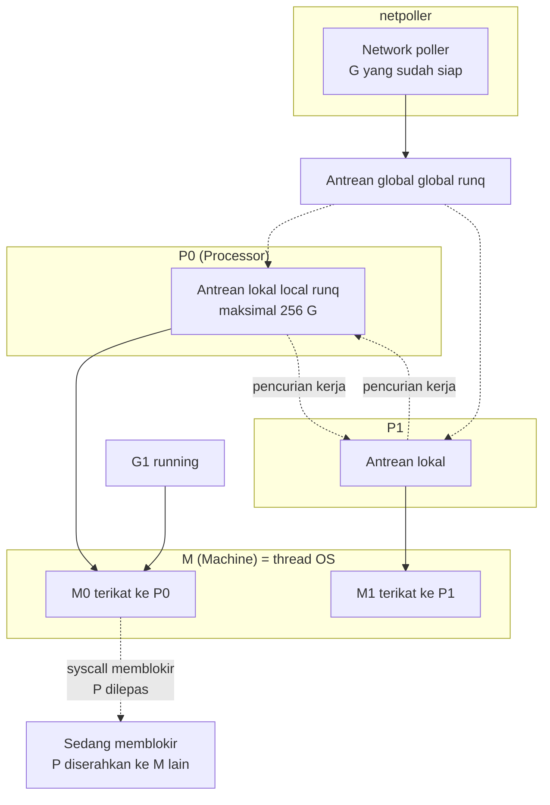
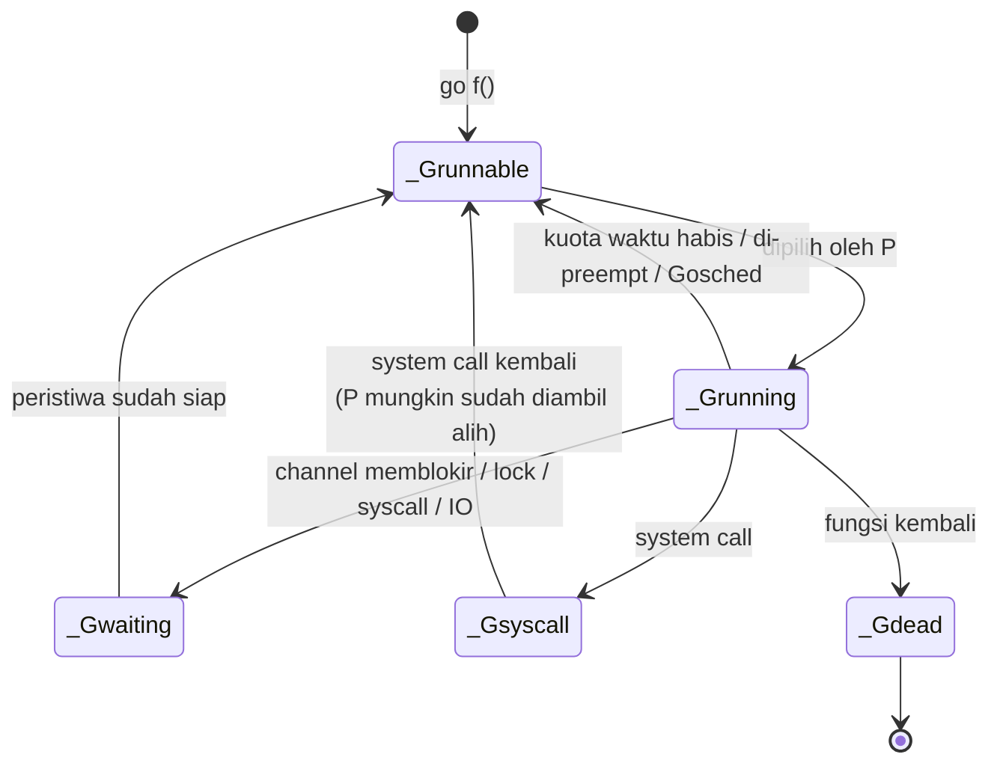
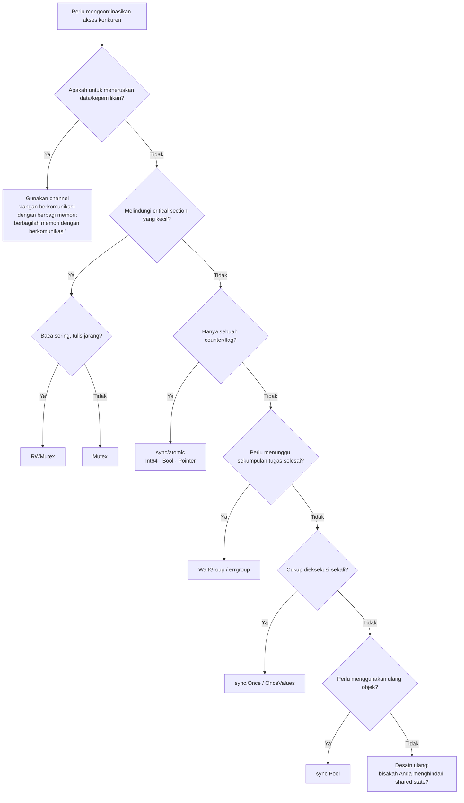
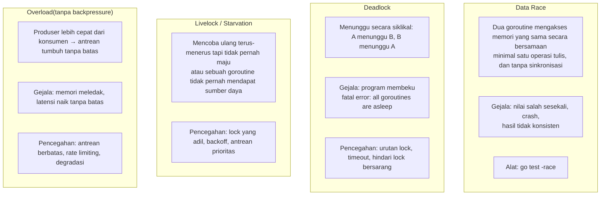
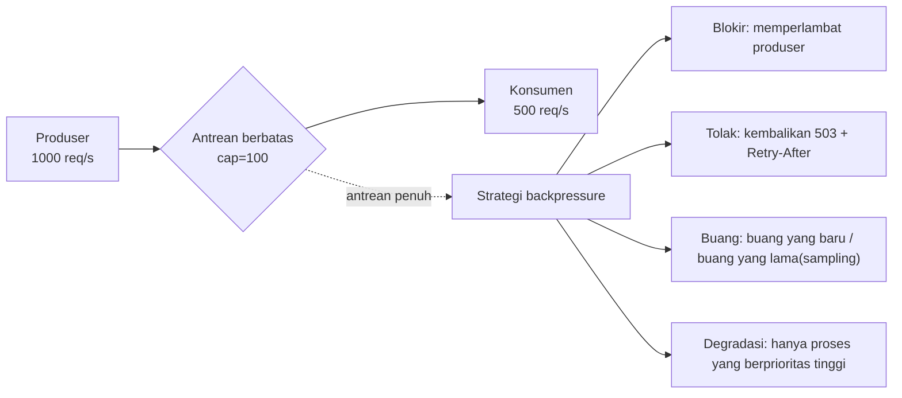
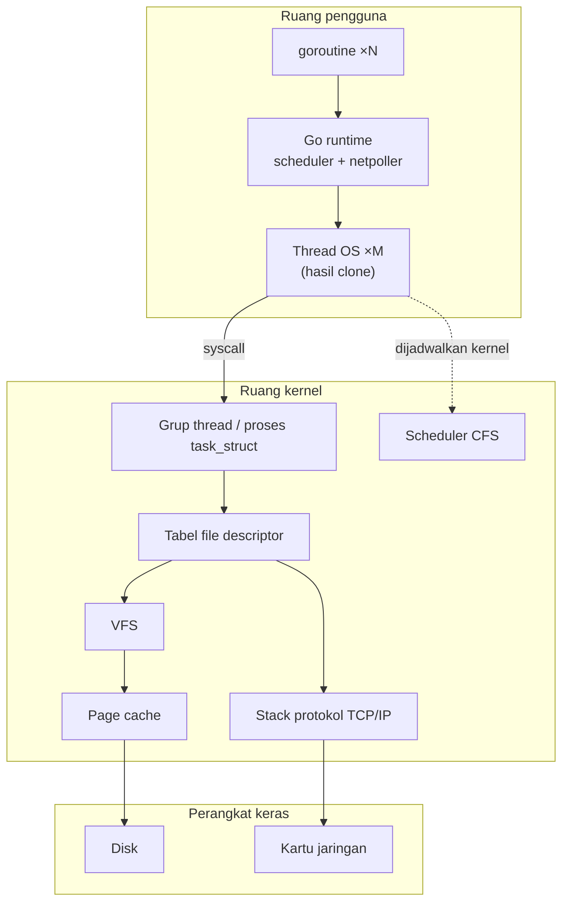
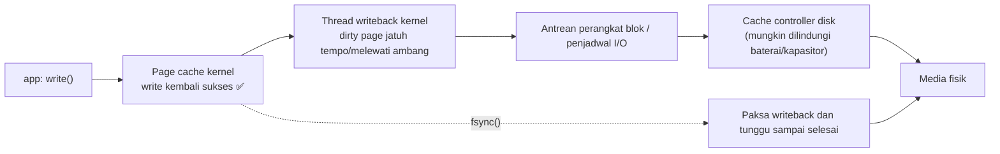

# Fase 2 · Konkurensi dan Sistem Operasi (Minggu 7–10)

> Intuisi yang ingin dibangun di fase ini: **konkurensi bukanlah "menjalankan beberapa goroutine lagi", melainkan "penjadwalan yang tertib atas sumber daya yang terbatas".**
> Menulis konkurensi yang "bisa jalan" itu mudah; menulis konkurensi yang "benar di bawah beban, pembatalan (cancellation), dan kegagalan" baru itu keahlian.

---

## Tujuan fase

1. Mampu menggambar model G-M-P dan menjelaskan kapan sebuah goroutine memblokir serta kapan ia di-preempt;
2. Mampu memilih antara `channel` / `mutex` / `atomic` dengan **alasan yang bisa dipertanggungjawabkan**;
3. Mampu menulis komponen konkuren yang lolos `-race`, bebas kebocoran, bisa dibatalkan, dan memiliki backpressure;
4. Mampu mengamati interaksi program dengan kernel memakai `strace` `/proc` `lsof` `ss`.

### Kriteria penerimaan fase (G2)

- [ ] `go-worker-pool` lolos `go test -race -count=100`
- [ ] Setelah ditutup, `runtime.NumGoroutine()` kembali ke baseline (tidak ada kebocoran)
- [ ] Perilaku saat antrean penuh sudah ditulis di README (tolak / blokir / buang — pilih satu dan jelaskan trade-off-nya)
- [ ] Perbandingan benchmark minimal 3 jenis counter konkuren + kesimpulan

---

## Minggu 7 · Scheduler goroutine: model G-M-P

### 7.1 Arti dari tiga huruf tersebut



| Singkatan | Kepanjangan | Hakikatnya | Jumlahnya |
| --- | --- | --- | --- |
| **G** | Goroutine | Korutin di user space, berisi stack, status, dan konteks | Bisa ribuan hingga puluhan ribu |
| **M** | Machine | **Thread OS yang sesungguhnya**, menjalankan G | Bertambah/berkurang dinamis dipengaruhi syscall/pemblokiran |
| **P** | Processor | **Sumber daya eksekusi / token**, memegang antrean lokal dan mcache | = `GOMAXPROCS` |

> **Satu kalimat untuk mengingatnya**: G adalah pekerjaan yang harus diselesaikan, M adalah orang yang mengerjakannya, P adalah stasiun kerja. **Tanpa stasiun kerja (P), pekerjaan tidak bisa dilakukan**, sebanyak apa pun orangnya (M).

### 7.2 Kapan penjadwalan terjadi



**Poin-poin penting**:

1. **Campuran kooperatif dan preemptif**. Sejak Go 1.14 mendukung **preemption asinkron** (preemption berbasis sinyal), yang menyelesaikan masalah lama: "loop `for` mati yang tidak memanggil fungsi bisa membuat satu P macet total".
2. **Saat syscall memblokir, P akan dilepas** dan diserahkan ke M lain agar G lain tetap berjalan. Jadi syscall yang memblokir **tidak** akan menghabiskan seluruh thread pool.
3. **I/O jaringan lewat netpoller** (epoll di Linux): goroutine ditangguhkan tapi tidak memakan M. Inilah inti mengapa Go sanggup menangani C10K.
4. **`GOMAXPROCS` bukanlah batas atas jumlah core CPU**; ia menentukan "berapa banyak P yang boleh menjalankan kode Go secara bersamaan". Di dalam container sebaiknya pakai `go.uber.org/automaxprocs` agar peka terhadap cgroup limit.

### 7.3 Eksperimen 1: kurva penskalaan beban CPU-intensif

```go
func burn(n int) int64 {   // murni CPU
    var s int64
    for i := 0; i < n; i++ { s += int64(i * i) }
    return s
}

func BenchmarkParallel(b *testing.B) {
    b.RunParallel(func(pb *testing.PB) {
        for pb.Next() { sink = burn(1000) }
    })
}
```

```bash
go test -bench=BenchmarkParallel -cpu=1,2,4,8 -count=5 ./... | tee w7.txt
benchstat w7.txt
nproc                                  # lihat jumlah core mesin
```

**Ekspektasi**: percepatan mendekati linear, sampai melewati jumlah core fisik (hyper-threading hanya memberi sebagian manfaatnya).

### 7.4 Eksperimen 2: `GOMAXPROCS` yang berlawanan dengan intuisi

```go
func BenchmarkGOMAXPROCS(b *testing.B) {
    for _, n := range []int{1, 2, 4, 8, 16, 64} {
        b.Run(fmt.Sprintf("procs=%d", n), func(b *testing.B) {
            old := runtime.GOMAXPROCS(n)
            defer runtime.GOMAXPROCS(old)
            // ukur CPU-intensif dan IO-intensif secara terpisah
        })
    }
}
```

**Kesimpulan yang harus Anda dapatkan**:
- CPU-intensif: `GOMAXPROCS > jumlah core` **tidak memberi manfaat**, bahkan bisa lebih buruk karena context switch
- I/O-intensif (banyak goroutine memblokir di netpoller): `GOMAXPROCS` boleh lebih kecil dari jumlah goroutine aktif, karena G yang memblokir tidak memakan P
- Tetapi kalau `GOMAXPROCS` terlalu kecil, **latensi penjadwalan** akan naik (lihat scheduler latency dengan `go tool trace`)

### 7.5 Eksperimen 3: biaya pembuatan goroutine

```go
func BenchmarkSpawnGoroutine(b *testing.B) {
    for i := 0; i < b.N; i++ {
        done := make(chan struct{})
        go func() { close(done) }()
        <-done
    }
}
func BenchmarkSpawnWithWork(b *testing.B) {
    // pembanding: goroutine yang mengerjakan sedikit pekerjaan
}
```

Besaran yang perlu Anda tahu: pembuatan + penghancuran goroutine sekitar **beberapa ratus nanodetik sampai 1 mikrodetik**, dengan stack awal 2KB. Ini murah, tapi **bukan nol**. Membuat sejuta goroutine per detik tetap merupakan masalah desain.

### 7.6 Hasil yang harus diserahkan

- `03-concurrency/week07/sched_bench_test.go`
- `docs/benchmarks/week07-scheduler.md`: kurva penskalaan pada berbagai `-cpu` + kesimpulan tentang `GOMAXPROCS`
- Satu tangkapan layar trace: memperlihatkan scheduler latency atau kurva jumlah goroutine

---

## Minggu 8 · Channel, Mutex, RWMutex, Atomics, dan model memori

### 8.1 Pohon keputusan memilih primitif sinkronisasi



> **Prinsip yang paling penting**: sinkronisasi terbaik adalah **tidak perlu sinkronisasi**. Data immutable, satu state per goroutine, dan meneruskan kepemilikan lewat channel — semuanya lebih jarang meleset daripada memakai lock.

### 8.2 Semantik channel (harus dikuasai dengan presisi)

| Operasi | channel nil | channel sudah ditutup | buffer penuh | buffer kosong |
| --- | --- | --- | --- | --- |
| kirim `ch <- v` | **memblokir selamanya** | **panic** | memblokir (atau `select` mengambil `default`) | berhasil |
| terima `<-ch` | **memblokir selamanya** | langsung mengembalikan nilai nol + `ok=false` | berhasil | memblokir |
| `close(ch)` | **panic** | **panic**(menutup dua kali) | boleh ditutup | boleh ditutup |

**Tiga aturan besi**:
1. **Tutuplah channel oleh pihak pengirim**, jangan oleh pihak penerima (kalau tidak, beberapa pengirim akan panic)
2. Jangan menutup channel yang memiliki **lebih dari satu pengirim**, kecuali ada koordinasi tambahan
3. `select` dengan `default` itu non-blokir; baru dengan `time.After` / `context.Done()` ia menjadi ber-timeout

```go
// ✅ Benar: satu pengirim yang menutup
func producer(n int) <-chan int {
    ch := make(chan int)
    go func() {
        defer close(ch)
        for i := 0; i < n; i++ { ch <- i }
    }()
    return ch
}

// ✅ Menggabungkan beberapa worker: koordinasikan dengan WaitGroup lalu tutup
func merge(inputs ...<-chan int) <-chan int {
    out := make(chan int)
    var wg sync.WaitGroup
    for _, in := range inputs {
        wg.Add(1)
        go func(c <-chan int) {
            defer wg.Done()
            for v := range c { out <- v }
        }(in)
    }
    go func() { wg.Wait(); close(out) }()
    return out
}
```

### 8.3 Model memori Go: happens-before

Jangan menghafal istilah "model memori"; ingatlah **jaminan-jaminan konkret** berikut:

| Jaminan | Penjelasan |
| --- | --- |
| Penulisan sebelum `go f()` terlihat oleh pembacaan di dalam f | pembuatan goroutine membangun happens-before |
| Pengiriman channel happens-before selesainya penerimaan yang bersangkutan | **ini jaminan inti dari channel** |
| `close(ch)` happens-before penerima menerima nilai nol | |
| channel tanpa buffer: penerimaan happens-before selesainya pengiriman | sinkronisasi dua arah |
| channel ber-buffer: penerimaan ke-k happens-before pengiriman ke-(k+C) | sinkronisasi bergaya semaphore |
| `Mutex.Unlock` happens-before `Lock` berikutnya | |
| `WaitGroup.Done` happens-before kembalinya `Wait` | |
| Operasi `sync/atomic` bersifat **sequentially consistent** | semua goroutine melihat urutan yang sama |

**Tidak ada jaminan = data race = perilaku tak terdefinisi.** Sekalipun "kelihatannya jalan" di x86, bisa saja hancur di ARM atau setelah dioptimasi compiler.

```go
// ❌ Data race yang khas
var done bool
go func() { /* kerja */; done = true }()
for !done { }        // compiler bisa memindahkan done ke luar register → loop mati

// ✅ Pakai channel
done := make(chan struct{})
go func() { defer close(done); /* kerja */ }()
<-done

// ✅ Atau atomic
var done atomic.Bool
go func() { done.Store(true) }()
for !done.Load() { runtime.Gosched() }
```

### 8.4 Eksperimen: empat jenis counter konkuren

```go
// 1) Mutex
type MutexCounter struct { mu sync.Mutex; n int64 }
func (c *MutexCounter) Inc() { c.mu.Lock(); c.n++; c.mu.Unlock() }

// 2) RWMutex(di sini baca sedikit tulis banyak, ekspektasinya lebih buruk —— buktikan dengan mengukur)
type RWMutexCounter struct { mu sync.RWMutex; n int64 }

// 3) atomic
type AtomicCounter struct { n atomic.Int64 }
func (c *AtomicCounter) Inc() { c.n.Add(1) }

// 4) shard / per-P, dijumlahkan di akhir(tanpa kontensi)
type ShardedCounter struct {
    shards []atomic.Int64   // disebar berdasarkan goroutine id / shard acak
}
```

```bash
go test -bench=BenchmarkCounter -benchmem -cpu=1,2,4,8 -count=10 ./... | tee w8.txt
benchstat w8.txt
go test -race -run TestCounter -count=20 ./...
```

**Kesimpulan yang diharapkan**(tulislah, lalu bandingkan dengan hasil ukur Anda):
- Konkurensi rendah(1-2): bedanya kecil, Mutex bahkan bisa lebih cepat(atomic punya biaya memory barrier)
- Konkurensi tinggi(8+): atomic dan sharding menang telak; Mutex menurun karena kontensi(futex sleep/wake itu mahal)
- RWMutex saat tulis banyak justru **lebih lambat** dari Mutex(lock tulis harus menunggu semua lock baca dilepas, bookkeeping-nya lebih berat)

### 8.5 Pemakaian modern `sync/atomic`(Go 1.19+)

```go
var n atomic.Int64       // jangan pakai gaya lama atomic.AddInt64(&rawInt64)
var f atomic.Pointer[Config]   // hot-reload konfigurasi tanpa lock
var b atomic.Bool

// lazy + baca tanpa lock
func GetConfig() *Config { return configPtr.Load() }
func SetConfig(c *Config) { configPtr.Store(c) }   // pembaca melihat snapshot pada saat pergantian
```

**Perhatian**: `atomic.Pointer` hanya bisa mengganti **pointer-nya** secara atomik, tidak bisa mengubah objek yang ditunjuk pointer itu. Kalau mau mengubah isi objek → salin yang baru lalu `Store`(copy-on-write).

### 8.6 Pertanyaan uji mandiri minggu ini

1. Apa perbedaan mendasar secara semantik sinkronisasi antara channel tanpa buffer dan channel ber-buffer 1?
2. Mengapa `select` memilih **secara acak** ketika beberapa case siap bersamaan?(jawabannya: mencegah starvation dan ketergantungan urutan implisit)
3. Dalam kondisi apa `sync.Mutex` lebih tepat daripada `atomic`?(critical section punya beberapa langkah, perlu menjaga invariant)
4. Apa yang terjadi kalau panic di dalam `sync.Once`?(**Once menganggapnya sudah selesai, pemanggilan berikutnya tidak dieksekusi lagi** → pakai `OnceValues` atau tangani sendiri)

### 8.7 Hasil yang harus diserahkan

- `03-concurrency/week08/counter_{mutex,rwmutex,atomic,shard}_bench_test.go`
- `03-concurrency/week08/channel_semantics_test.go`(termasuk batas nil/closed/timeout)
- `docs/benchmarks/week08-sync.md`

---

## Minggu 9 · Race, deadlock, starvation, backpressure —— proyek `go-worker-pool`

### 9.1 Empat kelas cacat konkurensi



**Backpressure adalah konsep terpenting di minggu ini.** Sistem tanpa backpressure, saat overload, tidak menjadi "lebih lambat" melainkan "hancur".



### 9.2 Spesifikasi kebutuhan `go-worker-pool`

```
Antarmuka(sarannya):
  type Pool struct
  func New(opts ...Option) *Pool
  func (p *Pool) Submit(ctx context.Context, task Task) error
  func (p *Pool) Shutdown(ctx context.Context) error     // graceful
  func (p *Pool) Stats() Stats

  type Task func(ctx context.Context) error
  type Stats struct {
      Queued      int64   // kedalaman antrean saat ini
      Running     int64   // jumlah task yang sedang dieksekusi
      Completed   int64
      Failed      int64
      WaitNanos   int64   // total waktu menunggu dalam antrean
      RunNanos    int64   // total waktu eksekusi
  }
```

Yang wajib diimplementasikan:

| Kebutuhan | Penjelasan |
| --- | --- |
| jumlah worker berbatas | `WithWorkers(n)`, default = `2 * runtime.NumCPU()`(bisa dikonfigurasi, jangan di-hardcode) |
| antrean berbatas | `WithQueueSize(n)`, kalau penuh harus ada strategi yang jelas |
| pembatalan context | `Submit` meneruskan ctx; saat worker mengeksekusi, ctx juga harus diteruskan |
| pemulihan panic | `defer recover()` di dalam worker, ubah jadi error yang dikembalikan, **jangan biarkan seluruh pool mati** |
| graceful shutdown | berhenti menerima task baru → tunggu task yang sedang berjalan selesai → ada batas atas timeout |
| metrik | queue depth, throughput, durasi task(pakai atomic atau counter tanpa lock) |
| bebas kebocoran | semua goroutine keluar setelah ditutup |

### 9.3 Kerangka referensi

```go
type Pool struct {
    tasks   chan Envelope  // berbatas
    workers int
    wg      sync.WaitGroup

    mu      sync.RWMutex
    state   state   // running / draining / stopped
    stats   Stats

    // dipakai untuk menunggu di Shutdown
    done    chan struct{}
    closeOnce sync.Once
}

type Envelope struct {
    ctx  context.Context
    fn   func(context.Context) error
    errCh chan error   // opsional: agar Submit bisa menunggu hasil
}

func (p *Pool) worker(id int) {
    defer p.wg.Done()
    for {
        select {
        case <-p.done:
            return
        case env, ok := <-p.tasks:
            if !ok { return }
            p.stats.running.Add(1)
            err := p.runSafely(env)     // di dalamnya ada recover
            p.stats.running.Add(-1)
            if err != nil { p.stats.failed.Add(1) } else { p.stats.completed.Add(1) }
            if env.errCh != nil { env.errCh <- err }
        }
    }
}

func (p *Pool) runSafely(env Envelope) (err error) {
    defer func() {
        if r := recover(); r != nil {
            stack := debug.Stack()
            err = fmt.Errorf("task panicked: %v\n%s", r, stack)
        }
    }()
    return env.fn(env.ctx)
}
```

**Beberapa jebakan yang pasti Anda injak, dijelaskan di awal**:

1. **Jangan pakai `close(tasks)` untuk menghentikan produser yang masih mengirim** —— itu akan panic. Cara yang benar: channel `done` + pemeriksaan state.
2. **Jangan memanggil `wg.Wait()` langsung di dalam `Shutdown` tanpa timeout** —— satu task yang macet bisa membuat layanan tidak pernah keluar. Pakai `context.WithTimeout`.
3. **`Submit` setelah shutdown harus mengembalikan error yang jelas**(misalnya `ErrPoolClosed`), tidak boleh membuangnya diam-diam.
4. **recover hanya bermakna di pintu masuk goroutine**; recover di dalam fungsi yang dipanggil tidak bisa menangkap panic milik orang lain.
5. **errCh harus ber-buffer 1**, kalau tidak worker bisa memblokir selamanya saat mengirim.

### 9.4 Checklist pengujian(semuanya harus hijau)

```bash
go test -race -count=100 ./...
go test -run TestConcurrent -count=100 ./...
go test -bench=. -benchmem -cpu=1,2,4,8 ./...
```

| Tes | Assertion |
| --- | --- |
| `TestSubmitAndComplete` | semua task dieksekusi |
| `TestQueueFullRejects` | perilaku saat antrean penuh sesuai dokumentasi |
| `TestPanicRecovered` | task yang panic tidak merusak pool, error bisa diambil |
| `TestContextCancel` | task yang ctx-nya dibatalkan tidak dieksekusi atau segera kembali |
| `TestGracefulShutdownDrains` | task yang sudah masuk antrean bisa diselesaikan saat ditutup |
| `TestShutdownTimeout` | saat ada task macet, tetap kembali setelah timeout |
| `TestNoGoroutineLeak` | setelah ditutup, `runtime.NumGoroutine()` kembali ke baseline |
| `TestStatsAccuracy` | pencacahan sesuai dengan kenyataan |

```go
func TestNoGoroutineLeak(t *testing.T) {
    base := runtime.NumGoroutine()
    for i := 0; i < 50; i++ {
        p := New(WithWorkers(8), WithQueueSize(16))
        for j := 0; j < 100; j++ { _ = p.Submit(context.Background(), noop) }
        if err := p.Shutdown(context.Background()); err != nil { t.Fatal(err) }
    }
    // beri scheduler sedikit waktu
    for i := 0; i < 100 && runtime.NumGoroutine() > base+5; i++ {
        time.Sleep(10 * time.Millisecond)
    }
    if got := runtime.NumGoroutine(); got > base+5 {
        t.Fatalf("goroutine leak: base=%d now=%d", base, got)
    }
}
```

> Untuk deteksi kebocoran yang lebih ketat, pakai `go.uber.org/goleak`. Disarankan menambahkannya ke CI.

### 9.5 Hasil yang harus diserahkan

- `03-concurrency/` pustaka lengkap + tes + benchmark
- `README.md`: **wajib menjelaskan strategi saat antrean penuh beserta alasannya**
- `docs/benchmarks/week09-pool.md`: kurva tingkat konkurensi vs throughput

---

## Minggu 10 · Proses Linux, thread, system call, file descriptor, sinyal

### 10.1 Program Go Anda dilihat dari kacamata kernel



**Daftar faktanya**:

- Program Go biasanya berupa **satu proses + beberapa thread**(`clone` dari `NPTL`).
- **goroutine bukanlah thread**, kernel tidak bisa melihatnya. Yang dijadwalkan kernel adalah M(thread OS).
- Setiap proses punya **tabel file descriptor** sendiri. fd adalah int yang menunjuk ke struktur file di kernel.
- `syscall` adalah perpindahan dari user mode ke kernel mode, **ada biayanya**(orde 1-2 mikrodetik, dan makin mahal setelah mitigasi Spectre/Meltdown).

### 10.2 Perintah yang wajib dikuasai

```bash
# Melihat proses dan thread
ps -eLf                       # L menampilkan thread(LWP)
top -H -p $(pidof app)        # melihat CPU per thread
cat /proc/<pid>/status        # Threads, VmRSS, VmSize
cat /proc/<pid>/limits        # berbagai batas sumber daya
cat /proc/<pid>/io            # jumlah byte baca/tulis(alat sakti untuk mendiagnosis masalah I/O)

# Melihat file descriptor
lsof -p <pid>
ls -l /proc/<pid>/fd | wc -l
cat /proc/<pid>/fdinfo/3      # pos/flags dari sebuah fd

# Melihat system call
strace -f -c -p <pid>                    # statistik(hati-hati di produksi, akan memperlambat secara signifikan)
strace -f -e trace=network ./server      # hanya yang berhubungan dengan jaringan
strace -f -e trace=file ./server
strace -f -tt -T ./server 2>&1 | head    # dengan timestamp dan durasi

# Melihat pemetaan memori
cat /proc/<pid>/smaps | head -50
pmap -x <pid>
```

**Cara membaca keluaran `strace -c`**:

```
% time     seconds  usecs/call     calls    errors syscall
------ ----------- ----------- --------- --------- ----------------
 45.23    0.120000          12     10000           epoll_pwait
 30.11    0.080000           8     10000           read
 12.00    0.032000          32      1000        12 futex
```

- `epoll_pwait` banyak → didominasi I/O jaringan, wajar
- `futex` banyak + errors banyak → **kontensi lock yang parah**
- jumlah pemanggilan `read`/`write` sangat banyak tapi ukurannya kecil-kecil → **I/O kecil, seharusnya dibatch/di-buffer**
- `mmap` sering → kemungkinan ada alokasi memori dalam jumlah besar

### 10.3 Eksperimen: mengamati kebocoran file descriptor

```go
// Versi yang bocor
func leaky() error {
    for i := 0; i < 10000; i++ {
        f, err := os.Open("/etc/hostname")
        if err != nil { return err }
        _ = f   // lupa Close
    }
    return nil
}
```

```bash
ulimit -n            # default biasanya 1024
go run leaky.go      # cepat fatal error: too many open files
```

**Perbaikan dan deteksinya**:

```go
f, err := os.Open(path)
if err != nil { return err }
defer f.Close()      // defer segera, jangan tunggu beberapa baris kemudian
```

Cara deteksi di CI: assert jumlah fd di dalam tes.

```go
func countFDs(t *testing.T) int {
    entries, _ := os.ReadDir(fmt.Sprintf("/proc/%d/fd", os.Getpid()))
    return len(entries)
}
func TestNoFDLeak(t *testing.T) {
    before := countFDs(t)
    // ... jalankan 1000 kali operasi ...
    if after := countFDs(t); after > before+10 {
        t.Fatalf("fd leak: %d -> %d", before, after)
    }
}
```

### 10.4 Sinyal dan keluar dengan anggun

```go
func main() {
    ctx, stop := signal.NotifyContext(
        context.Background(), os.Interrupt, syscall.SIGTERM)
    defer stop()

    srv := &http.Server{Addr: ":8080", Handler: mux}
    go func() {
        if err := srv.ListenAndServe(); err != nil && !errors.Is(err, http.ErrServerClosed) {
            log.Printf("server error: %v", err)
        }
    }()

    <-ctx.Done()      // menerima SIGINT/SIGTERM
    log.Println("shutting down...")

    shutdownCtx, cancel := context.WithTimeout(context.Background(), 30*time.Second)
    defer cancel()
    if err := srv.Shutdown(shutdownCtx); err != nil {
        log.Printf("forced shutdown: %v", err)
        srv.Close()
    }
    log.Println("bye")
}
```

**Poin-poin penting soal sinyal**:
- `SIGTERM` = mohon keluar dengan anggun; `SIGKILL` = tidak bisa ditangkap, langsung membunuh(**di K8s, inilah yang terjadi setelah `terminationGracePeriodSeconds`**)
- `SIGINT` = Ctrl+C
- Secara default program Go yang menerima `SIGTERM` akan **langsung keluar**; Anda harus mengambil alih dengan `signal.Notify`
- Di dalam container, PID 1 punya perilaku penanganan sinyal yang khusus —— pakai `tini` atau `--init`

### 10.5 Jalur I/O: mengapa `write()` kembali sukses belum berarti data sudah sampai ke disk



**Perbedaan kuncinya**:

| Pemanggilan | Jaminannya |
| --- | --- |
| `write()` | data berada di page cache kernel; **kalau proses crash, data masih ada**(kernel akan terus melakukan writeback), **tapi kalau listrik mesin putus bisa hilang** |
| `fsync()` | data + metadata sudah sampai ke disk(atau cache disk, tergantung perangkat kerasnya); **tidak hilang saat listrik putus**(dengan asumsi perangkat kerasnya tidak berbohong) |
| `fdatasync()` | hanya menyiram data, bukan metadata(misalnya mtime); lebih cepat kalau **ukuran file tidak berubah** |
| `O_SYNC` / `O_DSYNC` | setiap write sinkron, sangat lambat |
| `O_DIRECT` | melewati page cache, butuh alignment; dipakai ketika database mengelola cache-nya sendiri |

> **Pernyataan yang jujur**: sekalipun Anda memanggil `fsync`, durability tetap bergantung pada filesystem(mode data=ordered/writeback di ext4/xfs), opsi mount(`barrier`), serta apakah firmware disk Anda jujur.
> **Jangan mengklaim "tahan terhadap pemadaman listrik" kecuali Anda benar-benar sudah melakukan uji cabut kabel daya.** Uji yang hanya berupa "kill -9 proses lalu restart" hanya membuktikan "tahan terhadap crash proses".

### 10.6 Hasil yang harus diserahkan

- `03-concurrency/week10/strace-report.md`: jalankan `strace -c` terhadap `go-worker-pool` dan sebuah HTTP server, catat top syscall lalu jelaskan
- `03-concurrency/week10/signal/main.go`: contoh keluar dengan anggun
- tes deteksi kebocoran fd

---

## Checklist terpadu Fase 2(untuk review tim)

| # | Item pemeriksaan | Kegagalan yang umum |
| --- | --- | --- |
| 1 | Setiap goroutine punya jalan keluar yang pasti | `for {}` tanpa kondisi berhenti |
| 2 | Sudah jelas siapa yang menutup channel | banyak pihak menutup → panic |
| 3 | Semua `Close()` / `cancel()` sudah di-defer | kebocoran fd / goroutine |
| 4 | Akses konkuren ke shared state punya sinkronisasi | ditangkap dengan `-race` |
| 5 | Berbatas: worker, antrean, koneksi, memori | antrean tak berbatas = bom waktu |
| 6 | Pembatalan diteruskan lewat context sampai ke lapisan bawah | ctx hanya ada di lapisan atas, I/O di bawahnya tidak punya |
| 7 | panic bisa di-recover(di pintu masuk goroutine) | satu panic menjatuhkan seluruh proses |
| 8 | Ada batas atas timeout, tidak menunggu tanpa batas | `wg.Wait()` tanpa timeout |
| 9 | Metrik bisa diobservasi(kedalaman antrean, durasi) | saat ada masalah, kita buta total |
| 10 | `go test -race -count=N` lolos secara stabil | hanya dijalankan sekali di lokal lalu langsung di-commit |

---

## Referensi

| Topik | Tautan |
| --- | --- |
| Scheduler Go(pembicaraan klasik) | <https://go.dev/talks/2017/go-scheduler/> |
| Model memori Go | <https://go.dev/ref/mem> |
| Dokumen desain runtime/trace | <https://go.dev/blog/execution-traces-2024> |
| Panduan konkurensi uber-go | <https://github.com/uber-go/guide> |
| goleak | <https://github.com/uber-go/goleak> |
| errgroup | <https://pkg.go.dev/golang.org/x/sync/errgroup> |
| Trik strace Linux | `man strace` + <https://brendangregg.com/linuxperf.html> |
