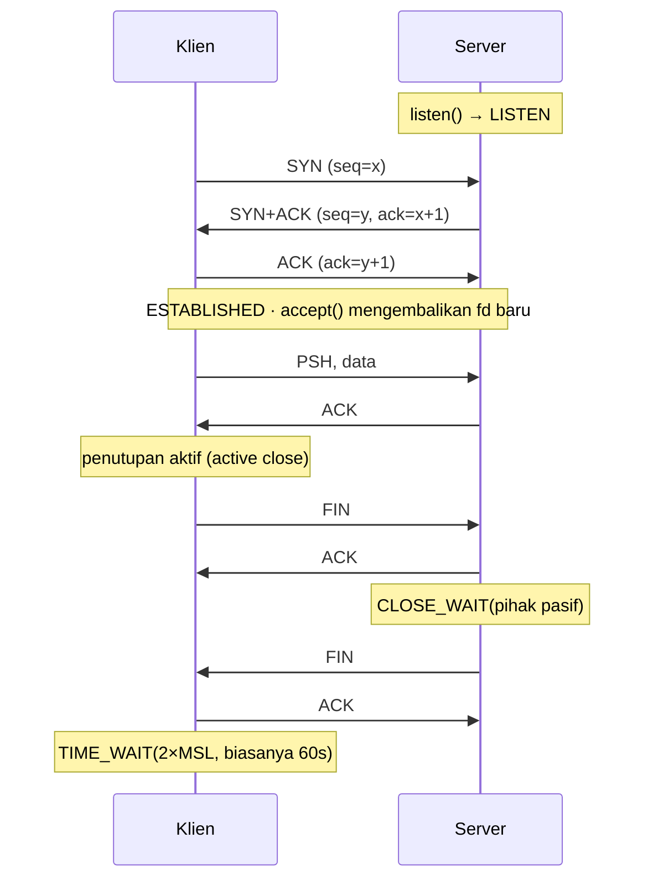
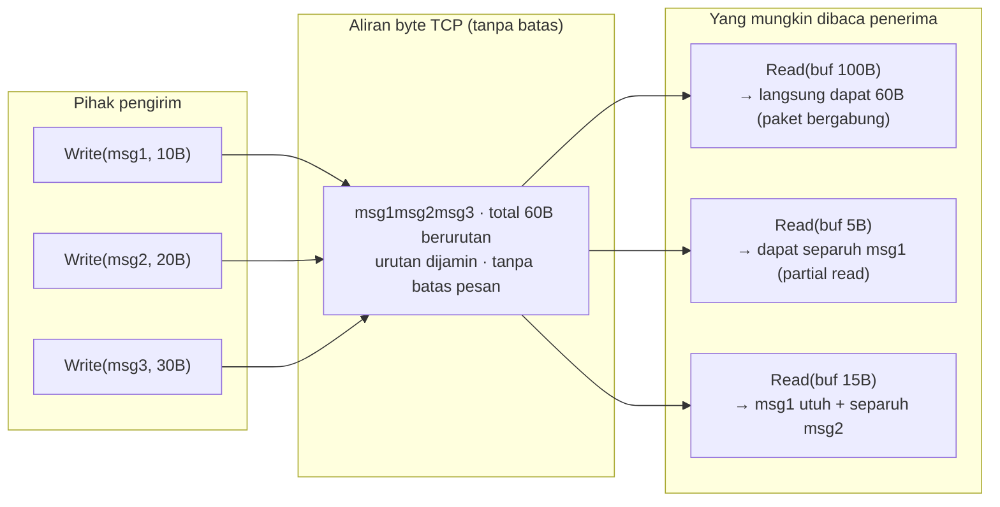
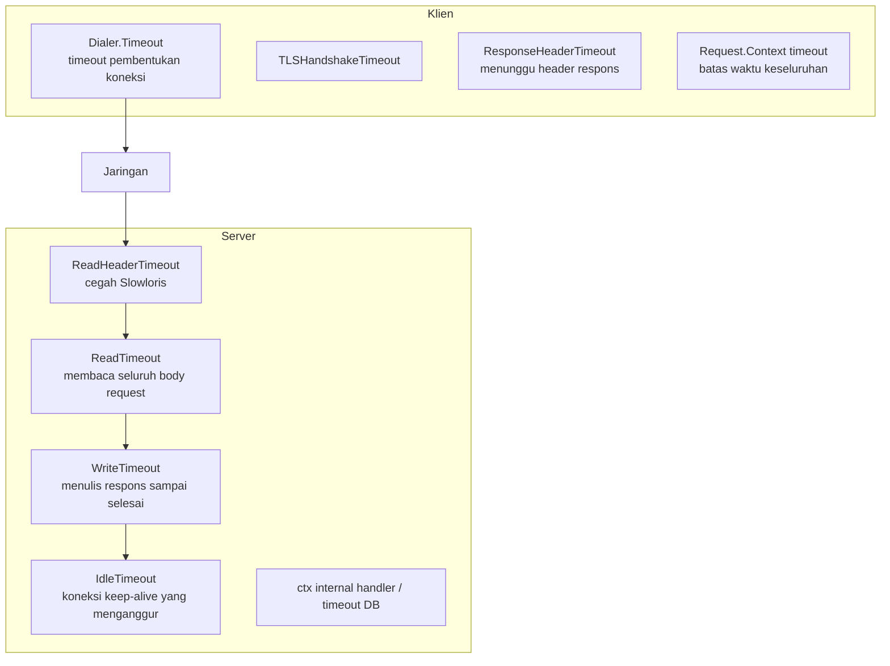
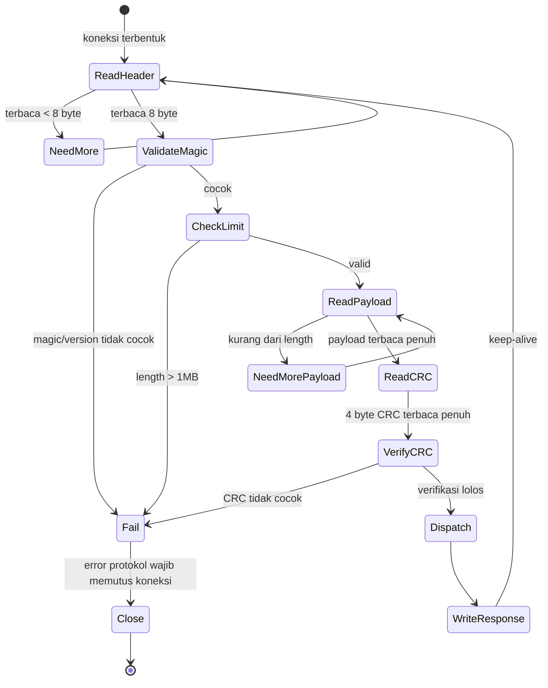

# Fase 3 · Jaringan dan Protokol (Minggu 11–13)

> Fase ini adalah yang paling mudah memperlihatkan seberapa dalam fondasi Anda: **TCP adalah aliran byte (byte stream), bukan aliran pesan.**
> Banyak orang bisa menulis HTTP handler dengan benar, tapi sedikit yang bisa melakukan framing dengan benar — padahal yang terakhir inilah fondasi middleware, gateway, dan framework RPC.

---

## Target fase

1. Mampu menjelaskan seluruh proses pembentukan, transmisi, dan penutupan koneksi dari level socket;
2. Mampu mengonfigurasi satu set **timeout HTTP yang lengkap** (bukan cuma satu `Timeout`);
3. Mampu merancang dan mengimplementasikan protokol biner kustom, serta menangani paket setengah (partial), paket bergabung (coalesced), paket rusak, dan pesan berukuran besar dengan benar;
4. Mampu memvalidasi pemahaman Anda sendiri secara mandiri dengan `tcpdump` `ss` `strace`.

### Kriteria kelulusan fase (G3)

- [ ] `go-kv-protocol` lulus uji paket setengah / paket bergabung / paket rusak / pesan terlalu besar / klien putus koneksi
- [ ] Ada dokumen spesifikasi protokol yang jelas (level byte)
- [ ] Matriks uji timeout HTTP server semuanya hijau
- [ ] Bisa menangkap byte aktual protokol Anda sendiri dengan `tcpdump` dan menjelaskannya byte demi byte

---

## Minggu 11 · TCP, UDP, Socket, DNS, Siklus Hidup Koneksi

### 11.1 Pembentukan dan penutupan



**Istilah yang wajib Anda tahu**:

| Status | Siapa yang mengalaminya | Arti | Nilai untuk troubleshooting |
| --- | --- | --- | --- |
| `LISTEN` | Server | Sedang mendengarkan (listening) | Apakah servis sudah hidup |
| `SYN_RECV` | Server | Antrean koneksi setengah jadi | **Lonjakan mendadak = SYN Flood** |
| `ESTABLISHED` | Kedua belah pihak | Koneksi normal | |
| `CLOSE_WAIT` | Pihak yang ditutup secara pasif | Peer sudah FIN, **kita belum Close** | **Menumpuk banyak = kode Anda membocorkan socket** |
| `TIME_WAIT` | Pihak yang menutup secara aktif | Menunggu 2×MSL | Akan banyak pada koneksi pendek berkonkurensi tinggi, bisa disetel dengan `tcp_tw_reuse` |
| `FIN_WAIT2` | Pihak yang menutup secara aktif | Menunggu FIN dari lawan | Terlalu banyak berarti peer tidak menutup koneksi |

> **Kalimat emas untuk troubleshooting**: `CLOSE_WAIT` banyak = **bug di program Anda** (socket tidak di-Close); `TIME_WAIT` banyak = **perilaku protokol yang normal** (jangan buru-buru "mengoptimalkan").

### 11.2 Byte stream vs pesan: konsep terpenting minggu ini



**Kesimpulan (wajib Anda hafal)**:

1. **Satu kali `Write` tidak dijamin berkorespondensi dengan satu kali `Read`.** Bisa digabung (Nagle / buffering), bisa juga dipecah (MSS / congestion window / receive buffer).
2. **Yang dijamin TCP adalah "urutan byte", bukan "batas pesan".** Batas pesan harus disediakan oleh **protokol lapisan aplikasi**.
3. Karena itu protokol kustom wajib melakukan **framing**. Tiga cara utama:

| Cara | Format | Kelebihan | Kekurangan |
| --- | --- | --- | --- |
| **Length-prefixed** | `[4B length][payload]` | Parsing sederhana, bisa pre-alokasi, paling umum | Perlu membatasi panjang maksimum |
| Delimiter | `...\r\n` atau `\0` | Mudah dibaca manusia, bisa diuji dengan telnet | payload perlu di-escape; tidak bisa pre-alokasi |
| Terstruktur swadeskripsi | TLV / Protobuf / MsgPack | Mudah dikembangkan, lintas bahasa | Implementasinya rumit |

**Fase ini memakai length-prefixed** (panjang di awal frame) — ini yang dipakai gRPC, Redis RESP, dan sebagian besar RPC.

### 11.3 Eksperimen 1: TCP echo server minimal

```go
func main() {
    ln, err := net.Listen("tcp", "127.0.0.1:8080")
    if err != nil { log.Fatal(err) }
    defer ln.Close()

    for {
        conn, err := ln.Accept()
        if err != nil {
            if errors.Is(err, net.ErrClosed) { return }
            log.Printf("accept: %v", err)
            continue    // error sementara: jangan keluar dari loop
        }
        go handle(conn)
    }
}

func handle(conn net.Conn) {
    defer conn.Close()
    buf := make([]byte, 4096)
    for {
        // Kunci: setiap operasi harus punya deadline; kalau tidak, Anda akan
        // macet selamanya saat peer tidak menutup koneksi
        if err := conn.SetReadDeadline(time.Now().Add(30 * time.Second)); err != nil {
            return
        }
        n, err := conn.Read(buf)
        if err != nil {
            if errors.Is(err, io.EOF) { return }
            var ne net.Error
            if errors.As(err, &ne) && ne.Timeout() { return }
            log.Printf("read: %v", err)
            return
        }
        if _, err := conn.Write(buf[:n]); err != nil { return }
    }
}
```

**Opsi socket yang wajib disetel**:

```go
if tc, ok := conn.(*net.TCPConn); ok {
    tc.SetNoDelay(true)                     // matikan Nagle: paket kecil langsung dikirim (skenario latensi rendah)
    tc.SetKeepAlive(true)                   // deteksi koneksi mati
    tc.SetKeepAlivePeriod(30 * time.Second) // tapi hati-hati: default Linux 2 jam, wajib disetel eksplisit
    tc.SetLinger(0)                         // kirim RST saat close (hati-hati: bisa kehilangan data)
}
```

### 11.4 Eksperimen 2: Mengamati kenyataannya

```bash
# Terminal 1: jalankan server
go run server.go

# Terminal 2: amati
ss -lntp                          # socket yang sedang listening
ss -tnp state established         # koneksi yang sudah terbentuk
watch -n1 'ss -s'                 # statistik total koneksi

# Terminal 3: tangkap paket
tcpdump -i lo -nn -X port 8080
tcpdump -i lo -nn -w capture.pcap port 8080   # simpan ke file, dibuka nanti dengan Wireshark
tcpdump -i lo -nn 'tcp[tcpflags] & tcp-syn != 0'   # hanya lihat SYN

# Uji manual (lebih cepat daripada menulis klien)
nc -v 127.0.0.1 8080
printf 'hello' | nc 127.0.0.1 8080
```

**Latihan**: setelah terhubung dengan `nc`, jangan kirim data apa pun, lalu lihat apakah server benar-benar memutus koneksi setelah 30 detik (memvalidasi bahwa deadline Anda bekerja).

### 11.5 UDP dan DNS (poin penting, tidak digali dalam-dalam)

- **UDP tanpa koneksi, tanpa retransmisi, tanpa urutan, tapi punya batas pesan** (satu kali `WriteTo` = satu datagram).
- **Bisa terjadi fragmentasi**: jika melebihi MTU (biasanya 1500B, payload sekitar 1472B) akan dipecah oleh lapisan IP; jika satu saja fragmen hilang, seluruh datagram gugur. Karena itu **payload UDP sebaiknya ≤ 1200B**.
- Di Go, `net.ResolveIPAddr` / resolver bawaan akan melakukan kueri DNS; Anda bisa memaksa resolver Go murni dengan `GODEBUG=netdns=go`, atau memakai resolver sistem dengan `netdns=cgo`.
- Cache DNS: resolver Go murni **tidak melakukan caching** (setiap kali selalu melakukan kueri). Untuk skenario frekuensi tinggi, Anda harus menambahkan cache sendiri atau memakai pustaka semacam `dnscache`.

### 11.6 Deliverable

- `04-tcp-protocol/week11/echo/server.go` + `client.go`
- `04-tcp-protocol/week11/framing-demo/`: program yang mendemonstrasikan paket bergabung / paket setengah (sengaja membaca dengan ukuran buffer berbeda)
- `docs/week11-tcpdump.md`: satu keluaran `tcpdump -X` berikut penjelasan field demi field

---

## Minggu 12 · HTTP/1.1, Framing, Keep-Alive, Timeout, Connection Pool

### 12.1 Empat lapisan timeout HTTP (kurang satu saja bisa jadi insiden)



**Server wajib dikonfigurasi secara eksplisit** (nilai nol `http.Server` berarti **tanpa timeout** — ini akar dari insiden produksi yang tak terhitung jumlahnya):

```go
srv := &http.Server{
    Addr:              ":8080",
    Handler:           mux,
    ReadHeaderTimeout: 5 * time.Second,   // cegah serangan Slowloris
    ReadTimeout:       15 * time.Second,  // termasuk body
    WriteTimeout:      15 * time.Second,
    IdleTimeout:       60 * time.Second,  // koneksi keep-alive yang menganggur
    MaxHeaderBytes:    1 << 20,           // 1MB, cegah serangan header raksasa
    ErrorLog:          slog.NewLogLogger(logger.Handler(), slog.LevelError),
}
```

> **Serangan Slowloris**: klien mengirim header request dengan sangat lambat (`\r\n` dikirim satu byte demi satu byte). Kalau `ReadHeaderTimeout` tidak disetel, satu koneksi saja bisa menempati satu goroutine + fd dalam waktu lama.

### 12.2 Connection pool sisi klien (`http.Transport`)

```go
tr := &http.Transport{
    Proxy:                 http.ProxyFromEnvironment,
    DialContext: (&net.Dialer{
        Timeout:   5 * time.Second,     // pembentukan koneksi
        KeepAlive: 30 * time.Second,    // TCP keep-alive
    }).DialContext,

    MaxIdleConns:          100,          // batas atas total koneksi menganggur
    MaxIdleConnsPerHost:   10,           // ⚠️ default-nya hanya 2! wajib diperbesar
    MaxConnsPerHost:       100,          // batas atas koneksi konkuren (termasuk yang aktif)
    IdleConnTimeout:       90 * time.Second,
    TLSHandshakeTimeout:   5 * time.Second,
    ExpectContinueTimeout: 1 * time.Second,
    ForceAttemptHTTP2:     true,
}
client := &http.Client{
    Transport: tr,
    Timeout:   10 * time.Second,   // timeout keseluruhan (termasuk membaca body)
    CheckRedirect: func(req *http.Request, via []*http.Request) error {
        if len(via) >= 5 { return errors.New("too many redirects") }
        return nil
    },
}
```

**Jebakan yang wajib Anda tahu**:
- Default `MaxIdleConnsPerHost` adalah **2**. Di bawah konkurensi tinggi ini akan menyebabkan **koneksi dibuat dan dihancurkan berulang-ulang** (TIME_WAIT melonjak, latensi naik). Ini masalah performa klien HTTP Go yang paling umum.
- **`http.Client` harus dipakai ulang**, jangan membuat yang baru setiap request (kalau tidak, connection pool-nya sia-sia).
- **Body respons wajib dibaca sampai habis lalu di-Close**, jika tidak koneksi tidak bisa dipakai ulang (dan akan bocor).

```go
resp, err := client.Do(req)
if err != nil { return err }
defer resp.Body.Close()
// kalau ingin koneksi dipakai ulang, body harus dibaca sampai habis
io.Copy(io.Discard, io.LimitReader(resp.Body, 64<<10))
```

- **`http.Client.Timeout` tidak mencakup waktu lanjutan untuk membaca body**? — Sebenarnya ia adalah batas waktu keseluruhan sejak `Do` sampai body selesai dibaca (diimplementasikan lewat timer internal). Tapi **saat membaca body besar secara streaming, ia akan memutus di tengah setelah timeout**, jadi untuk skenario streaming gunakan `context` dan kendalikan sendiri.

### 12.3 Keep-Alive dan verifikasi reuse koneksi

```bash
# Verifikasi reuse sisi klien: jalankan server yang mencetak remote addr:port
# Kalau port berubah di setiap request → tidak ada reuse
for i in $(seq 1 5); do curl -s http://localhost:8080/ > /dev/null; done

# Lihat koneksi dari sisi server
ss -tn state established '( sport = :8080 )'
```

### 12.4 Eksperimen: uji matriks timeout

Tulis sebuah matriks uji yang mencakup semua skenario timeout:

| Kasus uji | Cara mengkonstruksinya | Ekspektasi |
| --- | --- | --- |
| Timeout pembentukan koneksi | Sambung ke IP blackhole (mis. `10.255.255.1`) | `Dialer.Timeout` berlaku, gagal cepat |
| Header lambat | Klien mengirim header byte demi byte | `ReadHeaderTimeout` terpicu, koneksi ditutup |
| Body lambat | Kirim `Content-Length: 1000` tapi hanya kirim 10 byte | `ReadTimeout` terpicu |
| Respons lambat | handler `sleep(30s)` | ctx klien timeout dan membatalkan lebih dulu; handler server merasakan ctx.Done |
| Koneksi menganggur | Terhubung lalu diam saja | Server menutup setelah `IdleTimeout` |
| Header besar | Kirim header 10MB | Ditolak oleh `MaxHeaderBytes` |
| Klien membatalkan | Klien putus saat handler sedang berjalan | `r.Context()` handler dibatalkan, handler keluar dengan segera |

```go
func TestHandlerRespectsClientCancel(t *testing.T) {
    srv := httptest.NewServer(http.HandlerFunc(func(w http.ResponseWriter, r *http.Request) {
        select {
        case <-r.Context().Done():
            return                 // ✅ benar: merasakan pembatalan
        case <-time.After(5 * time.Second):
            w.Write([]byte("done"))
        }
    }))
    defer srv.Close()

    ctx, cancel := context.WithTimeout(context.Background(), 100*time.Millisecond)
    defer cancel()
    req, _ := http.NewRequestWithContext(ctx, http.MethodGet, srv.URL, nil)
    _, err := http.DefaultClient.Do(req)
    if !errors.Is(err, context.DeadlineExceeded) {
        t.Fatalf("expected deadline, got %v", err)
    }
}
```

### 12.5 Deliverable

- `04-tcp-protocol/week12/httpserver/`: server yang sudah diperkuat (semua timeout + graceful shutdown)
- `04-tcp-protocol/week12/httpclient/`: klien yang sudah dikonfigurasi + verifikasi connection pool
- `04-tcp-protocol/week12/timeout_matrix_test.go`

---

## Minggu 13 · Framing protokol, serialisasi, partial read, TLS —— proyek `go-kv-protocol`

### 13.1 Desain protokol: dari kebutuhan ke byte

**Kebutuhan**: menjalankan layanan KV sederhana di atas TCP, mendukung `PUT/GET/DELETE`.

**Keputusan desain** (ditulis ke dalam ADR):

| Titik keputusan | Pilihan | Alasan |
| --- | --- | --- |
| Cara framing | length-prefixed 4 byte big-endian | Bisa pre-alokasi, parsing sederhana, lazim di industri |
| Arti length | Hanya panjang payload (tidak termasuk header 4 byte) | Menghindari ambiguitas |
| Ukuran pesan maksimum | 1MB | Cegah memori habis; jika dilanggar, kembalikan error protokol |
| Encoding | Perintah teks biasa (mirip RESP) atau biner? | **Fase ini pakai biner** — terstruktur, tidak ada masalah escaping |
| Pemeriksaan | CRC32 di akhir payload | Mendeteksi bug transmisi/implementasi (TCP sudah punya checksum, tapi pemeriksaan di lapisan aplikasi bisa menangkap kesalahan implementasi) |
| Versi | Magic byte + versi di byte pertama | Memberi ruang untuk kompatibilitas masa depan |
| Alignment | Cukup alignment logis, tanpa padding saat transmisi | Menghemat bandwidth |

### 13.2 Tata letak byte

```
 0        1        2        3        4        5        6        7
 +--------+--------+--------+--------+--------+--------+--------+--------+
 | magic  | version|  type  | flags  |        length (uint32 BE)        |
 +--------+--------+--------+--------+--------+--------+--------+--------+
 |                       payload (length bytes)                        |
 |                       ...                                          |
 +--------+--------+--------+--------+--------+--------+--------+--------+
 |                  crc32 (uint32 BE, mencakup header+payload)         |
 +--------+--------+--------+--------+--------+--------+--------+--------+
```

- `magic` = `0x9B` (pilih saja satu byte yang tidak mirip teks)
- `version` = `0x01`
- `type`: `1=PUT, 2=GET, 3=DELETE, 0x81=OK, 0x82=VALUE, 0x83=NOT_FOUND, 0xFF=ERROR`
- `flags`: direservasi (mis. `0x01` = terkompresi)
- `length`: jumlah byte payload, **batas atas 1MB**

Isi payload (berbeda untuk setiap type):

```
PUT:    [keyLen uint16][key][valueLen uint32][value]
GET:    [keyLen uint16][key]
DELETE: [keyLen uint16][key]
VALUE:  [valueLen uint32][value]
ERROR:  [code uint16][msgLen uint16][msg]
```

### 13.3 Alur pemrosesan (sudut pandang state machine)



**Prinsip inti**:

1. **Error protokol harus memutus koneksi.** Karena aliran byte sudah bergeser dan sinkronisasi tidak bisa dipulihkan; terus membaca sama saja dengan berjudi.
2. **Error bisnis tidak memutus koneksi** (mis. `NOT_FOUND`) — kembalikan kode error dan terus melayani.
3. **Wajib membaca dalam loop** sampai jumlah byte yang dibutuhkan terpenuhi. Gunakan `io.ReadFull`.

### 13.4 Kerangka kode utama

```go
const (
    magic         = 0x9B
    version       = 0x01
    headerSize    = 8
    crcSize       = 4
    maxPayloadLen = 1 << 20   // 1MB
)

type Frame struct {
    Type    uint8
    Flags   uint8
    Payload []byte
}

// ReadFrame membaca satu frame dari conn. Mengembalikan io.EOF berarti
// peer menutup koneksi dengan bersih.
func ReadFrame(r io.Reader, buf *bufio.Reader) (Frame, error) {
    var hdr [headerSize]byte
    if _, err := io.ReadFull(buf, hdr[:]); err != nil {
        return Frame{}, err       // io.EOF / io.ErrUnexpectedEOF
    }
    if hdr[0] != magic {
        return Frame{}, fmt.Errorf("%w: bad magic 0x%02x", ErrProtocol, hdr[0])
    }
    if hdr[1] != version {
        return Frame{}, fmt.Errorf("%w: unsupported version %d", ErrProtocol, hdr[1])
    }
    length := binary.BigEndian.Uint32(hdr[4:8])
    if length > maxPayloadLen {
        return Frame{}, fmt.Errorf("%w: payload too large: %d", ErrProtocol, length)
    }

    payload := make([]byte, int(length)+crcSize)   // baca payload+crc sekaligus, hemat satu syscall
    if _, err := io.ReadFull(buf, payload); err != nil {
        return Frame{}, err
    }

    // Pemeriksaan: mencakup semua byte header + payload (tidak termasuk crc)
    sum := crc32.ChecksumIEEE(hdr[:])
    sum = crc32.Update(sum, crc32.IEEETable, payload[:length])
    want := binary.BigEndian.Uint32(payload[length:])
    if sum != want {
        return Frame{}, fmt.Errorf("%w: crc mismatch: got %08x want %08x",
            ErrProtocol, want, sum)
    }
    return Frame{Type: hdr[2], Flags: hdr[3], Payload: payload[:length]}, nil
}
```

**Penjelasan poin-poin penting**:

- `io.ReadFull` akan memanggil `Read` berulang kali sampai penuh atau terjadi error — inilah cara standar menangani "partial read".
- Bungkus conn dengan `bufio.Reader` untuk **mengurangi jumlah syscall secara drastis** (setiap `Read` adalah satu syscall).
- Batasi `length` **sebelum membaca payload**; kalau tidak, satu length palsu 4GB bisa membuat servis OOM.
- Pemeriksaan CRC diletakkan di **lapisan aplikasi**, bukan untuk mencegah kesalahan jaringan (TCP sudah menangani itu), melainkan untuk **menangkap bug implementasi kita sendiri** (serialisasi/deserialisasi yang bergeser).

### 13.5 Tes yang wajib ditulis

| Tes | Konstruksi | Aseri |
| --- | --- | --- |
| `TestRoundTrip` | PUT/GET normal | Nilainya sama |
| `TestPartialRead` | Tulis satu frame **perlahan, 1 byte per kali** | Server tetap bisa mem-parsing dengan benar |
| `TestCoalescedFrames` | Tulis 3 frame sekaligus | Server mem-parsing 3 request |
| `TestBadMagic` | Ubah byte pertama menjadi salah | Mengembalikan ErrProtocol, **koneksi ditutup** |
| `TestOversizedFrame` | Nyatakan length = 10MB | Ditolak dan tidak mengalokasi memori 10MB |
| `TestCorruptPayload` | Ubah satu byte pada payload | Pemeriksaan CRC gagal |
| `TestClientDisconnect` | Tutup koneksi setelah menulis separuh | Goroutine server keluar, **tanpa kebocoran** |
| `TestSlowClient` | Kirim dengan sangat lambat | Deadline terpicu, koneksi direklamasi |
| `TestConcurrentClients` | 100 klien konkuren | Tanpa race (`-race`) |

```go
// Menulis byte demi byte, menyimulasikan jaringan ekstrem
func TestPartialRead(t *testing.T) {
    ln, _ := net.Listen("tcp", "127.0.0.1:0")
    defer ln.Close()
    go serveOne(ln)

    conn, _ := net.Dial("tcp", ln.Addr().String())
    defer conn.Close()

    frame := encodePut([]byte("k"), []byte("v"))
    for i := range frame {              // kirim satu byte demi satu byte
        conn.Write(frame[i : i+1])
        time.Sleep(time.Millisecond)
    }
    // Asersikan bahwa respons OK diterima
}
```

### 13.6 Dasar TLS (cukup dipahami, tidak wajib mengimplementasikan CA)

```go
// Server
cert, err := tls.LoadX509KeyPair("server.crt", "server.key")
cfg := &tls.Config{
    Certificates: []tls.Certificate{cert},
    MinVersion:   tls.VersionTLS12,     // jangan lagi mengizinkan TLS 1.0/1.1
    CipherSuites: []uint16{
        tls.TLS_ECDHE_ECDSA_WITH_AES_128_GCM_SHA256,
        tls.TLS_ECDHE_RSA_WITH_AES_128_GCM_SHA256,
        tls.TLS_ECDHE_RSA_WITH_AES_256_GCM_SHA384,
    },
    CurvePreferences: []tls.CurveID{tls.X25519, tls.CurveP256},
}
ln, _ := tls.Listen("tcp", ":8443", cfg)
```

**Poin-poin penting**:
- **TLS juga merupakan aliran byte**; logika framing sama sekali tidak berubah — inilah sebabnya menulis framing di atas `io.Reader` adalah desain yang baik.
- Menangkap port 443 dengan `tcpdump` hanya akan memperlihatkan data terenkripsi; untuk verifikasi gunakan `openssl s_client -connect host:443`.
- Uji sertifikat self-signed: `GODEBUG=x509ignoreCN=0` (tidak direkomendasikan); cara yang benar adalah memakai `SAN`, bukan `CN`.

### 13.7 Deliverable

- `04-tcp-protocol/`: `frame.go`, `server.go`, `client.go`, tes lengkap
- `docs/protocol.md`: **spesifikasi level byte** (orang lain bisa mengimplementasikan klien dalam bahasa lain dengan mengikutinya)
- `docs/adr/0001-framing-choice.md`: mengapa memilih length-prefixed
- `docs/week13-tcpdump.md`: catatan verifikasi hasil tangkapan paket

---

## Kotak peralatan troubleshooting Fase 3

```bash
# Ringkasan status koneksi
ss -lntp                                  # siapa yang sedang listening
ss -tnp                                   # semua koneksi TCP + prosesnya
ss -s                                     # statistik ringkasan
netstat -s                                # statistik protokol (retransmisi, error)

# Menangkap paket
tcpdump -i lo -nn -X port 8080
tcpdump -i any -nn -c 100 'tcp port 8080 and tcp[tcpflags] & tcp-rst != 0'
tcpdump -i lo -nn -w out.pcap port 8080 && tcpdump -r out.pcap -X

# System call
strace -f -e trace=network -p <pid>
strace -f -c -e trace=sendto,recvfrom,epoll_pwait ./server

# Probing manual
nc -vz host port                          # keterhubungan port
printf 'GET / HTTP/1.0\r\n\r\n' | nc host 80
curl -v --max-time 5 http://host/

# Menyimulasikan jaringan lemah / loss paket (perlu root)
tc qdisc add dev eth0 root netem delay 100ms loss 5%
tc qdisc del dev eth0 root
```

---

## Checklist Fase 3

| # | Item pengecekan |
| --- | --- |
| 1 | Setiap koneksi sudah memiliki read/write deadline |
| 2 | Loop baca sisi server menangani `io.EOF`, `io.ErrUnexpectedEOF`, dan timeout dengan benar |
| 3 | Protokol memiliki magic number, versi, batas atas panjang, dan pemeriksaan |
| 4 | Error protokol memutus koneksi, error bisnis tidak memutus koneksi |
| 5 | Semua `net.Conn` di-defer Close |
| 6 | HTTP server sudah melengkapi 4 timeout |
| 7 | Klien HTTP memakai ulang Transport dan memperbesar `MaxIdleConnsPerHost` |
| 8 | Body respons dibaca sampai habis lalu di-Close |
| 9 | `go test -race` lulus uji klien konkuren |
| 10 | Ada dokumen protokol level byte sehingga pihak ketiga bisa mengimplementasikannya |

---

## Referensi

| Topik | Tautan |
| --- | --- |
| Beej's Guide to Network Programming(wajib dibaca) | <https://beej.us/guide/bgnet/html/index.html> |
| Paket net Go | <https://pkg.go.dev/net> |
| Artikel klasik tentang timeout HTTP server | <https://blog.cloudflare.com/the-complete-guide-to-golang-net-http-timeouts/> |
| State machine TCP / RFC 793 | <https://datatracker.ietf.org/doc/html/rfc793> |
| HTTP/1.1 RFC 9112 | <https://datatracker.ietf.org/doc/html/rfc9112> |
| Manual tcpdump | <https://www.tcpdump.org/manpages/tcpdump.1.html> |
