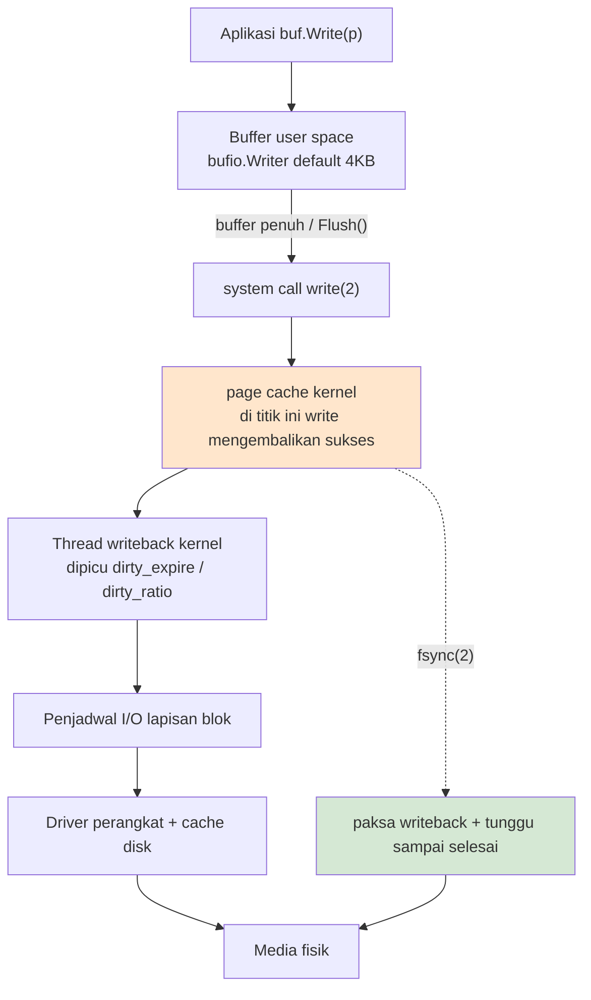
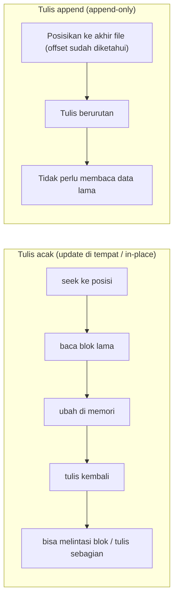
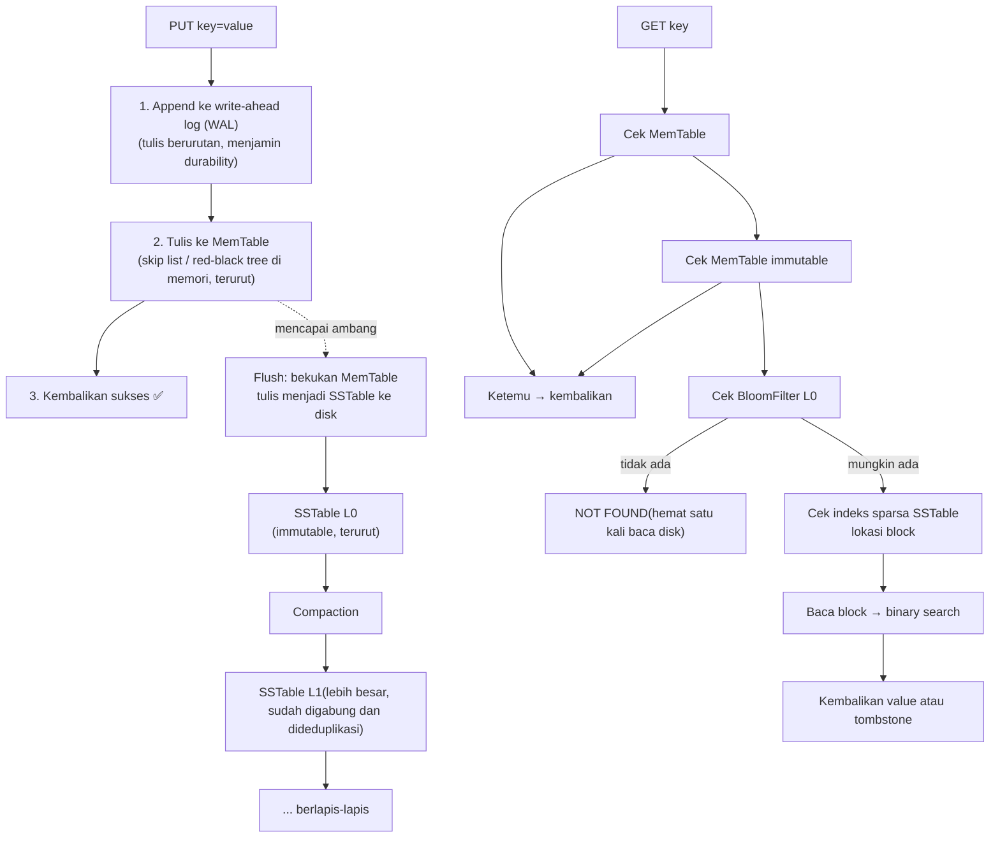
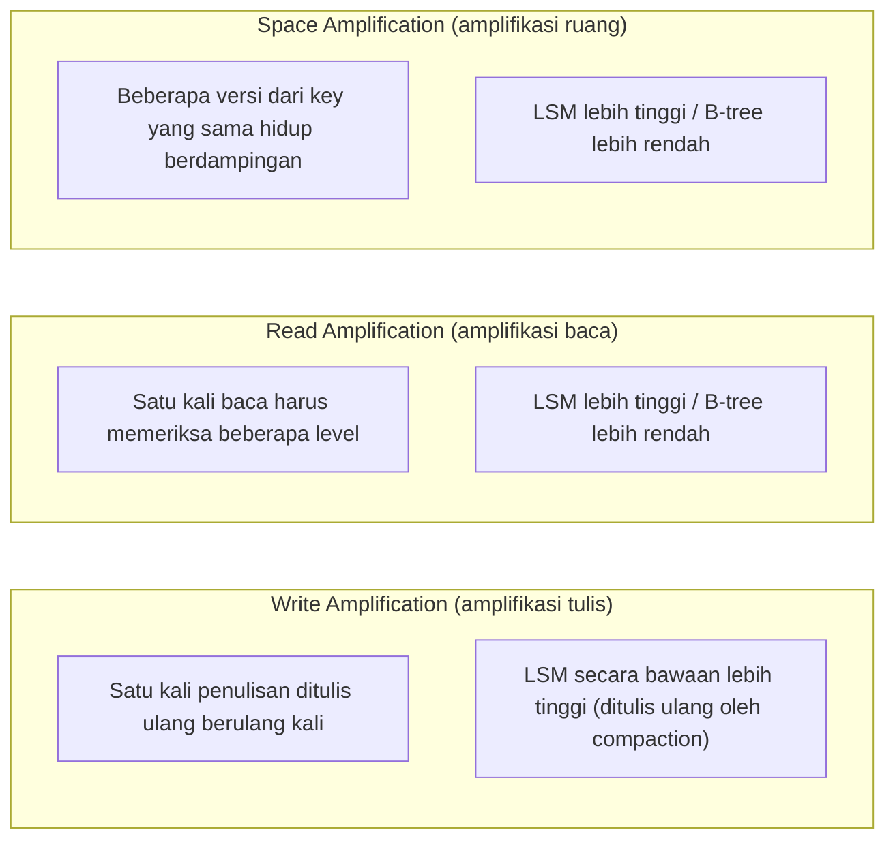
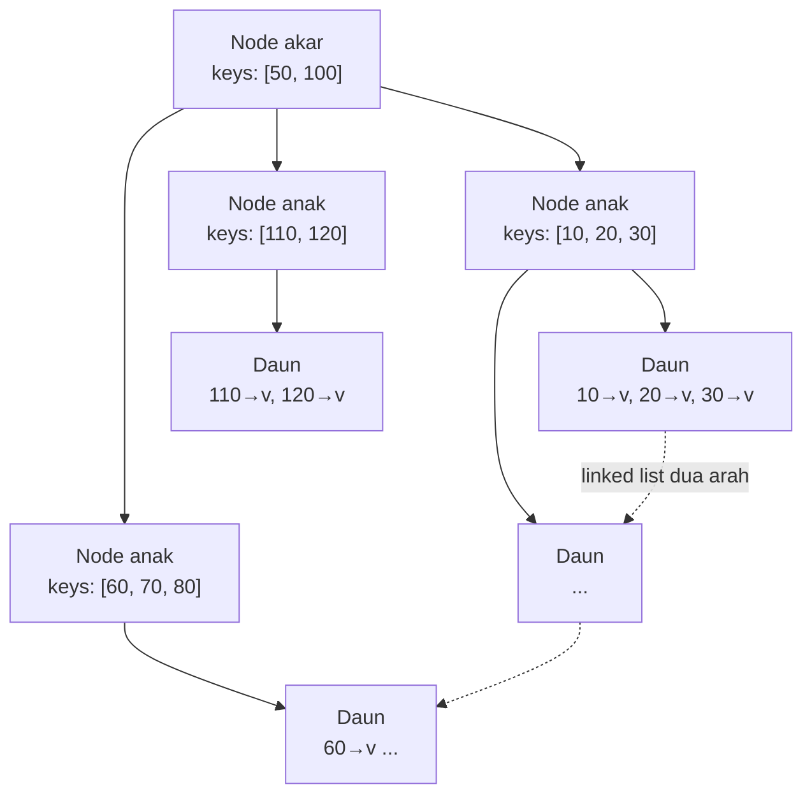
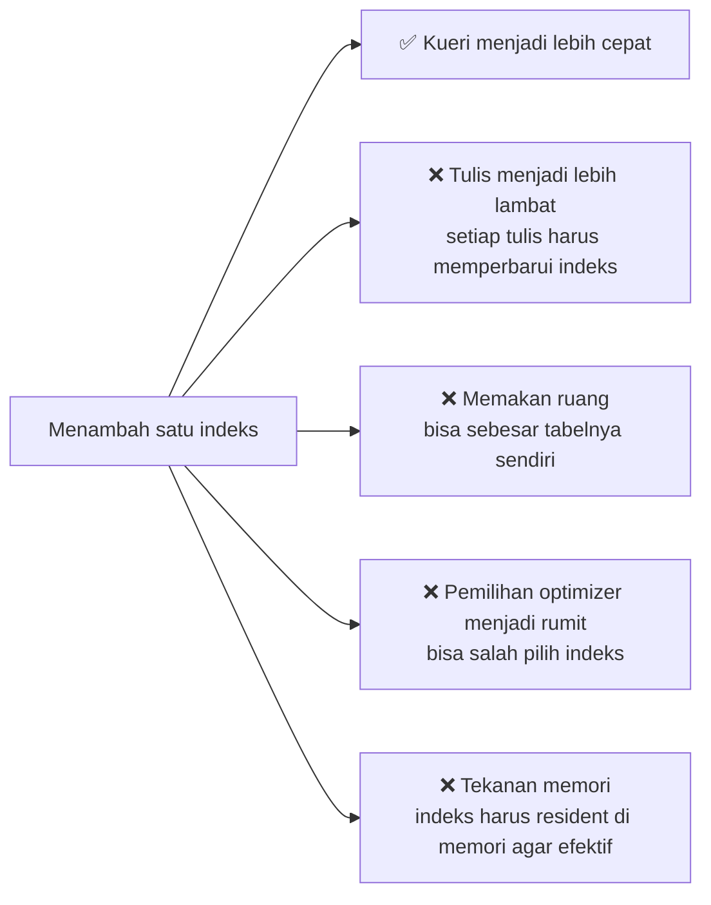
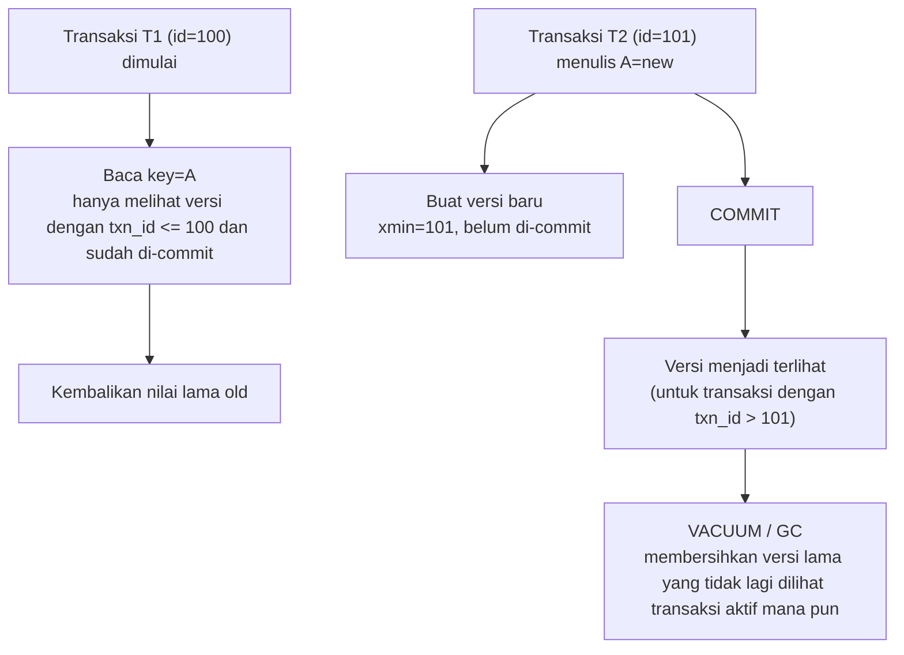

# Fase 4 · Mesin Storage dan Mekanisme Internal Database (Minggu 14–16)

> Fase ini akan mengubah secara total cara Anda memandang database.
> Anda akan paham mengapa `INSERT` itu lambat, mengapa indeks tidak boleh semakin banyak semakin baik, dan mengapa di balik tiga kata "sudah di-commit" tersimpan harga yang begitu mahal.

---

## Target fase

1. Mampu menjelaskan hubungan sebenarnya antara `write()`, `fsync`, page cache, dan durability;
2. Mampu mengimplementasikan KV store persisten ber-WAL yang bisa melakukan recovery dengan benar setelah restart;
3. Mampu menjelaskan dengan jelas **skenario yang cocok dan biayanya** masing-masing untuk B-tree dan LSM-tree;
4. Mampu merancang format record (termasuk pemeriksaan) serta mendeteksi/menangani data yang rusak.

### Kriteria kelulusan fase (G4)

- [ ] `gostore` datanya utuh setelah restart (termasuk dua skenario: kerusakan di ekor akibat truncate, dan kerusakan di tengah)
- [ ] Ada data benchmark untuk tulis berurutan dan baca acak
- [ ] README menyatakan secara eksplisit batas durability (**dilarang mengklaim tahan terhadap pemadaman listrik kecuali benar-benar sudah diuji**)
- [ ] Ada tes untuk verifikasi checksum dan deteksi kerusakan

---

## Minggu 14 · Filesystem, Buffered I/O, Page Cache, `fsync`, dan Persistensi

### 14.1 Gambaran utuh jalur penulisan



**Tiga model kegagalan yang wajib Anda bedakan**:

| Kegagalan | Data di page cache | Data setelah `fsync` | Penjelasan |
| --- | --- | --- | --- |
| Crash proses(`panic`, `kill -9`) | ✅ tidak hilang | ✅ tidak hilang | Kernel masih memegang dirty page dan akan terus melakukan writeback |
| Pemadaman listrik / kernel panic | ❌ **bisa hilang** | ✅ biasanya tidak hilang | Bergantung pada apakah perangkat kerasnya jujur |
| Kerusakan disk / bug filesystem | ❌ | ❌ | Butuh replika; ini bukan masalah yang bisa diselesaikan satu mesin |

> **Pernyataan rekayasa yang jujur**:
> - Yang hanya pernah menguji `kill -9`, hanya boleh berkata "tahan terhadap crash proses"
> - Yang sudah menguji `fsync` + pemadaman listrik, barulah boleh berkata "tahan terhadap crash host"
> - Ketahanan terhadap kerusakan media bergantung pada **replika** (replication), bukan pada `fsync`

### 14.2 Append-only log: primitif persistensi yang paling sederhana

**Mengapa append-only begitu populer?**



- Tulis berurutan di HDD **1~2 orde magnitudo** lebih cepat daripada tulis acak (menghemat seek); di SSD juga lebih cepat (mengurangi write amplification dan tekanan GC)
- **Aman terhadap crash**: tulis append tidak akan merusak data yang sudah ada; skenario terburuk hanyalah **satu record yang tidak lengkap di ekor** → cukup dibuang dengan checksum
- Inilah sebabnya WAL, Kafka, dan hampir semua database memakai append-only log

### 14.3 Desain format record

```
+--------+--------+--------+--------+
|  crc32 (4B, BE)                  |   ← mencakup length+type+payload
+--------+--------+--------+--------+
|  length (4B, BE)                 |   ← jumlah byte payload
+--------+---+----+--------+--------+
| type(1B)| reserved(3B)           |
+--------+-------------------------+
|  payload (length bytes)          |
|  ...                             |
+----------------------------------+
```

```
type: 1=PUT, 2=DELETE(tombstone), 3=CHECKPOINT, 4=TXN_COMMIT
```

**Mengapa CRC diletakkan paling depan?** Dengan begitu, saat membaca di tengah dan menemukan CRC salah, kita bisa langsung menyimpulkan "mulai dari sini adalah sampah" (biasanya sisa tulisan setengah jadi saat crash), lalu langsung memotongnya.

### 14.4 Implementasi: append-only log

```go
type Log struct {
    mu     sync.Mutex
    f      *os.File
    buf    *bufio.Writer
    offset int64      // offset logis (jumlah byte yang sudah dipersistenkan)
    syncPolicy SyncPolicy
}

type SyncPolicy int
const (
    SyncNone   SyncPolicy = iota // tanpa fsync: paling cepat, data hilang saat crash
    SyncEvery                    // fsync setiap record: paling lambat, paling aman
    SyncPeriodic                 // berkala / berdasarkan jumlah: kompromi (umum dipakai)
)

func Open(path string, p SyncPolicy) (*Log, error) {
    f, err := os.OpenFile(path, os.O_CREATE|os.O_RDWR|os.O_APPEND, 0o644)
    if err != nil { return nil, err }
    st, err := f.Stat()
    if err != nil { f.Close(); return nil, err }
    return &Log{f: f, buf: bufio.NewWriterSize(f, 64<<10), offset: st.Size(), syncPolicy: p}, nil
}

func (l *Log) Append(recType uint8, payload []byte) (int64, error) {
    l.mu.Lock()
    defer l.mu.Unlock()

    off := l.offset
    var hdr [12]byte
    binary.BigEndian.PutUint32(hdr[0:4], uint32(len(payload)))
    hdr[4] = recType

    // CRC mencakup length + type + reserved + payload
    sum := crc32.ChecksumIEEE(hdr[0:12])
    sum = crc32.Update(sum, crc32.IEEETable, payload)

    var crc [4]byte
    binary.BigEndian.PutUint32(crc[:], sum)

    if _, err := l.buf.Write(crc[:]); err != nil { return 0, err }
    if _, err := l.buf.Write(hdr[:]); err != nil { return 0, err }
    if _, err := l.buf.Write(payload); err != nil { return 0, err }

    l.offset += int64(4 + 12 + len(payload))

    if l.syncPolicy == SyncEvery {
        if err := l.sync(); err != nil { return 0, err }
    }
    return off, nil
}

func (l *Log) sync() error {
    if err := l.buf.Flush(); err != nil { return err }   // wajib Flush ke kernel dulu
    return l.f.Sync()                                    // barulah fsync
}
```

**Urutan kritis (kalau salah urutan, data hilang)**:

```
1. buf.Flush()  → buffer user space → page cache kernel
2. f.Sync()     → page cache → disk
```

Kalau hanya memanggil `Sync()` tanpa `Flush()`, data masih berada di dalam `bufio` Anda, dan `fsync` tidak menyiram apa pun.

### 14.5 Recovery: memindai log untuk membangun ulang state

```go
func (l *Log) Replay(fn func(off int64, recType uint8, payload []byte) error) error {
    // Buka ulang dalam mode read-only (hindari tercampur dengan Append sehingga offset kacau)
    f, err := os.Open(l.path)
    if err != nil { return err }
    defer f.Close()

    r := bufio.NewReaderSize(f, 64<<10)
    var off int64
    for {
        var crc [4]byte
        if _, err := io.ReadFull(r, crc[:]); err != nil {
            if errors.Is(err, io.EOF) { return nil }        // berakhir bersih
            if errors.Is(err, io.ErrUnexpectedEOF) {        // record setengah jadi di ekor
                return l.truncateTo(off)                    // buang saja
            }
            return err
        }
        var hdr [12]byte
        if _, err := io.ReadFull(r, hdr[:]); err != nil { return l.truncateTo(off) }

        length := binary.BigEndian.Uint32(hdr[0:4])
        if length > maxRecordSize { return l.truncateTo(off) }   // jelas-jelas rusak

        payload := make([]byte, length)
        if _, err := io.ReadFull(r, payload); err != nil { return l.truncateTo(off) }

        // Verifikasi
        sum := crc32.ChecksumIEEE(hdr[:])
        sum = crc32.Update(sum, crc32.IEEETable, payload)
        if binary.BigEndian.Uint32(crc[:]) != sum {
            return l.truncateTo(off)     // mulai dari sini tidak bisa dipercaya
        }

        if err := fn(off, hdr[4], payload); err != nil { return err }
        off += int64(4 + 12 + int(length))
    }
}
```

**Strategi recovery**:
- Menemukan error CRC / panjang yang tidak wajar / record setengah jadi → **potong file mulai offset tersebut**(`f.Truncate(off)`), buang semua isi setelahnya
- Inilah keuntungan terbesar append-only: **kerusakan hanya mungkin terjadi di ekor**

### 14.6 Eksperimen: perbedaan performa tiga strategi sync

```bash
go test -bench=BenchmarkAppend -benchmem ./...
# Uji masing-masing SyncNone / SyncEvery / SyncPeriodic (setiap 100 record)
```

Ekspektasi (**wajib Anda ukur sendiri**):

| Strategi | Throughput | Yang hilang setelah crash |
| --- | --- | --- |
| `SyncNone` | Sangat tinggi (ratusan ribu~jutaan ops/s, hanya menulis ke cache) | Bisa hilang banyak |
| `SyncEvery` | Dibatasi latensi `fsync` disk (SSD sekitar 0,1~1ms per kali → 1000~10000 ops/s) | Hampir tidak ada yang hilang |
| `SyncPeriodic` | Mendekati SyncNone | Kehilangan satu jendela terakhir |

**Hal yang paling mengejutkan dari eksperimen ini**: `fsync` **100~1000 kali** lebih lambat daripada "menulis ke memori". Begitu Anda memahaminya, Anda akan paham mengapa database punya group commit, mengapa ada `synchronous_commit=off`, dan mengapa Kafka secara default tidak melakukan fsync untuk setiap record.

### 14.7 Deliverable

- `05-storage-engine/week14/log.go` + `replay.go` + tes
- Tes: `TestReplayAfterCleanShutdown`, `TestReplayTruncatesPartialRecord`, `TestReplayDetectsCorruption`
- `docs/benchmarks/week14-fsync.md`: perbandingan tiga strategi

---

## Minggu 15 · WAL, MemTable, SSTable, Compaction —— proyek `gostore`

### 15.1 Arsitektur LSM klasik



### 15.2 Peran masing-masing komponen

| Komponen | Peran | Mengapa diperlukan |
| --- | --- | --- |
| **WAL** | Recovery saat crash | Data di memori bisa hilang, log tidak |
| **MemTable** | Buffer tulis + struktur terurut di memori | Mengubah tulis acak menjadi tulis berurutan |
| **MemTable immutable** | Snapshot read-only selama flush | Tetap bisa menerima tulisan saat flush berjalan |
| **SSTable** | File terurut yang immutable | Tulis berurutan ke disk; karena immutable → tidak perlu lock |
| **Bloom Filter** | Menentukan dengan cepat bahwa "key pasti tidak ada" | Menghemat 90%+ pembacaan disk yang sia-sia |
| **Indeks sparsa** | Menemukan block tempat key berada | Tidak perlu memindai seluruh file |
| **Compaction** | Menggabungkan, mendeduplikasi, membersihkan tombstone | Mengendalikan amplifikasi baca dan amplifikasi ruang |
| **Tombstone** | Penanda penghapusan | SSTable immutable, hapus hanya bisa ditandai |

### 15.3 Spesifikasi implementasi minimal `gostore`

```
API:
  func Open(dir string, opts ...Option) (*Store, error)
  func (s *Store) Put(key, value []byte) error
  func (s *Store) Get(key []byte) ([]byte, bool, error)
  func (s *Store) Delete(key []byte) error
  func (s *Store) Close() error

Wajib diimplementasikan:
  ✅ WAL append-only (hasil Minggu 14)
  ✅ replay saat startup untuk membangun ulang MemTable
  ✅ penghapusan dengan tombstone
  ✅ pemeriksaan CRC + deteksi kerusakan
  ✅ flush MemTable menjadi SSTable setelah mencapai ambang
  ✅ Compaction (minimal gabungan sederhana L0 → L1)
  ✅ Benchmark: tulis berurutan / baca acak
```

**MemTable memakai apa?** Saran:

- Versi pertama: langsung pakai `map[string][]byte` + pengurutan saat menulis (**utamakan membuat alurnya jalan dulu**)
- Versi kedua: ganti ke skip list atau `github.com/google/btree`, karena SSTable membutuhkan keluaran yang **terurut**
- Pustaka standar Go tidak punya ordered map — ini adalah titik trade-off rekayasa yang nyata dan layak didiskusikan di ADR

### 15.4 Format file SSTable

```
+---------------------------+
| data blocks   (masing-masing 4KB)  |   ← key/value tersusun terurut
+---------------------------+
| index block               |   ← [lastKey of block][block offset][block size]
+---------------------------+
| bloom filter              |
+---------------------------+
| footer (ukuran tetap)      |
|  - indexOffset  uint64    |
|  - indexSize    uint64    |
|  - bloomOffset  uint64    |
|  - bloomSize    uint64    |
|  - numEntries   uint64    |
|  - magic        uint64    |
+---------------------------+
```

**Footer di akhir + ukuran tetap**: saat membuka file, seek dulu ke akhir untuk membaca footer (satu kali I/O), dan Anda langsung mendapatkan offset semua metadata. Inilah cara yang dipakai LevelDB/RocksDB.

### 15.5 Compaction: memahami tiga "amplifikasi"



| Strategi | Amplifikasi tulis | Amplifikasi baca | Amplifikasi ruang | Cocok untuk |
| --- | --- | --- | --- | --- |
| **Leveled**(default LevelDB/RocksDB) | sedang~tinggi | rendah | rendah | baca banyak, tulis sedikit |
| **Tiered / Size-tiered**(Cassandra) | rendah | tinggi | tinggi | tulis banyak, baca sedikit |
| **B-tree** | tinggi (tulis acak + WAL) | rendah | rendah | baca banyak, butuh range scan dan transaksi |

**Trade-off inti compaction**: semakin agresif compaction → baca makin cepat dan ruang makin hemat, tapi amplifikasi tulis makin parah (CPU + bandwidth disk dimakan oleh compaction).

### 15.6 Tes yang wajib ditulis

| Tes | Aseri |
| --- | --- |
| `TestPutGet` | Baca-tulis dasar |
| `TestDeleteViaTombstone` | Setelah dihapus, Get mengembalikan not found; **ada record tombstone di WAL** |
| `TestRestartRecovers` | Setelah Close lalu Open kembali, data utuh |
| `TestReplaySkipsCorruptTail` | Sengaja menambahkan byte sampah di ekor file; setelah restart data sebelumnya tetap bisa dipulihkan |
| `TestFlushCreatesSSTable` | Setelah menulis cukup untuk mencapai ambang, SSTable muncul di direktori |
| `TestCompactionReducesFiles` | Setelah compaction jumlah file turun dan hasil baca tidak berubah |
| `TestGetFromSSTable` | Setelah flush, Get masih berhasil (lewat jalur SSTable) |
| `TestConcurrentWrites` | Aman untuk tulis konkuren (`-race`) |

```go
func TestReplaySkipsCorruptTail(t *testing.T) {
    dir := t.TempDir()
    s, _ := Open(dir)
    for i := 0; i < 100; i++ { s.Put([]byte(fmt.Sprintf("k%d", i)), []byte("v")) }
    s.Close()

    // Sengaja menyuntikkan kerusakan: tambahkan byte acak
    f, _ := os.OpenFile(filepath.Join(dir, "wal.log"), os.O_APPEND|os.O_WRONLY, 0)
    f.Write([]byte{0xDE, 0xAD, 0xBE, 0xEF, 0x01, 0x02})
    f.Close()

    s2, err := Open(dir)        // harus bisa dibuka, tidak boleh panic
    if err != nil { t.Fatal(err) }
    defer s2.Close()

    // 100 record sebelumnya wajib masih ada
    for i := 0; i < 100; i++ {
        if _, ok, _ := s2.Get([]byte(fmt.Sprintf("k%d", i))); !ok {
            t.Fatalf("lost key k%d", i)
        }
    }
}
```

### 15.7 Deliverable

- `05-storage-engine/` implementasi lengkap
- `docs/adr/0002-lsm-vs-btree.md`
- `docs/benchmarks/week15-store.md`

---

## Minggu 16 · B-tree, LSM, Indeks, Transaksi, dan Isolation

### 16.1 Seperti apa bentuk B-tree



**Sifat-sifat kunci**:

- **Seimbang**: semua daun berada di level yang sama, kompleksitas pencarian `O(log_B N)`, dengan `B` adalah orde (berapa banyak key yang bisa muat dalam satu node)
- **Fan-out tinggi**: satu node biasanya = satu halaman disk (4KB/16KB), bisa memuat ratusan key → cukup 3~4 level untuk mengindeks ratusan juta baris
- **Linked list pada daun**: mendukung range scan yang efisien (range scan di LSM harus menggabungkan beberapa level, lebih merepotkan)
- **Update in-place**: perubahan harus ditulis kembali ke halaman asalnya → **tulis acak**, inilah sebabnya ia lebih lambat menulis dibanding LSM

### 16.2 B-tree vs LSM: menjelaskan trade-off-nya dengan jelas

| Dimensi | B-tree | LSM-tree |
| --- | --- | --- |
| Tulis | Tulis acak + WAL, amplifikasi tulis tinggi | Tulis berurutan, throughput tulis tinggi |
| Baca (point lookup) | Stabil `O(log N)`, sekitar 3~4 kali I/O | Bisa memeriksa beberapa level, dimitigasi dengan BloomFilter |
| Range scan | Sangat baik (linked list daun) | Biasa saja (penggabungan multi-level) |
| Amplifikasi ruang | Rendah (tapi ada fragmentasi / fill factor) | Tinggi (banyak versi hidup berdampingan) |
| Amplifikasi tulis | Sedang (penulisan ulang level halaman) | Tinggi (compaction) |
| Rasio kompresi | Biasa saja | Baik (SSTable ringkas) |
| Representasi tipikal | PostgreSQL, MySQL InnoDB, SQLite | RocksDB, Cassandra, ClickHouse, TiDB |

> **Inilah sebabnya PostgreSQL memakai B-tree, sementara TiDB/CockroachDB di bawahnya memakai RocksDB**: yang pertama mengoptimalkan baca transaksional, yang terakhir mengoptimalkan throughput tulis dan skalabilitas horizontal.

### 16.3 Biaya indeks (banyak orang hanya mengingat manfaatnya)



**Eksperimen**: tambahkan sebuah indeks sekunder "kueri berdasarkan prefix value" ke KV store, lalu ukur seberapa besar throughput tulis turun.**Berikan angkanya**.

### 16.4 Transaksi dan level isolation

**Arti sebenarnya dari ACID**:

| Huruf | Arti | Sarana implementasi |
| --- | --- | --- |
| **A**tomicity | Semua dikerjakan atau tidak sama sekali | Undo log / WAL + rollback |
| **C**onsistency | Memenuhi semua constraint | Constraint aplikasi + constraint database |
| **I**solation | Transaksi konkuren tidak saling mengganggu | Lock / MVCC |
| **D**urability | Setelah commit tidak hilang | `fsync` + WAL |

**Empat level isolation dan anomali yang menyertainya** (bahasa bersama untuk wawancara maupun desain):

| Level | Dirty read | Non-repeatable read | Phantom read | Write skew |
| --- | --- | --- | --- | --- |
| Read Uncommitted | ❌ bisa terjadi | ❌ | ❌ | ❌ |
| Read Committed | ✅ dihindari | ❌ | ❌ | ❌ |
| Repeatable Read | ✅ | ✅ | ❌(MySQL InnoDB pada dasarnya menghindarinya lewat gap lock) | ❌ |
| Serializable | ✅ | ✅ | ✅ | ✅ |

> Level isolation default `database/sql` di Go bergantung pada driver/database-nya.**Default PostgreSQL adalah Read Committed**.
> Catatan: "Repeatable Read" dalam standar SQL **berbeda** dengan implementasi MySQL InnoDB (RR-nya InnoDB melalui MVCC + next-key lock sebenarnya mendekati Serializable).

**Ringkasan MVCC**:



### 16.5 Eksperimen mini: menambahkan transaksi single-key "read committed" ke `gostore`

Jangan serakah soal cakupan. Implementasikan antarmuka transaksi yang minimal:

```go
type Tx interface {
    Get(key []byte) ([]byte, bool)
    Put(key, value []byte)
    Delete(key []byte)
    Commit() error
    Rollback() error
}
```

Strategi (**tulis ke dalam ADR**):
- Operasi tulis disangga dulu secara lokal di dalam transaksi
- Saat `Commit`, **sekali saja** menambahkan satu record `TXN_COMMIT` (berisi semua operasi) ke WAL → **atomicitas dijamin oleh "penulisan satu record tunggal"**
- Ini adalah atomic commit yang paling sederhana: **batch append + satu CRC**; kalau sukses semuanya berlaku, kalau gagal semuanya dibuang

Keterbatasan desain ini (harus ditulis dengan jelas): tidak mendukung deteksi konflik tulis antar-transaksi secara konkuren (tanpa MVCC/lock); hanya menjamin atomicitas dalam satu transaksi.

### 16.6 Deliverable

- `05-storage-engine/btree/`: satu implementasi B-tree minimal (atau eksperimen perbandingan)
- `05-storage-engine/txn.go`: transaksi mini
- `docs/benchmarks/week16-index.md`: pengukuran nyata biaya indeks
- `docs/adr/0003-transaction-atomicity.md`

---

## Checklist Fase 4

| # | Item pengecekan |
| --- | --- |
| 1 | `Flush()` dipanggil sebelum `Sync()` (urutan tidak boleh terbalik) |
| 2 | Record WAL memiliki CRC dan length, sehingga bisa mendeteksi tulis sebagian |
| 3 | Replay bisa memotong saat menemukan kerusakan, bukan panic |
| 4 | Penghapusan memakai tombstone dan benar-benar dibersihkan saat compaction |
| 5 | Ada konfigurasi strategi `fsync` beserta data performanya |
| 6 | README menyatakan batas durability secara eksplisit (tidak dilebih-lebihkan) |
| 7 | File handle ditutup dengan benar (uji restart akan menemukannya) |
| 8 | `go test -race` lulus uji baca-tulis konkuren |
| 9 | Ada benchmark tulis berurutan / baca acak |
| 10 | Ada ADR yang mencatat dasar trade-off LSM vs B-tree |

---

## Referensi

| Topik | Tautan |
| --- | --- |
| DDIA(Designing Data-Intensive Applications, wajib dibaca) | <https://dataintensive.net/> |
| Dokumen implementasi LevelDB | <https://github.com/google/leveldb/blob/main/doc/impl.md> |
| Format file SQLite | <https://www.sqlite.org/fileformat.html> |
| MVCC PostgreSQL | <https://www.postgresql.org/docs/current/mvcc.html> |
| BoltDB(B+tree murni Go, kodenya sangat mudah dibaca) | <https://github.com/etcd-io/bbolt> |
| gofs: kebenaran tentang fsync | <https://www.postgresql.org/docs/current/wal-reliability.html> |
