# Fase 5 · Sistem Terdistribusi (Minggu ke-17–20)

> Ringkasan satu kalimat untuk fase ini: **Hakikat sistem terdistribusi adalah berusaha mempertahankan ilusi "seolah-olah ini satu mesin", dalam kondisi di mana "pesan bisa hilang, bisa tertunda, bisa duplikat, dan mesin bisa mati."**
>
> Urutan yang disarankan: KV satu node → replikasi sederhana → konsensus. **Jangan langsung menulis Raft sejak awal.**

---

## Tujuan Fase

1. Mampu merancang strategi timeout, retry, dan idempotency secara lengkap, serta menjelaskan konsekuensi dari setiap kombinasinya;
2. Mampu mengimplementasikan replikasi primary-replica, dan menjelaskan tingkat konsistensi apa yang diberikannya;
3. Mampu mengimplementasikan leader election dan replikasi log Raft, serta lolos uji partisi/crash;
4. Mampu merancang sharding dan rebalancing, serta menjelaskan risiko konsistensi selama proses migrasi.

### Kriteria Kelulusan Fase (G5)

- [ ] Mampu menyuntikkan crash node, timeout, dan partisi, lalu menjelaskan perilaku sistem yang sebenarnya
- [ ] Mampu membedakan dengan jelas consistency / availability / durability
- [ ] Mampu menjelaskan dalam kondisi apa **stale read, operasi ganda, dan split-brain** bisa terjadi
- [ ] Pengujian fault injection punya skrip otomatis (bukan mengetik perintah secara manual)

---

## Minggu 17 · Latensi, Availability, failure model, timeout, retry, idempotency

### 17.1 failure model: dari yang paling ideal sampai yang paling buruk

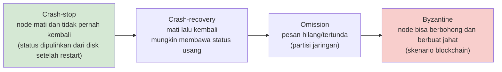

**Fase ini hanya menangani tiga yang pertama** (Byzantine membutuhkan konsensus BFT, dan sebagian besar sistem bisnis tidak membutuhkannya).

**Pemahaman kunci**: di jaringan asinkron, **Anda tidak bisa membedakan "pihak seberang mati" dan "pihak seberang sangat lambat"**. Inilah akar dari semua penderitaan dalam sistem terdistribusi.

### 17.2 timeout: tidak sesederhana "tinggal set satu nilai"

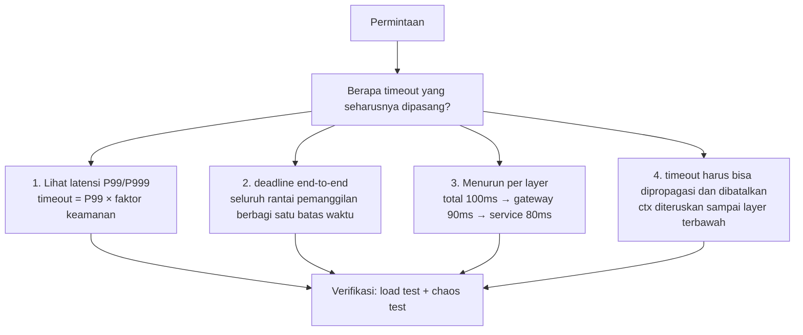

**Propagasi deadline (aturan yang paling penting)**:

```go
// ✅ Benar: pakai ctx yang sama, deadline ikut terpropagasi
func handle(w http.ResponseWriter, r *http.Request) {
    ctx := r.Context()                    // sudah berisi deadline dari klien/gateway
    val, err := kv.Get(ctx, key)          // pemanggilan DB di layer bawah juga membawa ctx
    // ...
}

// ❌ Salah: setiap layer memasang timeout sendiri, sampai layer dalam lebih panjang dari layer luar
ctx, cancel := context.WithTimeout(context.Background(), 5*time.Second)  // mengabaikan upstream
```

Aturan: **timeout harus menurun di sepanjang rantai pemanggilan**. Kalau timeout downstream lebih panjang dari upstream, maka setelah upstream timeout downstream masih berjalan → sumber daya terbuang sia-sia, dan retry akan memperburuk keadaan.

### 17.3 retry: fitur yang paling mudah menjatuhkan sistem

**Tiga bencana akibat retry**:

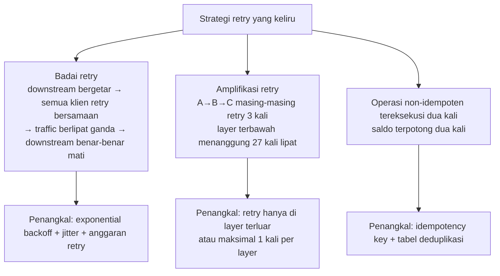

**Implementasi retry yang benar**:

```go
type RetryConfig struct {
    MaxAttempts    int
    InitialBackoff time.Duration
    MaxBackoff     time.Duration
    Multiplier     float64
    Jitter         bool
    Budget         *RetryBudget   // anggaran retry global (penting!)
}

func Do(ctx context.Context, cfg RetryConfig, fn func(context.Context) error) error {
    var lastErr error
    backoff := cfg.InitialBackoff
    for attempt := 0; attempt < cfg.MaxAttempts; attempt++ {
        if err := ctx.Err(); err != nil { return err }   // deadline sudah habis, jangan retry lagi

        if attempt > 0 {
            if cfg.Budget != nil && !cfg.Budget.TryConsume() {
                return fmt.Errorf("retry budget exhausted: %w", lastErr)
            }
            d := backoff
            if cfg.Jitter { d = jitter(backoff) }        // tambah jitter agar retry tidak sinkron
            select {
            case <-time.After(d):
            case <-ctx.Done():
                return ctx.Err()
            }
            backoff = min(time.Duration(float64(backoff)*cfg.Multiplier), cfg.MaxBackoff)
        }

        lastErr = fn(ctx)
        if lastErr == nil { return nil }
        if !isRetryable(lastErr) { return lastErr }      // 4xx jangan di-retry
    }
    return fmt.Errorf("after %d attempts: %w", cfg.MaxAttempts, lastErr)
}

// full jitter: acak di [0, backoff), paling efektif untuk memecah retry yang serentak
func jitter(d time.Duration) time.Duration {
    return time.Duration(rand.Int64N(int64(d)))
}
```

**Daftar aturan retry**:

| Aturan | Penjelasan |
| --- | --- |
| Hanya retry error yang **bisa di-retry** | connection error, timeout, 503, 429; **400/401/404 jangan di-retry** |
| Harus menghormati deadline | berhenti begitu `ctx.Err()` tidak nil |
| Exponential backoff + **jitter** | tanpa jitter akan terjadi "retry tersinkronisasi" (thundering herd) |
| **Anggaran retry** | jumlah retry global tidak lebih dari 10~20% traffic normal |
| Retry hanya operasi yang **idempoten** | atau jadikan idempoten terlebih dahulu |
| Hormati header `Retry-After` | server memberi tahu secara eksplisit berapa lama harus menunggu |
| Gabungkan dengan **circuit breaker** | kalau gagal terus-menerus, gagalkan cepat, jangan retry terus |

### 17.4 idempotency: membuat retry menjadi aman

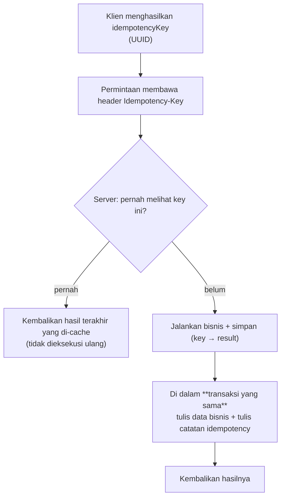

**Detail implementasi yang krusial**:

```go
func (s *Service) Transfer(ctx context.Context, idemKey string, req TransferReq) (*Result, error) {
    // Harus dalam satu transaksi: cek catatan idempotency + tulis data bisnis + tulis catatan idempotency
    tx, err := s.db.BeginTx(ctx, nil)
    if err != nil { return nil, err }
    defer tx.Rollback()

    // 1. Cek dulu apakah sudah pernah diproses (pakai SELECT ... FOR UPDATE atau deteksi konflik unique index)
    var prev Result
    if err := tx.GetContext(ctx, &prev,
        `SELECT result FROM idempotency WHERE key = $1`, idemKey); err == nil {
        return &prev, nil       // sudah diproses, langsung kembalikan
    }

    // 2. Jalankan logika bisnis
    if err := s.doTransfer(ctx, tx, req); err != nil { return nil, err }
    res := Result{OK: true}

    // 3. Catat hasil idempotency (ada unique index pada key; saat konkuren, konflik menjamin hanya satu yang sukses)
    _, err = tx.ExecContext(ctx,
        `INSERT INTO idempotency (key, result, created_at) VALUES ($1,$2,now())
         ON CONFLICT (key) DO NOTHING`, idemKey, res)
    if err != nil { return nil, err }

    if err := tx.Commit(); err != nil { return nil, err }
    return &res, nil
}
```

**Tiga level implementasi idempotency**:

| Level | Cara | Kapan dipakai |
| --- | --- | --- |
| Idempoten secara alami | `SET x = 5` (timpa nilai), `DELETE` | prioritaskan desain seperti ini |
| Deduplikasi dengan idempotency key | klien/gateway menghasilkan key, server melakukan deduplikasi | solusi umum |
| Validasi state machine | `UPDATE ... WHERE status = 'pending'` | bisnis dengan transisi status (CAS) |

**Masa retensi idempotency key**: harus lebih besar dari jendela retry klien (umumnya 24 jam), dan dibersihkan secara berkala.

### 17.5 Eksperimen: badai retry

```go
// Simulasikan 1000 klien yang memukul satu service yang sedang bergetar
// Bandingkan: tanpa backoff / backoff tetap / exponential backoff + jitter / dengan anggaran
```

Catat: **perbedaan success rate-nya akan mengejutkan**. Ini eksperimen yang paling meyakinkan di fase ini.

### 17.6 Deliverables

- `06-distributed-kv/week17/retry/`: library retry yang dapat dikonfigurasi + tes
- `06-distributed-kv/week17/idempotency/`: service idempoten + tes deduplikasi konkuren
- `docs/benchmarks/week17-retry-storm.md`: grafik perbandingan empat strategi

---

## Minggu 18 · Replikasi, Pemilihan Leader, Model Konsistensi

### 18.1 Tiga pola dasar replikasi

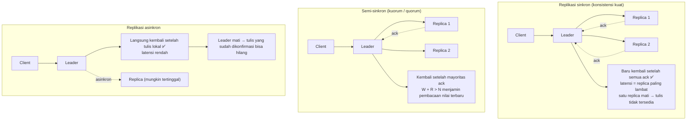

### 18.2 Matematika kuorum (quorum)

Misalkan ada `N` replica, tulis butuh `W` ack, baca butuh meng-query `R` replica:

- **Kondisi cukup untuk pembacaan konsisten kuat: `W + R > N`**
- Konfigurasi umum: `N=3, W=2, R=2` (3 replica, mentolerir 1 kegagalan)
- `N=3, W=1, R=3`: tulis cepat baca lambat (banyak tulis, sedikit baca)
- `N=3, W=3, R=1`: tulis lambat baca cepat (banyak baca, sedikit tulis)

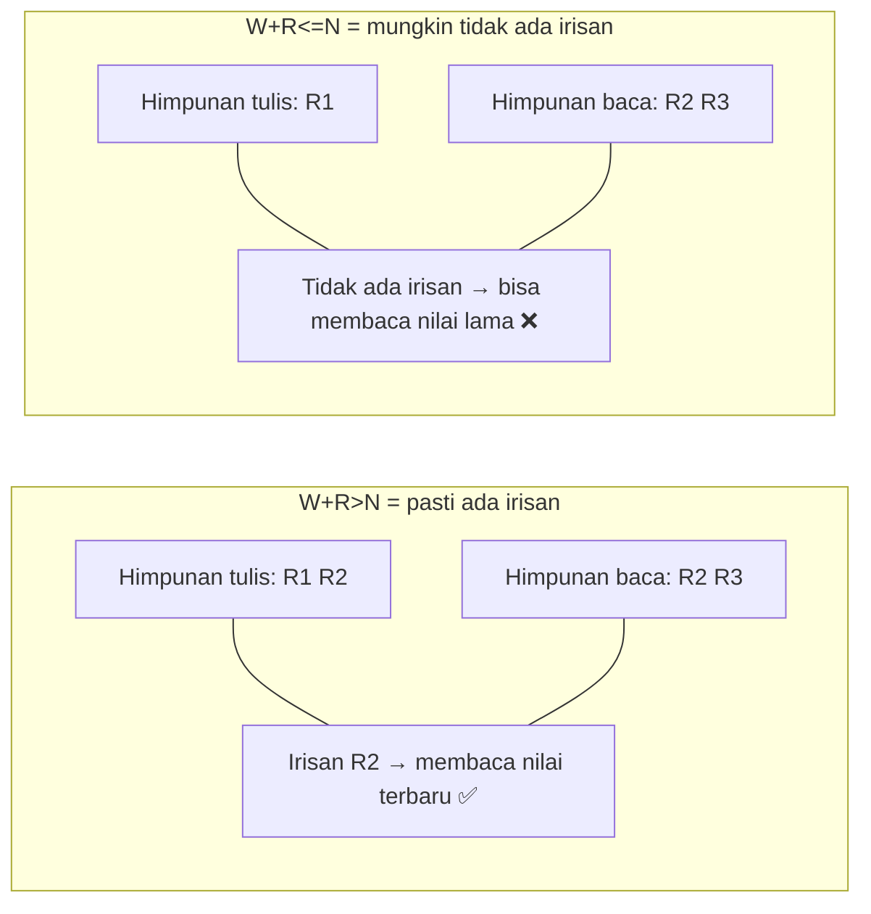

### 18.3 Spektrum model konsistensi (dari kuat ke lemah)

| Model | Jaminan | Biaya | Contoh tipikal |
| --- | --- | --- | --- |
| **Linearizable** (konsistensi linear) | semua operasi seolah dieksekusi pada satu titik dalam urutan waktu nyata | latensi tinggi, butuh konsensus | etcd/ZooKeeper, pembacaan Raft |
| **Sequential** (konsistensi sekuensial) | urutan tiap klien terjaga, dan ada satu urutan global tertentu | menengah | banyak sistem nyata |
| **Causal** (konsistensi kausal) | operasi yang punya hubungan sebab-akibat terjaga urutannya | butuh pelacakan dependensi (vector clock) | sebagian NoSQL |
| **Read-your-writes** | apa yang Anda tulis pasti bisa Anda baca sendiri | session sticky atau nomor versi | sistem web pada umumnya |
| **Eventual** (konsistensi eventual) | setelah penulisan berhenti, pada akhirnya konvergen | latensi rendah, availability tinggi, tapi bisa membaca nilai lama | DNS, replikasi asinkron |

**Anda harus bisa menjelaskan contoh ini**:

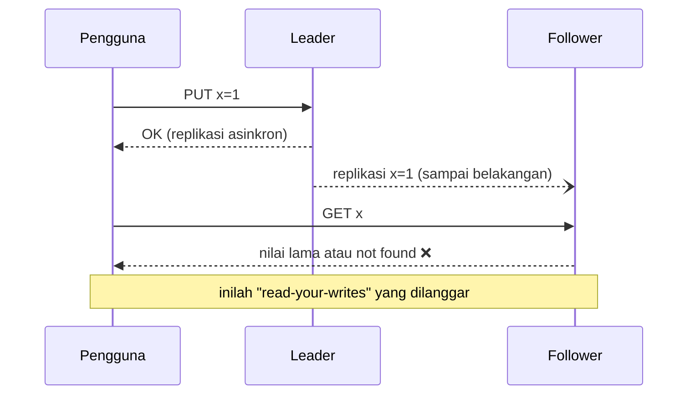

**Pemahaman CAP yang benar** (jangan cuma menghafal tiga huruf):

- **C** berarti **Linearizable** (bukan konsep kabur "data konsisten")
- **P** berarti **partisi jaringan** (di jaringan nyata pasti pernah terjadi, bukan pilihan)
- Jadi pilihan yang sebenarnya adalah: **saat partisi terjadi, pilih C atau A**
- Kerangka yang lebih praktis adalah **PACELC**: saat tidak ada partisi (E) pun kita tetap harus menimbang latensi (L) lawan konsistensi (C)

### 18.4 Leader election (Pemilihan Leader)

**Mengapa butuh pemilihan leader?** Karena banyak penulis perlu sepakat soal "urutan operasi", dan memilih leader adalah **cara paling sederhana** untuk mencapai konsensus (menyerahkan keputusan urutan kepada satu pihak).

**Dua jenis implementasi leader election**:

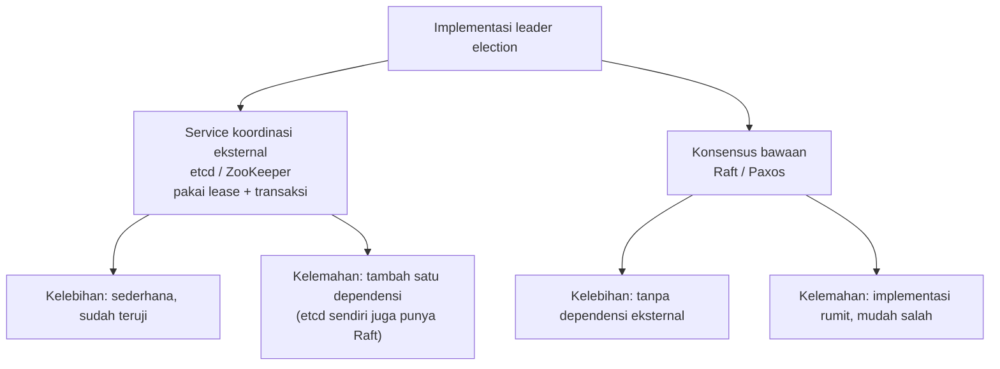

**Mekanisme lease (sewa)**:

```go
// Implementasi leader election dengan etcd (disederhanakan)
func campaign(ctx context.Context, cli *clientv3.Client, key, id string) error {
    s, err := concurrency.NewSession(cli, concurrency.WithTTL(10))
    if err != nil { return err }
    e := concurrency.NewElection(s, key)
    if err := e.Campaign(ctx, id); err != nil { return err }   // memblokir sampai menjadi leader

    // Setelah menjadi leader: perpanjang lease berkala + pantau kehilangan leadership
    select {
    case <-s.Done():          // lease kedaluwarsa (proses macet/putus jaringan)
        return ErrLostLeadership
    case <-ctx.Done():
        e.Resign(ctx)
        return ctx.Err()
    }
}
```

**Hal penting**: **lease kedaluwarsa ≠ saya bukan leader lagi**. Bisa saja terjadi "leader lama masih mengira dirinya leader" (jeda GC, partisi jaringan membuat perpanjangan lease gagal). Karena itu:

- Setiap operasi tulis harus **memvalidasi leadership** (fence token / epoch)
- Dari sinilah asal **fencing token**: nomor yang monotonik naik, dan layer penyimpanan menolak token yang lebih kecil

### 18.5 Eksperimen: KV primary-replica

```
Arsitektur:
  Client → Router → Primary (tulis + baca)
                  → Replica1 (hanya baca, replikasi asinkron)
                  → Replica2 (hanya baca, replikasi asinkron)

Implementasi:
  ✅ tulis harus lewat primary
  ✅ primary menulis lokal + meneruskan ke replica (bisa dikonfigurasi sinkron/asinkron/semi-sinkron)
  ✅ baca bisa dikonfigurasi: lewat primary (konsisten kuat) atau replica mana pun (mungkin usang)
  ✅ primary mati: promosikan satu replica secara manual/otomatis (di fase ini boleh manual)
  ✅ ada metrik replication lag
```

**Tes yang wajib ditulis**:

| Tes | Assertion |
| --- | --- |
| `TestWriteReplicated` | setelah tulis ke primary, pada akhirnya replica punya datanya |
| `TestAsyncLagCausesStaleRead` | saat ada replication lag, baca replica mendapat nilai lama (**ini perilaku yang diharapkan, Anda harus bisa menjelaskannya**) |
| `TestSyncWriteRequiresQuorum` | saat satu replica mati, tulis tetap sukses (kuorum) |
| `TestSyncWriteFailsWithoutQuorum` | saat dua replica mati, tulis gagal |
| `TestPromoteReplica` | setelah promosi, primary baru bisa menerima tulis |
| `TestStaleLeaderRejected` | setelah primary lama pulih, tulisnya ditolak (fencing) |

### 18.6 Deliverables

- `06-distributed-kv/week18/` implementasi + tes
- `docs/adr/0004-replication-strategy.md`
- Satu dokumen penjelasan: konsistensi jenis apa yang diberikan sistem ini? Dalam kondisi apa ia bisa dilanggar?

---

## Minggu 19 · Konsensus: Raft

### 19.1 Mengapa butuh Raft

Replikasi primary-replica dengan sendirinya **tidak menyelesaikan**:

- siapa leadernya (leader election)
- setelah leader mati, bagaimana menjamin tulis yang sudah di-commit tidak hilang
- saat partisi, bagaimana menghindari split-brain

Tujuan Raft: **algoritma konsensus yang bisa dipahami**. Ia memecah masalah menjadi tiga sub-masalah:

1. **Leader election** (pemilihan leader)
2. **Replikasi log** (log replication)
3. **Safety** (keamanan: log yang sudah di-commit tidak akan hilang)

### 19.2 Tiga peran dan term dalam Raft

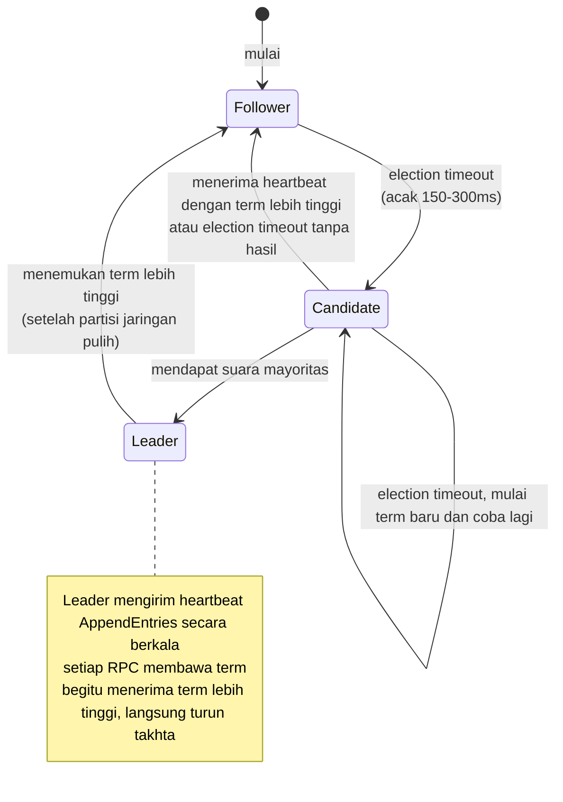

**Term (masa jabatan) adalah jam logika**:

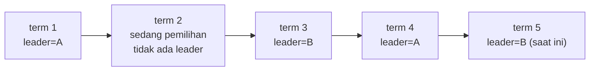

- Setiap node mempersistenkan `currentTerm`, `votedFor`, dan log
- Menerima permintaan dengan term lebih tinggi → segera perbarui term dan menjadi Follower
- **Satu term paling banyak satu leader** (dijamin oleh voting mayoritas)

### 19.3 Alur pemilihan

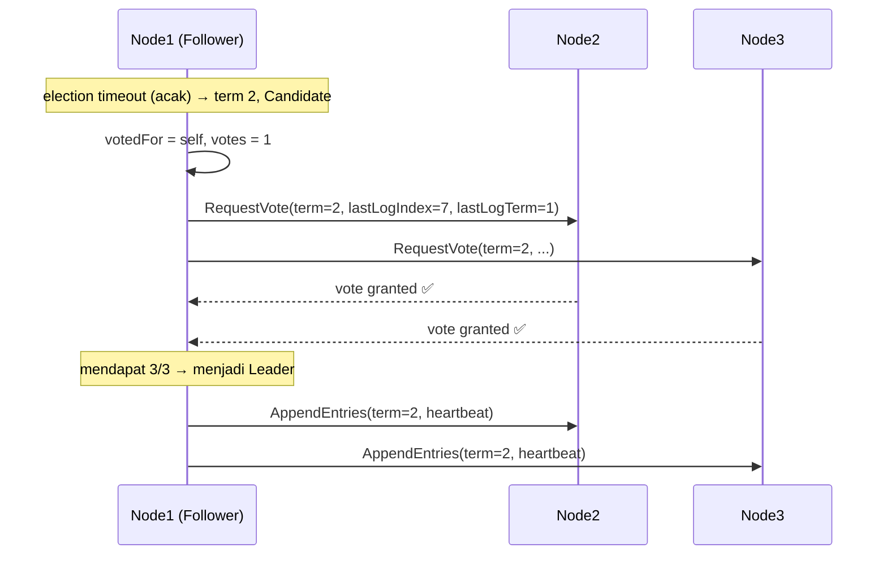

**Aturan voting ("paling tidak sama baru dengan saya")**:
- `(lastLogTerm, lastLogIndex)` kandidat harus **tidak lebih tertinggal** dari pemberi suara, kalau tidak maka ditolak
- Aturan ini menjamin: **leader yang terpilih pasti memuat semua entri log yang sudah di-commit**

**Pengacakan election timeout** bertujuan menghindari banyak node memulai pemilihan bersamaan yang berujung seri berulang.

### 19.4 Replikasi log

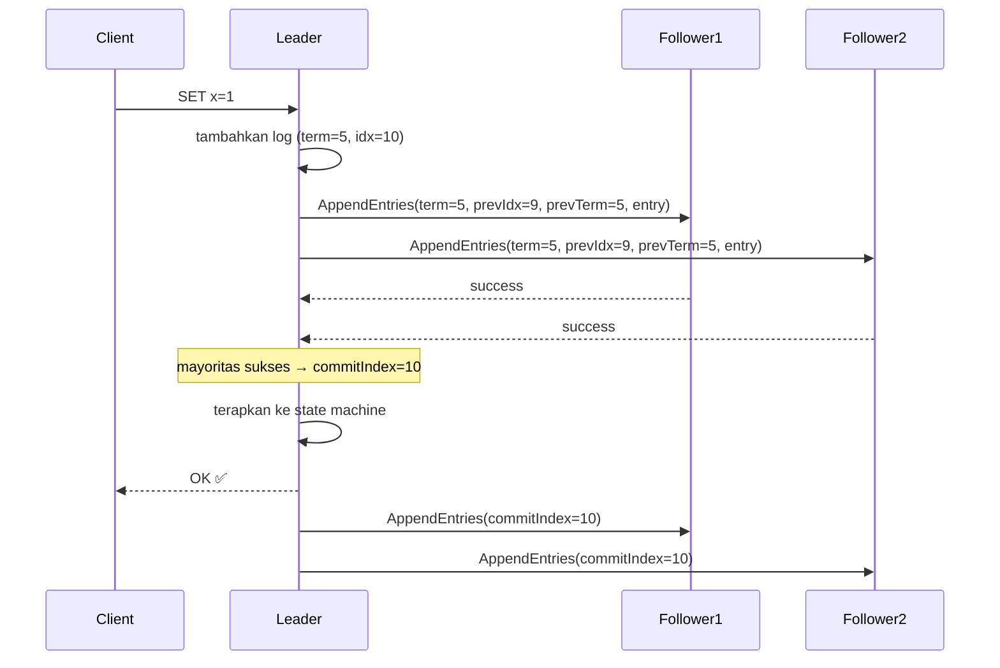

**Pemeriksaan konsistensi**: `AppendEntries` membawa `prevLogIndex` dan `prevLogTerm`. Kalau Follower menemukan ketidakcocokan ia menolak, lalu Leader memundurkan `nextIndex` dan mencoba lagi. **Inilah yang menjamin sifat "kecocokan awalan" pada log**.

### 19.5 Daftar implementasi (berurut dari yang paling mudah)

```
Fase A (harus selesai minggu ini):
  ✅ state machine node: Follower / Candidate / Leader
  ✅ persistensi: currentTerm, votedFor, log[]
  ✅ election timeout (diacak) + RPC RequestVote
  ✅ heartbeat AppendEntries (entries kosong)
  ✅ penambahan log + pemeriksaan konsistensi + pemunduran nextIndex
  ✅ pemajuan commitIndex + penerapan ke state machine

Fase B (nilai tambah):
  ⬜ kompresi log (snapshot)
  ⬜ perubahan keanggotaan (joint consensus)
  ⬜ ReadIndex / LeaseRead (pembacaan linearizable)
  ⬜ PreVote (mencegah gangguan term setelah partisi pulih)
```

**Poin penting state machine**:

```go
type Raft struct {
    mu sync.Mutex

    // Status yang dipersistenkan (setiap perubahan harus ditulis ke disk dulu sebelum merespons)
    currentTerm int
    votedFor    int
    log         []LogEntry   // index mulai dari 1

    // Status yang mudah hilang (volatile)
    commitIndex int
    lastApplied int
    state       State

    // Khusus Leader
    nextIndex  []int
    matchIndex []int

    // Komunikasi
    applyCh chan ApplyMsg
}
```

**6 titik yang paling sering salah ditulis** (hindari dari awal):

1. **Urutan persistensi**: `currentTerm` / `votedFor` harus **ditulis ke disk dulu baru membalas RPC**
2. **Granularitas lock**: di dalam RPC handler jangan memegang lock terus-menerus sambil melakukan I/O (bisa deadlock); pakai salinan data atau kunci tersegmentasi
3. **Pemeriksaan term**: setiap handler RPC harus menangani "menerima term lebih tinggi → turun takhta"
4. **Perhitungan commitIndex**: hanya boleh pakai median dari `matchIndex`, dan **hanya boleh meng-commit log pada term saat ini** (tidak boleh langsung meng-commit log dari term lama, kecuali ada log baru di term saat ini yang berhasil di-commit)
5. **Election timeout harus diacak**, dan harus lebih besar dari interval heartbeat (kalau tidak, leader tidak akan pernah terpilih)
6. **apply harus setelah commit**, dan harus dilakukan oleh goroutine terpisah secara serial

### 19.6 Pengujian dan fault injection

```bash
# Gaya MIT 6.5840: jalankan ribuan iterasi, suntikkan kegagalan acak
go test -run TestRaft -count=1 -race ./raft
go test -run TestRaftPartition -count=50 -race ./raft
```

| Tes | Skenario |
| --- | --- |
| `TestInitialElection` | apakah 3 node bisa memilih 1 leader |
| `TestReElection` | apakah pemilihan ulang terjadi setelah leader mati |
| `TestBasicAgree` | apakah log bisa konvergen saat tidak ada kegagalan |
| `TestFailAgree` | tetap bisa commit saat minoritas gagal |
| `TestFailNoAgree` | saat mayoritas gagal, **tidak boleh** commit |
| `TestConcurrentStarts` | commit konkuren tidak kehilangan log |
| `TestPartition` | setelah partisi: sisi mayoritas tetap bekerja; sisi minoritas tidak commit; konvergen setelah pulih |
| `TestPersist` | status benar setelah restart |
| `TestFigure8` | **kasus klasik**: mencegah kehilangan data akibat meng-commit log term lama secara langsung |

### 19.7 Deliverables

- `06-distributed-kv/raft/` implementasi + tes
- `docs/failure-analysis/raft-partition.md`: catatan eksperimen partisi (termasuk diagram sekuens)
- Penjelasan: apa yang **tidak** ditangani implementasi Anda? (snapshot, perubahan keanggotaan, dll. — sebutkan dengan jujur)

---

## Minggu 20 · Sharding, Partisi, Rebalancing, Pemulihan Kegagalan

### 20.1 Tujuan dan cara sharding

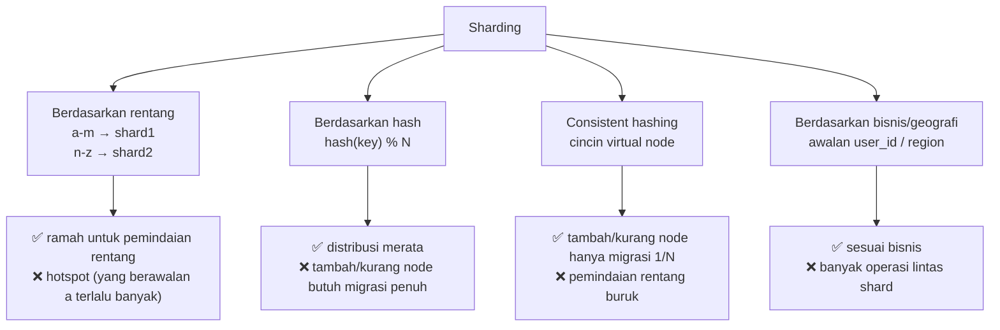

### 20.2 Consistent hashing

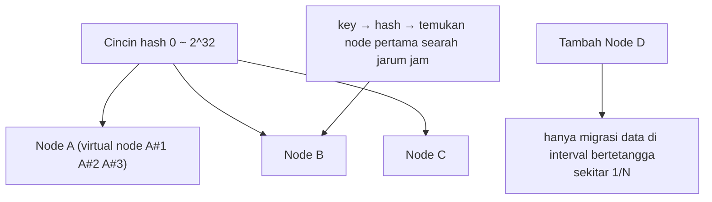

**Fungsi virtual node**: membuat beban lebih merata (kalau tidak, saat node sedikit distribusinya sangat timpang).

### 20.3 Risiko rebalancing

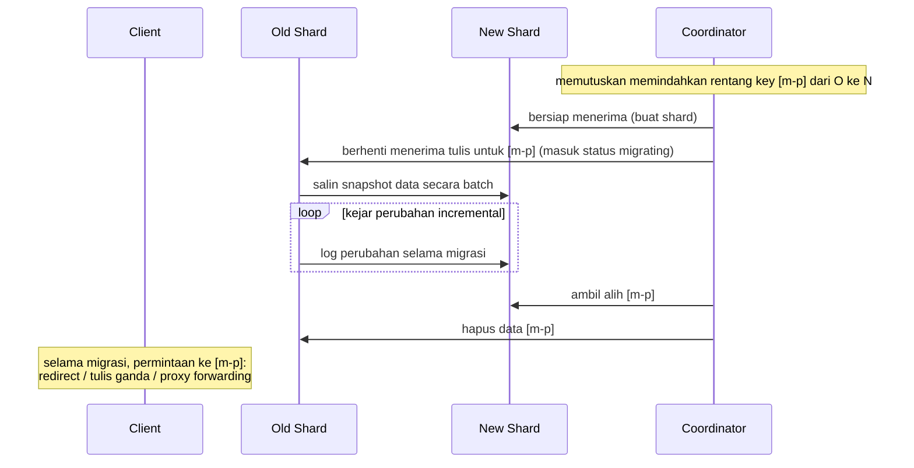

**Tiga masalah klasik selama migrasi**:

| Masalah | Gejala | Penangkal |
| --- | --- | --- |
| **Tulis ganda tidak konsisten** | data ada di dua sisi selama migrasi, salah satu update gagal | tulis ganda + verifikasi; atau kejar dengan log perubahan |
| **Badai redirect permintaan** | klien terus-menerus di-redirect | klien meng-cache tabel routing + nomor versi |
| **Migrasi terputus** | gagal di tengah, status setengah baru setengah lama | persistensikan status migrasi, dukung retry idempoten; simpan data lama sampai selesai dikonfirmasi |

### 20.4 Pengelolaan tabel routing

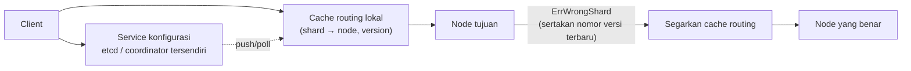

**Hal penting**: kesalahan routing seharusnya bukan exception, melainkan **aliran kontrol yang normal**. Saat mengembalikan `ErrWrongShard`, sertakan versi routing saat ini agar klien bisa menyegarkan otomatis.

### 20.5 Tiga tahap pemulihan kegagalan

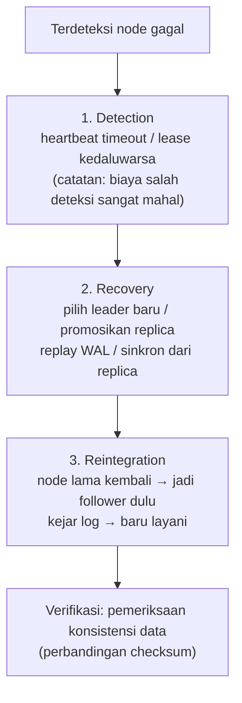

**Hal paling berbahaya saat pemulihan**: membiarkan node **dengan status usang** langsung ikut melayani. Ia harus dikejar dulu sampai setara.

### 20.6 Matriks fault injection (wajib dikerjakan)

| Jenis kegagalan | Cara menyuntikkan | Apa yang diamati | Perilaku yang diharapkan |
| --- | --- | --- | --- |
| Crash proses | `kill -9` lalu start lagi | apakah data utuh, apakah bisa bergabung kembali | data tidak hilang, otomatis mengejar ketertinggalan |
| Proses dijeda | `SIGSTOP` / `SIGCONT` | apakah memicu pemilihan leader yang salah | setelah lease timeout boleh digantikan |
| Latensi jaringan | `tc netem delay 500ms` | apakah timeout terpicu, apakah retry mengganda | timeout berlaku, retry punya anggaran |
| Packet loss jaringan | `tc netem loss 10%` | seberapa besar throughput turun, apakah ada badai retry | degradasi yang anggun |
| Partisi jaringan | `iptables` atau Docker network disconnect | perilaku kedua sisi, apakah konvergen setelah pulih | minoritas tidak bisa tulis, mayoritas tersedia, konsisten setelah pulih |
| Pergeseran clock | `date -s` atau libfaketime | apakah lease/timeout kacau | sistem tidak bergantung pada clock untuk menentukan kebenaran |
| Disk penuh | penuhi dengan `dd` | apakah crash, apakah error bisa dipulihkan | error jelas, tidak ada kerusakan diam-diam |
| Replica lambat | `sleep` buatan | apakah memperlambat keseluruhan (tail latency) | ada hedging atau backup request |

**Contoh fault injection dengan Docker Compose**:

```bash
# Partisi
docker network disconnect mynet node-c

# Pulihkan
docker network connect mynet node-c

# Jaringan lambat (butuh NET_ADMIN)
docker exec node-b sh -c "tc qdisc add dev eth0 root netem delay 200ms loss 5%"
```

### 20.7 Deliverables

- `06-distributed-kv/` sistem lengkap (sharding + replikasi + routing)
- `docker-compose.yml` + skrip fault injection `scripts/chaos/*.sh`
- `docs/failure-analysis/week20-matrix.md`: tabel di atas, diisi dengan hasil pengukuran nyata
- `docs/adr/0005-sharding-strategy.md`

---

## Checklist Fase 5

| # | Item pemeriksaan |
| --- | --- |
| 1 | Semua RPC punya timeout, dan deadline menurun di sepanjang rantai |
| 2 | Retry punya backoff + jitter + anggaran, dan hanya dilakukan pada operasi idempoten |
| 3 | Operasi tulis punya idempotency key atau idempoten secara alami |
| 4 | Bisa membedakan "node lambat" dan "node mati", dan tidak langsung melayani setelah salah mendeteksi |
| 5 | Ada mekanisme fencing untuk mencegah tulis dari leader lama |
| 6 | Saat partisi, sisi minoritas **menolak** tulis (bukan menulis lalu membuangnya) |
| 7 | Fault injection berupa **skrip otomatis** yang bisa dijalankan berulang |
| 8 | Ada dokumentasi replication lag dan tingkat konsistensi |
| 9 | `go test -race -count=N` stabil di bawah pengujian terdistribusi |
| 10 | README menyebutkan secara eksplisit "apa yang tidak dijamin" |

---

## Referensi

| Topik | Tautan |
| --- | --- |
| **MIT 6.5840 (materi utama)** | <https://pdos.csail.mit.edu/6.5840/> |
| Paper Raft | <https://raft.github.io/raft.pdf> |
| Visualisasi Raft (wajib dilihat) | <https://raft.github.io/> |
| Panduan Raft untuk mahasiswa (wajib dibaca untuk menghindari jebakan) | <https://thesquareplanet.com/blog/students-guide-to-raft/> |
| DDIA Bab 5-9 | <https://dataintensive.net/> |
| Laporan uji Jepsen (lihat bagaimana sistem nyata gagal) | <https://jepsen.io/analyses> |
| Catatan berbahasa Mandarin untuk Designing Data-Intensive Applications | cukup cari dengan kata kunci |
