# Fase 6 · Desain Sistem Lanjutan dan Rekayasa Produksi (Minggu ke-21–24)

> Lima fase sebelumnya membuat komponen-komponennya; fase ini menjawab: **begitu komponen itu dirangkai, apa yang terjadi di bawah traffic nyata dan kegagalan nyata.**

---

## Tujuan Fase

1. Mampu merancang dan mengimplementasikan task queue dengan semantik pengiriman yang jelas (termasuk DLQ dan visibility timeout);
2. Mampu membangun observabilitas end-to-end, dan memakainya untuk **benar-benar menemukan satu masalah**;
3. Mampu melakukan perencanaan kapasitas dan overload control, lalu memberikan kesimpulan yang berisi angka;
4. Mampu menghasilkan ADR, diagram arsitektur, laporan load test, dan runbook.

### Kriteria Kelulusan Fase (G6)

- [ ] Laporan load test: throughput / distribusi latensi / pemakaian sumber daya / lokasi bottleneck di beberapa tingkat konkurensi
- [ ] Observabilitas: tiga serangkai metrics + logs + traces, dan bisa dirangkai untuk menelusuri satu permintaan
- [ ] Minimal 3 ADR (termasuk opsi yang ditolak)
- [ ] Runbook: ≥5 skenario, masing-masing punya deteksi, lokalisasi, pemulihan, dan pencegahan

---

## Minggu 21 · Queue, Semantik Pengiriman, Idempotency, Pola Outbox

### 21.1 Mengapa butuh queue

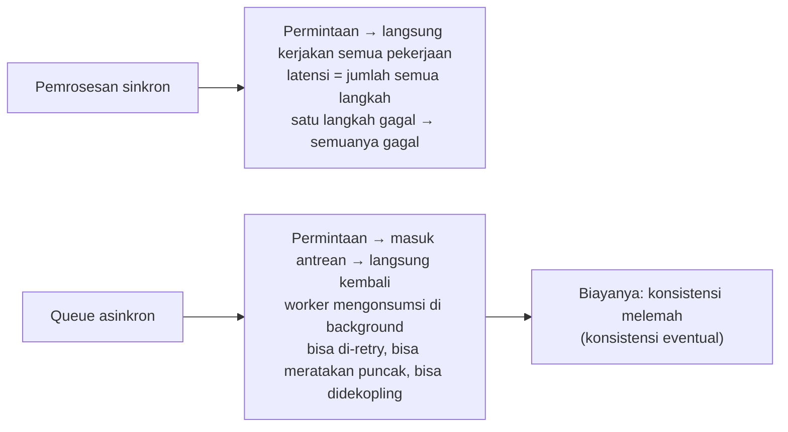

**Tiga masalah yang diselesaikan queue**:

| Masalah | Penjelasan |
| --- | --- |
| **Perataan puncak** | traffic mendadak masuk antrean dulu, diproses sesuai kapasitas konsumsi |
| **Dekopling** | produsen tidak perlu tahu siapa konsumennya dan ada berapa |
| **Keandalan** | kalau gagal bisa di-retry, tugas tidak hilang |

### 21.2 Semantik pengiriman (harus bisa dijelaskan dengan tepat, kata demi kata)

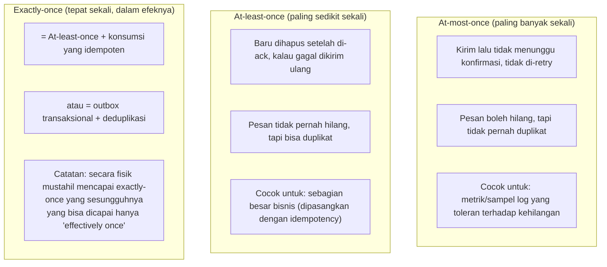

> **Faktanya**: dalam sistem terdistribusi **tidak ada** exactly-once secara fisik. Yang disebut exactly-once selalu berarti "pengiriman paling sedikit sekali + pemrosesan idempoten", atau "transaksi + deduplikasi". Bisa menjelaskan hal ini jauh lebih penting daripada sekadar menghafal istilahnya.

### 21.3 Mekanisme inti queue: visibility timeout

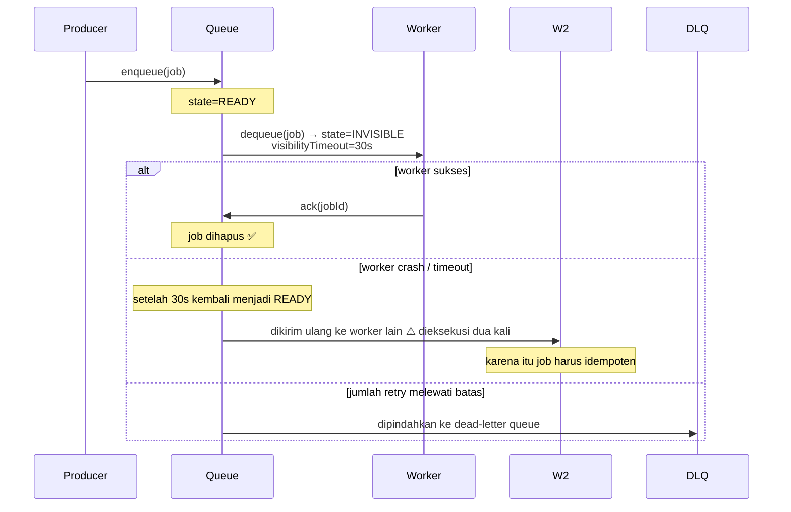

**Mengapa butuh visibility timeout? (bukan "hapus begitu diambil")**

- Hapus begitu diambil: worker crash → tugas **hilang selamanya**
- Visibility timeout: worker crash → tugas **kembali terlihat**, diproses worker lain
- Biayanya: **bisa dieksekusi dua kali** → karena itu logika konsumsi harus idempoten

**Mengimplementasikan queue dengan database** (cara yang paling umum di Go, supaya tidak perlu membawa Kafka/RabbitMQ):

```sql
-- Ambil satu batch tugas secara atomik (kuncinya: FOR UPDATE SKIP LOCKED)
UPDATE jobs
SET state = 'running',
    visible_until = now() + interval '30 seconds',
    attempts = attempts + 1,
    worker_id = $1
WHERE id IN (
    SELECT id FROM jobs
    WHERE state = 'ready' AND visible_until <= now()
    ORDER BY priority DESC, created_at
    LIMIT $2
    FOR UPDATE SKIP LOCKED      -- kuncinya: lewati baris yang sedang dikunci, banyak worker tidak saling memblokir
)
RETURNING *;
```

**`FOR UPDATE SKIP LOCKED` adalah intinya**: ia membuat banyak worker yang mengambil tugas secara konkuren tidak saling menunggu. Ini teknik standar untuk membuat queue di Postgres.

### 21.4 Dead-letter queue (DLQ)

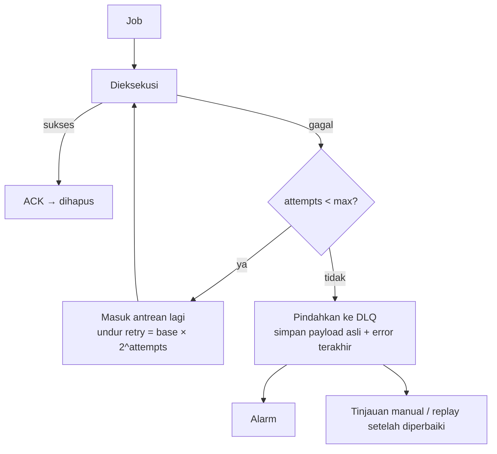

**Disiplin DLQ**:
- Isi DLQ harus **bisa diperiksa** (simpan payload lengkap dan stack error)
- Harus ada alarm (**DLQ yang tumbuh diam-diam adalah pertanda insiden yang paling sering terjadi**)
- Harus ada alat "replay", kalau tidak DLQ hanya akan jadi tempat sampah

```go
type Job struct {
    ID          string
    Type        string
    Payload     []byte
    State       string    // ready | running | done | dead
    Attempts    int
    MaxAttempts int
    VisibleUntil time.Time
    LastError   *string
    IdempotencyKey string   // opsional, untuk deduplikasi
    CreatedAt   time.Time
}
```

### 21.5 Pola outbox: menyelesaikan atomicitas antara "tulis database" dan "kirim pesan"

**Masalahnya**:

```go
// ❌ Kesalahan klasik: dua langkah, crash di tengah maka tidak konsisten
db.Exec("UPDATE orders SET status='paid'")   // sukses
mq.Publish("OrderPaid", id)                  // crash → pesan tidak pernah terkirim
// atau sebaliknya: pesan terkirim, database di-rollback → konsumen melihat data yang tidak ada
```

**Solusi outbox**:

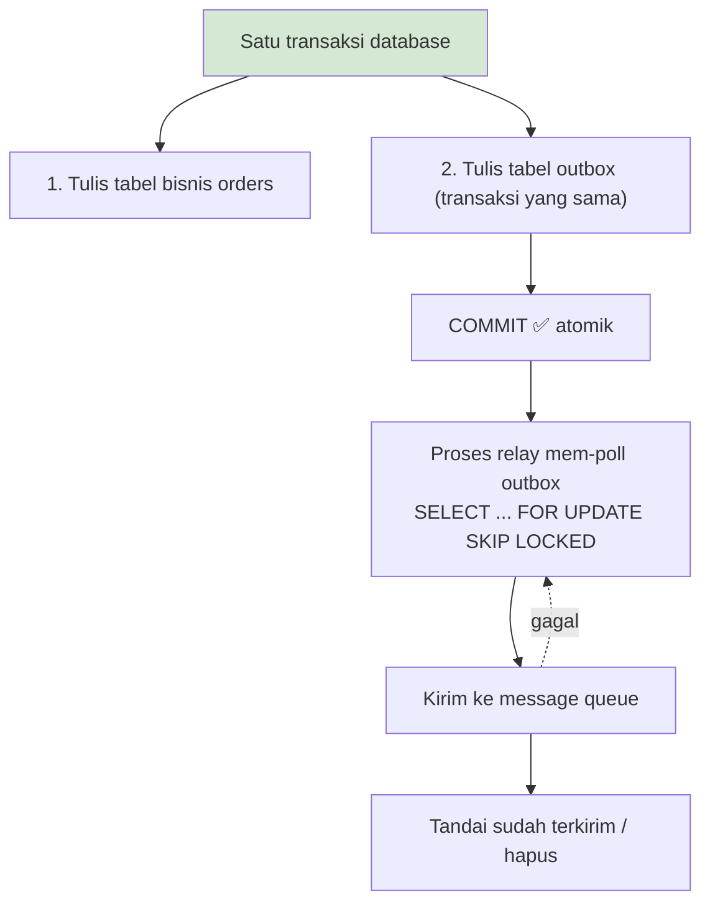

```sql
BEGIN;
  UPDATE orders SET status = 'paid' WHERE id = $1;
  INSERT INTO outbox (aggregate_id, event_type, payload)
  VALUES ($1, 'OrderPaid', $2);
COMMIT;
```

**Dua cara mengimplementasikan relay**:
- **Polling**: `SELECT * FROM outbox WHERE published_at IS NULL ORDER BY id LIMIT 100 FOR UPDATE SKIP LOCKED`
- **CDC (change data capture)**: baca WAL (Debezium / logical replication Postgres), latensi lebih rendah, tanpa beban polling

**Biayanya (wajib ditulis di ADR)**:
- Menambah latensi (interval polling)
- Tabel outbox akan terus bertumbuh, perlu dibersihkan
- Pesan tetap bisa **terkirim duplikat** (relay mengirim tapi crash sebelum menandai sukses) → konsumen tetap harus idempoten

### 21.6 Deliverables

- `07-job-queue/` implementasi lengkap (Postgres atau versi in-memory + abstraksi antarmuka)
- `docs/adr/0006-delivery-semantics.md`
- Tes: `TestAtLeastOnceDeliversEventually`, `TestDuplicateDeliveryIsIdempotent`, `TestDLQAfterMaxAttempts`, `TestVisibilityTimeoutRequeues`

---

## Minggu 22 · Observabilitas: Metrics, Tracing, Structured Logging

### 22.1 Tiga pilar dan pembagian tugasnya

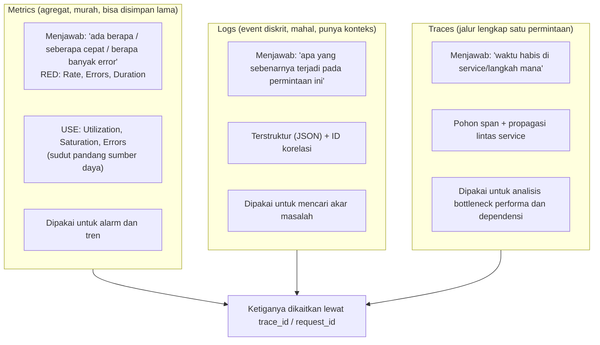

### 22.2 Metrics: empat tipe di Prometheus

| Tipe | Kegunaan | Contoh |
| --- | --- | --- |
| **Counter** | hanya naik | `http_requests_total`, `jobs_failed_total` |
| **Gauge** | bisa naik bisa turun | `queue_depth`, `goroutines`, `in_flight` |
| **Histogram** | statistik per bucket (bisa dihitung persentilnya) | `http_request_duration_seconds` |
| **Summary** | persentil di sisi klien (tidak bisa diagregasi) | jarang dipakai, bermasalah saat diagregasi lintas instance |

```go
var (
    reqTotal = prometheus.NewCounterVec(prometheus.CounterOpts{
        Name: "http_requests_total",
        Help: "Total HTTP requests.",
    }, []string{"method", "route", "status"})

    reqDur = prometheus.NewHistogramVec(prometheus.HistogramOpts{
        Name:    "http_request_duration_seconds",
        Help:    "Request duration.",
        Buckets: []float64{0.001, 0.005, 0.01, 0.05, 0.1, 0.5, 1, 5},
    }, []string{"method", "route"})

    queueDepth = prometheus.NewGauge(prometheus.GaugeOpts{
        Name: "worker_queue_depth",
        Help: "Number of jobs waiting.",
    })
)

func init() {
    prometheus.MustRegister(reqTotal, reqDur, queueDepth)
}

// Middleware
func instrument(next http.Handler) http.Handler {
    return http.HandlerFunc(func(w http.ResponseWriter, r *http.Request) {
        start := time.Now()
        rw := &statusRecorder{ResponseWriter: w, status: 200}
        next.ServeHTTP(rw, r)
        dur := time.Since(start).Seconds()
        reqTotal.WithLabelValues(r.Method, routeOf(r), strconv.Itoa(rw.status)).Inc()
        reqDur.WithLabelValues(r.Method, routeOf(r)).Observe(dur)
    })
}
```

**Query PromQL yang sering dipakai**:

```promql
# QPS (laju 5 menit)
sum(rate(http_requests_total[5m]))

# Rasio error
sum(rate(http_requests_total{status=~"5.."}[5m]))
  / sum(rate(http_requests_total[5m]))

# Latensi P99 (histogram_quantile, perhatikan bucket harus masuk akal)
histogram_quantile(0.99,
  sum by (le) (rate(http_request_duration_seconds_bucket[5m])))

# Saturasi: tren kedalaman antrean
worker_queue_depth
```

**Konvensi penamaan (diseragamkan di tim)**:
- Tulis satuannya di nama: `_seconds`, `_bytes`, `_total`
- Counter diakhiri `_total`
- Kardinalitas label harus dikendalikan: **jangan pakai user_id atau request_id sebagai label** (ledakan kardinalitas akan membuat Prometheus kewalahan)

### 22.3 Structured Logging

```go
// Go 1.21+ dengan log/slog dari pustaka standar
logger := slog.New(slog.NewJSONHandler(os.Stdout, &slog.HandlerOptions{
    Level: slog.LevelInfo,
}))
slog.SetDefault(logger)

// Log yang membawa konteks
slog.InfoContext(ctx, "order created",
    "order_id", id,
    "user_id", userID,
    "amount", amount,
    "trace_id", trace.SpanContextFromContext(ctx).TraceID().String(),
)
```

**Aturan logging**:

| Aturan | Penjelasan |
| --- | --- |
| Terstruktur (JSON) | bisa di-query, jangan mengandalkan parsing regex |
| Ada request_id / trace_id | bisa dirangkai |
| Level jelas | ERROR=butuh tindakan manusia, WARN=ada keanehan tapi bisa lanjut, INFO=event penting, DEBUG=untuk investigasi |
| Jangan menulis INFO di hot path | log itu sendiri adalah I/O, biayanya mahal |
| **Jangan mencatat informasi sensitif** | kata sandi, token, nomor identitas, nomor kartu lengkap |
| Catat error sekali saja | jangan log error yang sama di setiap layer (akan menenggelamkan alarm) |

### 22.4 Distributed Tracing (OpenTelemetry)

```go
import (
    "go.opentelemetry.io/otel"
    "go.opentelemetry.io/otel/trace"
)

// Sisi server: ekstrak konteks dari header HTTP
func handler(w http.ResponseWriter, r *http.Request) {
    ctx, span := tracer.Start(r.Context(), "handler.createOrder",
        trace.WithAttributes(
            attribute.String("order.type", req.Type),
        ),
    )
    defer span.End()

    user, err := svc.LoadUser(ctx, req.UserID)   // ctx terus diteruskan ke bawah
    if err != nil {
        span.RecordError(err)
        span.SetStatus(codes.Error, err.Error())
        return
    }
    span.AddEvent("user loaded")
}

// Propagasi: klien HTTP harus menyuntikkan header
req, _ := http.NewRequestWithContext(ctx, "GET", url, nil)
otel.GetTextMapPropagator().Inject(ctx, propagation.HeaderCarrier(req.Header))
```

**Atribut span vs event vs metrik**:

| Mekanisme | Kegunaan |
| --- | --- |
| Attribute | mendeskripsikan **dimensi** span ini (untuk filter/pengelompokan) |
| Event | **titik waktu** di dalam span (misalnya "cache miss") |
| Link | mengaitkan span yang tidak bertalian (misalnya pemrosesan batch) |
| Status | sukses/gagal |

**Strategi sampling** (biaya vs cakupan):

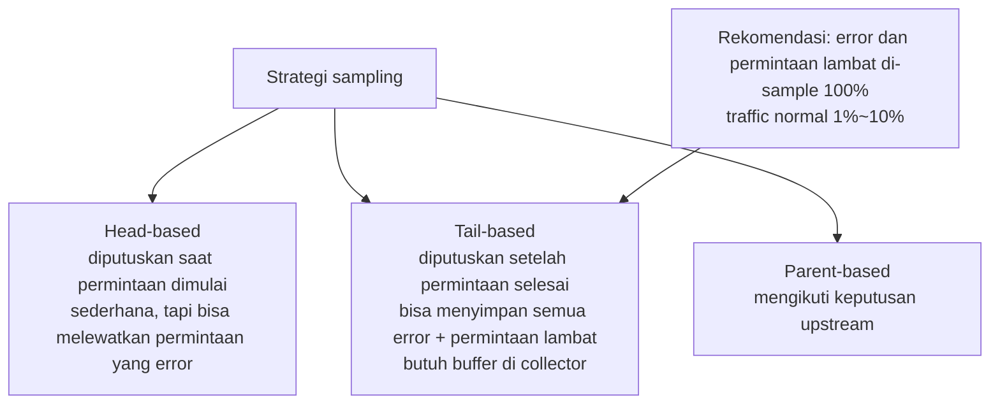

### 22.5 Satu latihan penanganan insiden end-to-end (latihan inti minggu ini)

Skenario: seseorang melaporkan "P99 endpoint pemesanan naik dari 200ms menjadi 2s".

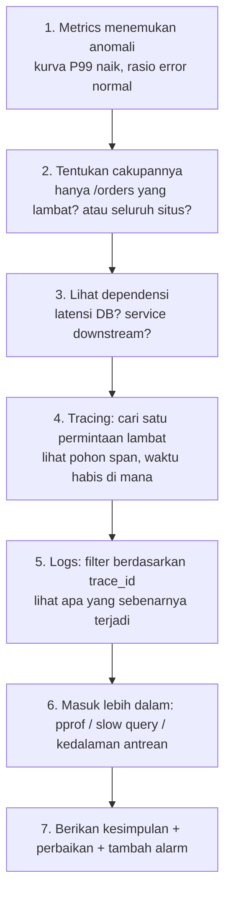

**Yang dikirimkan**: satu **Laporan Penanganan Insiden** yang menjelaskan dengan jelas alat apa yang dipakai di setiap langkah, apa yang terlihat, dan berapa lama waktu yang dihabiskan. **Laporan ini lebih membuktikan kemampuan Anda daripada sertifikasi apa pun.**

### 22.6 Deliverables

- `08-observability/`: `docker-compose.yml` (Prometheus + Grafana + Tempo/Jaeger + Loki)
- Service terintegrasi dengan OTel + Prometheus + slog
- Dashboard Grafana dalam bentuk JSON (dua panel: RED + USE)
- `docs/failure-analysis/week22-triage.md`: laporan penanganan insiden

---

## Minggu 23 · Perencanaan Kapasitas, Load Test, Overload Control

### 23.1 Teori antrean: mengapa latensi meledak saat utilisasi > 80%

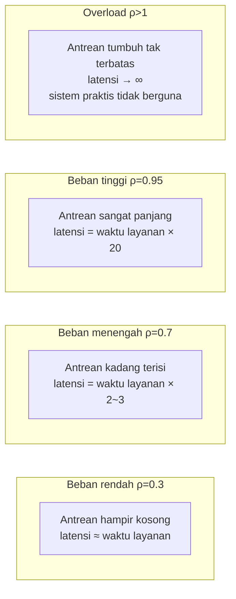

**Rumus inti (Little's Law)**:

```
L = λ × W
Panjang antrean = laju kedatangan × waktu tinggal rata-rata
```

Serta waktu tunggu M/M/1: `W = 1 / (μ - λ)`, dengan `μ` adalah laju layanan dan `λ` adalah laju kedatangan.
Ketika `λ → μ`, maka `W → ∞`. **Inilah sebabnya kita harus menyisakan ruang cadangan.**

**Kesimpulan rekayasa**:
- Utilisasi target biasanya **60~70%** (bukan 95%)
- Harus ada rate limiting, kalau tidak saat `λ > μ` sistem akan kolaps, bukan sekadar melambat
- **Amplifikasi tail latency**: satu permintaan fan-out ke 100 node, masing-masing P99 = 100ms, maka P99 keseluruhan akan sangat buruk (peluang ada satu yang lambat sangat tinggi)

### 23.2 Metode load test

```bash
# vegeta (ditulis dalam Go, outputnya ramah)
echo "GET http://localhost:8080/api/orders" | \
  vegeta attack -rate=100/s -duration=60s -timeout=5s | \
  vegeta report -type=text

# Beberapa tingkat konkurensi, gambar kurvanya
for r in 10 50 100 200 500 1000; do
  echo "GET http://localhost:8080/api/orders" | \
    vegeta attack -rate=$r/s -duration=30s > results_$r.bin
  echo "=== rate=$r ==="
  vegeta report -type=text results_$r.bin | head -20
done

# Hasilkan laporan HTML
vegeta plot results_100.bin > plot.html

# wrk (lebih dekat ke load test HTTP murni)
wrk -t4 -c100 -d30s --latency http://localhost:8080/api/orders
```

**Disiplin load test (yang mudah terlewat)**:

| Aturan | Penjelasan |
| --- | --- |
| Pisahkan mesin load test dan mesin service | kalau tidak, Anda sedang menguji alat load test-nya |
| Pemanasan | jalankan 30s dulu sebelum mulai menghitung (JIT, connection pool, cache) |
| Naikkan beban bertahap | langsung memukul penuh hanya memberi satu titik data: "sudah hancur" |
| Kumpulkan metrik sisi server bersamaan | CPU, memori, GC, goroutine, kedalaman antrean |
| Catat lingkungannya | jumlah core, memori, tipe disk, versi Go, GOMAXPROCS |
| Uji sampai "titik belok" | temukan titik di mana throughput berhenti naik sementara latensi melonjak |

**Output wajib memuat** (bukan cuma satu angka QPS):

| Konkurensi | Throughput (req/s) | P50 | P90 | P99 | P999 | Rasio error | CPU | Memori |
| --- | --- | --- | --- | --- | --- | --- | --- | --- |
| 10 | | | | | | | | |
| 50 | | | | | | | | |
| 100 | | | | | | | | |
| ... | | | | | | | | |

### 23.3 Empat cara overload control

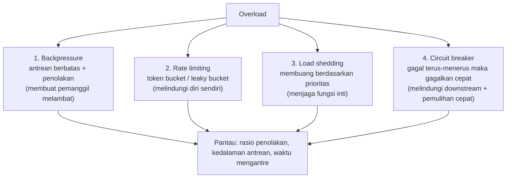

**Rate limiting dengan token bucket (direkomendasikan)**:

```go
// Pakai golang.org/x/time/rate
limiter := rate.NewLimiter(rate.Limit(1000), 100)  // 1000 QPS, kapasitas bucket 100 (burst yang diizinkan)

func middleware(next http.Handler) http.Handler {
    return http.HandlerFunc(func(w http.ResponseWriter, r *http.Request) {
        if !limiter.Allow() {
            w.Header().Set("Retry-After", "1")
            http.Error(w, "rate limited", http.StatusTooManyRequests)
            metrics.limited.Inc()
            return
        }
        next.ServeHTTP(w, r)
    })
}
```

**Tiga status circuit breaker**:

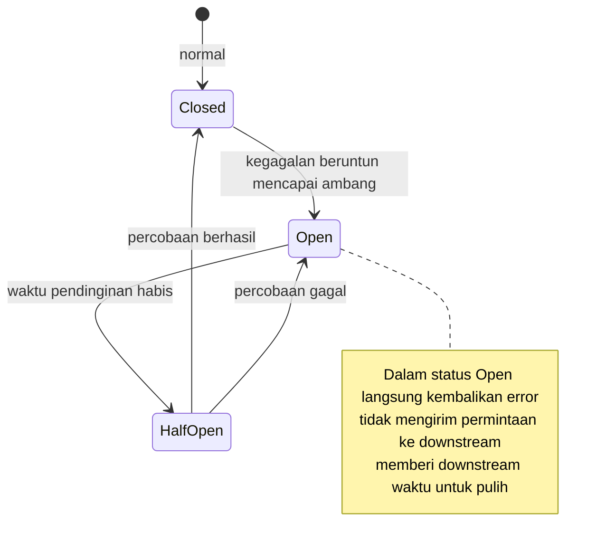

**Pembatasan konkurensi adaptif (LIFO + CoDel)**:
- Saat antrean penuh, buang permintaan yang **paling lama** dulu (LIFO): permintaan lama kemungkinan besar sudah timeout, melayaninya tidak ada gunanya
- Atau pakai CoDel: kalau waktu mengantre melewati target (misalnya 5ms), mulailah membuang

### 23.4 Alur perencanaan kapasitas

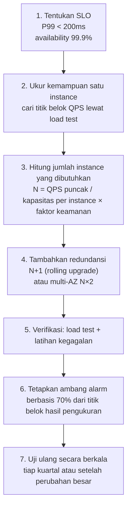

**Contoh perhitungan** (tulis di laporan):

```
QPS puncak: 5000
Kapasitas aman per instance (70% dari titik belok load test): 350 QPS
Instance yang dibutuhkan: 5000 / 350 ≈ 15
Tambah redundansi N+1: 16
Deployment multi-AZ: 16 × 2 = 32 (tiap AZ menanggung beban penuh)
```

### 23.5 Deliverables

- `docs/benchmarks/week23-loadtest.md`: laporan load test lengkap (tabel di atas terisi + analisis titik belok + lokalisasi bottleneck)
- Implementasi rate limiting / circuit breaker + tes
- `docs/adr/0007-overload-strategy.md`

---

## Minggu 24 · Trade-off Arsitektur, Analisis Kegagalan, Kesiapan Produksi

### 24.1 ADR: seperti apa yang bisa disebut berguna

```markdown
# ADR-0007: Memakai rate limiting token bucket, bukan fixed window counter

## Status
Accepted (2026-XX-XX) · menggantikan ADR-0003

## Konteks
Service pemesanan mengalami kenaikan P99 dari 200ms ke 3.2s saat puncak promo, dan muncul OOM.
Load test menunjukkan: saat konkurensi > 800, antrean tumbuh tanpa batas (lihat docs/benchmarks/week23).

## Keputusan
Gunakan rate limiting token bucket dari golang.org/x/time/rate di layer API gateway:
- Laju stabil 1000 QPS
- Kapasitas burst 100 (mengizinkan puncak singkat)
- Jika dilampaui, kembalikan 429 + Retry-After

## Opsi alternatif
| Opsi | Kelebihan | Kelemahan | Mengapa ditolak |
| --- | --- | --- | --- |
| Fixed window counter | implementasi sederhana | di batas window bisa meloloskan 2× traffic | lonjakan di batas window tidak bisa diterima |
| Sliding window | presisi | memori O(jumlah permintaan) | overhead memori besar |
| Tanpa rate limiting, andalkan scaling | tidak ada perubahan kode | tidak sanggup menghadapi lonjakan setingkat flash sale; biaya tinggi | load test sudah membuktikan akan OOM |

## Konsekuensi
Positif: P99 stabil di bawah 210ms; OOM hilang.
Negatif: sekitar 0.3% permintaan ditolak (429). Perlu logika retry di sisi klien.
Masih dipantau: apakah kapasitas burst 100 sudah tepat, perlu disesuaikan setelah promo besar berikutnya.

## Cara verifikasi
Setelah `vegeta attack -rate=2000/s -duration=60s`, periksa:
- Proporsi 429 < 1%
- P99 < 250ms
- Memori stabil
```

**Empat elemen wajib ADR**: konteks (berisi data), keputusan (konkret), alternatif beserta **alasan penolakan**, konsekuensi (termasuk yang negatif).
ADR tanpa "alasan penolakan" hanya catatan peristiwa sesudahnya, tidak punya nilai sebagai keputusan.

### 24.2 Proyek akhir `go-infrastructure-lab`

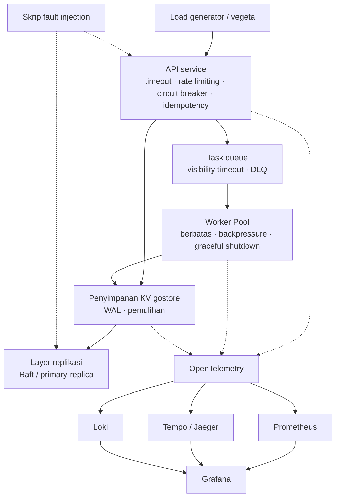

**Persyaratan minimum** (jangan menumpuk komponen hanya demi menggenapi daftar):

| Komponen | Persyaratan |
| --- | --- |
| API service | punya timeout, rate limiting, idempotency key, graceful shutdown |
| Queue/Worker | berbatas, bisa dibatalkan, punya DLQ |
| Penyimpanan | punya WAL, bisa pulih setelah restart |
| Observabilitas | metrik RED + log terstruktur + minimal satu trace |
| Load test | laporan multi-tingkat konkurensi + titik belok |
| Kegagalan | injeksi ≥3 skenario + dokumen pemulihan |

> **Pengingat**: jangan memasukkan semuanya ke dalam satu proses. Tujuannya adalah memahami **batasan dan trade-off**, bukan menang lomba "siapa folder GitHub-nya paling banyak".

### 24.3 Template runbook

Setiap skenario memuat empat bagian: **deteksi → lokalisasi → pemulihan → pencegahan**.

```markdown
## Skenario: Latensi P99 tiba-tiba naik

### Deteksi
- Alarm: `histogram_quantile(0.99, rate(http_request_duration_seconds_bucket[5m])) > 0.5` selama 5 menit
- Dashboard: Grafana → "Service RED"

### Lokalisasi (jalankan berurutan, tiap langkah sekitar 2-5 menit)
1. Seluruh situs atau satu endpoint? → kelompokkan `http_request_duration_seconds` berdasarkan route
2. Masalahnya sendiri atau dependensi? → lihat proporsi waktu span DB/downstream di dalam trace
3. Sumber daya atau lock? → lihat CPU profile (kalau CPU tinggi) atau block profile (kalau CPU rendah)
4. Apakah GC? → `GODEBUG=gctrace=1` atau lihat `go_gc_duration_seconds`
5. Antrean menumpuk? → apakah `worker_queue_depth` terus naik

### Pemulihan
- Kalau karena lonjakan traffic: pastikan rate limiting sudah berjalan; bila perlu scaling sementara
- Kalau karena downstream lambat: pastikan circuit breaker sudah terbuka; aktifkan degradasi (kembalikan cache/nilai default)
- Kalau karena GC: sementara setel `GOGC` (mengobati gejala), lalu turunkan laju alokasi (mengobati akar masalah)
- Kalau karena deadlock/pemblokiran: rollback perubahan terakhir

### Pencegahan
- Load test mencakup tingkat traffic tersebut (saat ini baru diuji sampai 1000 QPS, padahal puncak nyata 2000)
- Tambah alarm kedalaman antrean
- Akar masalah kali ini: ______ (wajib diisi setelah kejadian)
```

**Tulis minimal 5 skenario**:

1. Latensi P99 naik
2. Rasio error melonjak
3. Memori terus bertumbuh (dugaan kebocoran)
4. Jumlah goroutine meledak
5. Antrean menumpuk dan tidak dikonsumsi
6. Disk penuh
7. Replica tertinggal / replikasi terputus
8. Service dependensi tidak tersedia

### 24.4 Checklist kesiapan produksi (Production Readiness)

| Kategori | Item pemeriksaan |
| --- | --- |
| **Konfigurasi** | semua nilai timeout, connection pool, dan rate limiting bisa dikonfigurasi lewat environment variable; punya nilai default dan divalidasi |
| **Graceful shutdown** | menangani SIGTERM; `Shutdown` punya timeout; permintaan yang sedang berjalan bisa diselesaikan |
| **Health check** | `/healthz` (liveness), `/readyz` (readiness, termasuk pemeriksaan dependensi); **readiness jangan bergantung secara berantai** |
| **Batas sumber daya** | limit memori dipasang; `GOMEMLIMIT` selaras dengan limit container; `GOMAXPROCS` sadar cgroup |
| **Log** | terstruktur; ada request_id/trace_id; tanpa informasi sensitif; level bisa dikendalikan |
| **Metrik** | RED + saturasi; jalur kritis punya histogram; tanpa label berkekardinalan tinggi |
| **Alarm** | berbasis gejala (SLO) bukan penyebab; tiap alarm punya tautan runbook; tidak ada alarm "serigala datang" |
| **Dependensi** | semua pemanggilan eksternal punya timeout, retry, dan circuit breaker; ada jalur degradasi |
| **Data** | ada backup; backup **pernah dilatih untuk dipulihkan**; ada target waktu pemulihan (RTO) dan target titik pemulihan (RPO) |
| **Deployment** | bisa di-rollback; ada canary; ada strategi backward compatible untuk migrasi database |
| **Keamanan** | rahasia tidak masuk ke kode/image; TLS 1.2+; validasi input; pemindaian kerentanan dependensi |
| **Dokumentasi** | README berisi diagram arsitektur, cara menjalankan, dan **batasan yang diketahui** |

### 24.5 Paket penyerahan akhir

```
docs/
├── architecture/
│   ├── overview.mmd          # gambaran keseluruhan sistem
│   ├── request-flow.mmd      # urutan permintaan
│   └── data-flow.mmd         # aliran data dan persistensi
├── adr/
│   ├── 0001-framing-choice.md
│   ├── 0002-lsm-vs-btree.md
│   ├── 0003-transaction-atomicity.md
│   ├── 0004-replication-strategy.md
│   ├── 0005-sharding-strategy.md
│   ├── 0006-delivery-semantics.md
│   └── 0007-overload-strategy.md
├── benchmarks/
│   ├── week02-ptr-vs-value.md
│   ├── week05-profile.md
│   ├── week08-sync.md
│   ├── week14-fsync.md
│   ├── week17-retry-storm.md
│   └── week23-loadtest.md
└── failure-analysis/
    ├── raft-partition.md
    ├── week20-matrix.md
    ├── week22-triage.md
    └── runbook.md
```

---

## Referensi

| Topik | Tautan |
| --- | --- |
| OpenTelemetry Go | <https://opentelemetry.io/docs/languages/go/> |
| Praktik terbaik Prometheus | <https://prometheus.io/docs/practices/naming/> |
| Google SRE Book (Bab 4/6/22) | <https://sre.google/books/> |
| Site Reliability Engineering · Penanganan overload | <https://sre.google/sre-book/handling-overload/> |
| vegeta | <https://github.com/tsenart/vegeta> |
| Template ADR (MADR) | <https://adr.github.io/madr/> |
| Little's Law dan teori antrean | cari "Little's Law capacity planning" |
