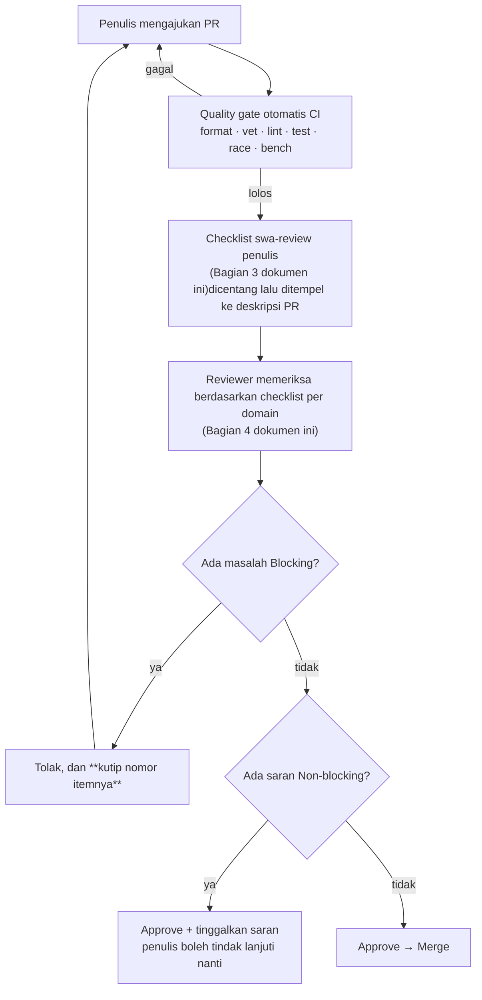
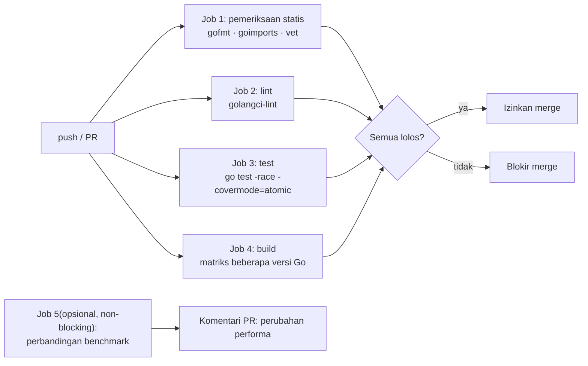
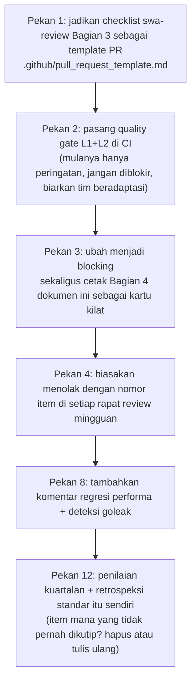

# Standar Code Review dan Quality Gate (bisa langsung diterapkan tim)

> Dokumen ini menyelesaikan separuh lain dari "peningkatan kemampuan teknis": **bagaimana membuat output setiap orang di tim mencapai batas bawah yang sama.**
> Seberapa baik pun individu belajar, tanpa standar review dan quality gate otomatis, rata-rata level tim tetap ditentukan oleh commit yang paling asal-asalan.

---

## 0. Samakan Dulu Tiga Istilah

| Istilah | Definisi | Contoh |
| --- | --- | --- |
| **Bug** | Kode tidak bekerja sesuai maksud penulisnya | Kurang satu pengecekan batas |
| **Defect** | Kode bisa jalan, tapi perilakunya tidak dapat diterima pada kondisi tertentu | Antrean tak berbatas menyebabkan OOM |
| **Smell** | Bukan salah, tapi menaikkan probabilitas error di masa depan | Mencampur receiver value/pointer |

Tujuan review bukan memusnahkan smell (itu tidak akan ada habisnya diperdebatkan), melainkan **memprioritaskan menangkap bug dan defect**.

---

## 1. Alur Review



### Tiga Aturan Besi

1. **Penolakan wajib mengutip nomor item**(misalnya "melanggar C-3"). Penolakan tanpa nomor akan berubah menjadi debat subjektif.
2. **Saran Non-blocking tidak memblokir merge**. Reviewer tidak boleh menjadikan "saya lebih suka cara penulisan lain" sebagai Blocking.
3. **Swa-review penulis mendahului review orang lain**. PR tanpa checklist swa-review boleh langsung tidak dilihat oleh reviewer.

---

## 2. Definisi Tingkat Keparahan

| Level | Arti | Penanganan |
| --- | --- | --- |
| **Blocker** | Menyebabkan kehilangan data, celah keamanan, crash produksi, kebocoran resource | Wajib diperbaiki |
| **Major** | Akan bermasalah di jalur beban tinggi/error; atau jelas melanggar konvensi arsitektur | Wajib diperbaiki |
| **Minor** | Keterbacaan, penamaan, pemeliharaan | Disarankan diperbaiki, tidak memblokir |
| **Nit** | Murni gaya penulisan | Opsional, jangan buang waktu di sini |

---

## 3. Checklist Swa-review Penulis(wajib diisi sebelum mengajukan PR)

```markdown
### Checklist Swa-review
- [ ] `gofmt` / `goimports` sudah dijalankan
- [ ] `go vet ./...` tidak mengeluarkan output
- [ ] `golangci-lint run` tidak ada peringatan baru
- [ ] Kode yang ditambahkan/diubah punya test, dan mencakup jalur kegagalan
- [ ] `go test -race ./...` lolos(wajib untuk kode konkuren)
- [ ] Perubahan terkait performa menyertakan perbandingan `benchstat` sebelum/sesudah
- [ ] Semua goroutine baru punya jalur keluar
- [ ] Semua resource(fd / conn / ticker / body)di-defer close
- [ ] Semua pemanggilan eksternal punya timeout/pembatalan
- [ ] Penanganan error tidak menelan error(tidak ada `_ = err`)
- [ ] Tidak ada angka ajaib yang di-hardcode(atau sudah diberi komentar yang menjelaskan asalnya)
- [ ] README / dokumentasi sudah diperbarui sinkron
- [ ] Keterbatasan yang diketahui sudah ditulis di dokumentasi
```

---

## 4. Checklist Review(per domain)

### A. Ke-benaran Umum(semua kode)

| # | Item Pemeriksaan | Level | Masalah Khas |
| --- | --- | --- | --- |
| A-1 | Apakah error ditangani dengan benar(tidak ditelan, tidak panic mentah-mentah) | Blocker | `_ = doSomething()` |
| A-2 | Apakah error membawa konteks(`fmt.Errorf("...: %w", err)`) | Major | Informasi rantai pemanggilan hilang |
| A-3 | Kondisi batas: kosong, nilai nol, satu elemen, nilai maksimum | Major | `len(s)-1` pada slice kosong |
| A-4 | Pengecekan nil(pointer, slice, map, interface) | Major | Menulis ke map nil akan panic |
| A-5 | Overflow integer / pemotongan konversi tipe | Major | `int(uint32)` pada 32-bit |
| A-6 | Tidak ada path, port, atau kunci rahasia yang di-hardcode | Blocker | Kunci rahasia masuk ke repositori |
| A-7 | Tidak ada input pengguna yang langsung disisipkan ke SQL / perintah | Blocker | SQL injection |
| A-8 | Apakah test benar-benar mengasersi perilaku(bukan sekadar memanggil fungsi sekali) | Major | Test tidak punya `if got != want` |

### B. Konkurensi dan goroutine(sesuai Fase 2)

| # | Item Pemeriksaan | Level | Masalah Khas |
| --- | --- | --- | --- |
| B-1 | Setiap `go func()` punya jalur keluar yang pasti | Blocker | `for {}` tanpa keluar |
| B-2 | Pihak yang menutup channel unik dan jelas | Blocker | Banyak pihak close → panic |
| B-3 | Apakah `select` punya cabang `ctx.Done()` | Major | Tidak bisa dibatalkan |
| B-4 | Apakah state bersama punya sinkronisasi(lock/atomic/channel) | Blocker | Data race |
| B-5 | Apakah ada I/O atau pemanggilan fungsi eksternal sambil memegang lock | Major | Deadlock / scope lock terlalu luas |
| B-6 | Apakah urutan lock konsisten(beberapa lock) | Blocker | Deadlock AB-BA |
| B-7 | Apakah antrean/worker/connection pool berbatas | Major | Tak berbatas → OOM |
| B-8 | Apakah ada `recover` di dalam goroutine(kode pihak ketiga/tidak terkendali) | Major | Satu panic menjatuhkan proses |
| B-9 | Apakah `WaitGroup.Add` dipanggil di **luar** goroutine | Blocker | Race membuat Wait kembali lebih awal |
| B-10 | Apakah `context` diteruskan sampai pemanggilan paling bawah | Major | Hulu sudah batal tapi hilir masih jalan |
| B-11 | Apakah `time.After` bocor di dalam loop | Minor | Memakai `time.After` dalam loop menumpuk timer |
| B-12 | Apakah ada `context.Background()` di dalam kode library | Minor | Seharusnya diterima dari pemanggil |

### C. Jaringan dan Protokol(sesuai Fase 3)

| # | Item Pemeriksaan | Level | Masalah Khas |
| --- | --- | --- | --- |
| C-1 | Setiap koneksi punya read/write deadline | Blocker | Klien lambat menghabiskan fd |
| C-2 | Loop baca menangani `io.EOF` / `io.ErrUnexpectedEOF` / timeout dengan benar | Blocker | Loop tak berujung / error palsu |
| C-3 | Memakai `io.ReadFull` untuk framing(bukan sekali `Read`) | Blocker | Bug setengah paket |
| C-4 | Panjang pesan punya batas atas, dan divalidasi **sebelum alokasi** | Blocker | length palsu → OOM |
| C-5 | Error protokol memutus koneksi, error bisnis tidak | Major | Terus membaca setelah framing bergeser |
| C-6 | HTTP server lengkap dengan 4 timeout | Blocker | Slowloris / kebocoran koneksi |
| C-7 | HTTP client memakai ulang Transport, `MaxIdleConnsPerHost` sudah disetel | Major | Masalah performa |
| C-8 | Body respons dibaca habis lalu di-Close | Blocker | Koneksi tidak bisa dipakai ulang → bocor |
| C-9 | Retry punya backoff + jitter + batas atas | Major | Badai retry |
| C-10 | Operasi yang di-retry bersifat idempotent | Blocker | Pemotongan saldo ganda |

### D. Storage dan Persistensi(sesuai Fase 4)

| # | Item Pemeriksaan | Level | Masalah Khas |
| --- | --- | --- | --- |
| D-1 | `Flush()` dipanggil sebelum `Sync()` | Blocker | Data masih di buffer user space |
| D-2 | Record punya CRC/checksum yang bisa mendeteksi partial write | Major | Kerusakan diam-diam |
| D-3 | Logika pemulihan bisa truncate saat menemukan kerusakan, bukan panic | Blocker | Crash saat startup |
| D-4 | Penghapusan memakai tombstone, dan compaction membersihkannya | Major | Ruang tidak dikembalikan |
| D-5 | Semua file handle di-defer Close | Blocker | Kebocoran fd |
| D-6 | Klaim durability sesuai dengan perilaku aktual | Major | README bilang tahan mati listrik tapi tidak ada fsync |
| D-7 | Penulisan konkuren diserialisasi(lock atau single writer) | Blocker | Log tercampur dan rusak |
| D-8 | Ada test pemulihan(restart + injeksi kerusakan) | Blocker | Pemulihan tidak pernah diuji |

### E. Terdistribusi(sesuai Fase 5)

| # | Item Pemeriksaan | Level | Masalah Khas |
| --- | --- | --- | --- |
| E-1 | Semua RPC punya timeout | Blocker | Menggantung selamanya |
| E-2 | Deadline menurun di sepanjang rantai pemanggilan | Major | Timeout hilir > hulu |
| E-3 | Turun tahta saat menerima term/epoch yang lebih tinggi | Blocker | Split brain |
| E-4 | Ada fencing(tulisan dari leader lama ditolak) | Blocker | Double write |
| E-5 | State kritis **ditulis ke disk dulu baru merespons** | Blocker | Sudah berjanji tapi belum dipersistensi |
| E-6 | Minoritas menolak penulisan saat terjadi partisi | Blocker | Kehilangan data |
| E-7 | Ada test injeksi kegagalan(bukan hanya menguji happy path) | Major | Kegagalan tidak pernah diuji |
| E-8 | Menyatakan secara eksplisit level konsistensi dan kondisi kapan ia bisa dilanggar | Major | Menjanjikan terlalu banyak |

### F. Observability(sesuai Fase 6)

| # | Item Pemeriksaan | Level | Masalah Khas |
| --- | --- | --- | --- |
| F-1 | Jalur kritis punya metrik(jumlah request, latensi, jumlah error) | Major | Berjalan sebagai kotak hitam |
| F-2 | Kardinalitas label metrik terkendali(tanpa user_id / request_id) | Major | Menghancurkan Prometheus |
| F-3 | Log terstruktur dan membawa request/trace id | Major | Tidak bisa dirangkaikan |
| F-4 | Log tidak memuat informasi sensitif | Blocker | Membocorkan privasi |
| F-5 | Log error tidak dicetak berulang di tiap lapis | Minor | Alert menenggelamkan informasi yang berguna |
| F-6 | Ada metrik saturasi(kedalaman antrean, in-flight) | Major | Tidak ada peringatan sebelum overload |

---

## 5. Konfigurasi Quality Gate CI

### 5.1 Struktur Pipeline



### 5.2 Contoh GitHub Actions

```yaml
name: ci
on:
  push: { branches: [main] }
  pull_request:

jobs:
  static:
    runs-on: ubuntu-latest
    steps:
      - uses: actions/checkout@v4
      - uses: actions/setup-go@v5
        with: { go-version-file: go.mod }
      - name: gofmt
        run: |
          out=$(gofmt -l .)
          if [ -n "$out" ]; then
            echo "Perlu gofmt:"; echo "$out"; exit 1
          fi
      - run: go vet ./...
      - run: go build ./...

  lint:
    runs-on: ubuntu-latest
    steps:
      - uses: actions/checkout@v4
      - uses: actions/setup-go@v5
        with: { go-version-file: go.mod }
      - uses: golangci/golangci-lint-action@v6
        with:
          version: latest
          args: --timeout=5m

  test:
    runs-on: ubuntu-latest
    steps:
      - uses: actions/checkout@v4
      - uses: actions/setup-go@v5
        with: { go-version-file: go.mod }
      - name: race tests
        run: go test -race -covermode=atomic -coverprofile=cover.out ./...
      - name: shuffle tests(mendeteksi ketergantungan urutan test)
        run: go test -shuffle=on ./...
      - name: ambang batas coverage
        run: |
          go tool cover -func=cover.out | tail -1
          # Jika perlu memaksa ambang batas, pakai go-test-coverage atau skrip asersi buatan sendiri

  matrix:
    runs-on: ubuntu-latest
    strategy:
      matrix:
        go: ["oldstable", "stable"]
    steps:
      - uses: actions/checkout@v4
      - uses: actions/setup-go@v5
        with: { go-version: ${{ matrix.go }} }
      - run: go test ./...
```

### 5.3 Konfigurasi yang Disarankan untuk `.golangci.yml`

```yaml
run:
  timeout: 5m
  tests: true

linters:
  enable:
    - errcheck        # error yang tidak diperiksa
    - govet
    - ineffassign     # penugasan yang tidak berguna
    - staticcheck
    - unused
    - gosimple
    - bodyclose       # body HTTP tidak ditutup(penting!)
    - noctx           # request HTTP tanpa ctx
    - contextcheck    # masalah penerusan ctx
    - sqlclosecheck
    - rowserrcheck
    - exportloopref
    - copyloopvar     # tidak perlu di Go 1.22+, tapi perlu di 1.21
    - makezero        # jebakan append setelah make
    - nilerr          # mengembalikan nil padahal err tidak nil
    - errorlint       # perbandingan/pembungkusan tipe error
    - prealloc        # slice yang bisa dipre-alokasi di dalam loop
    - unconvert
    - misspell
    - revive

linters-settings:
  errcheck:
    check-type-assertions: true
    check-blank: true
  govet:
    enable:
      - shadow        # pembayangan variabel(opsional, bisa dimatikan jika terlalu berisik)
  revive:
    rules:
      - name: context-as-argument
      - name: error-return
      - name: error-strings
      - name: unreachable-code

issues:
  exclude-rules:
    - path: _test\.go
      linters:
        - errcheck
        - noctx
  max-issues-per-linter: 0
  max-same-issues: 0
```

### 5.4 Penjelasan Linter Kunci(mengapa harus diaktifkan)

| Linter | Apa yang Ditangkap | Klausul Dokumen Terkait |
| --- | --- | --- |
| `bodyclose` | Body respons HTTP tidak ditutup | C-8 |
| `noctx` | `http.Get` tanpa context | C-6 / B-10 |
| `contextcheck` | Fungsi seharusnya menerima ctx tapi tidak | B-10 |
| `errcheck` | Error yang tidak diperiksa | A-1 |
| `nilerr` | Error tidak sengaja dijadikan nil | A-1 |
| `makezero` | `make(len)` lalu append(akan muncul nilai nol ekstra) | A-3 |
| `rowserrcheck` | Error SQL rows tidak diperiksa | A-1 |
| `prealloc` | Slice yang bisa dipre-alokasi di dalam loop | Performa |

### 5.5 Quality Gate Regresi Performa(non-blocking, tapi sangat disarankan)

```bash
# Di CI(pada runner yang sedang sepi)
go test -bench=. -benchmem -count=5 ./... > new.txt
# Bandingkan dengan basis branch main, lalu kirim hasilnya sebagai komentar PR
benchstat base.txt new.txt | gh pr comment $PR --body-file -
```

Aturan:
- Regresi performa > 10% → **minta penulis menjelaskan alasannya di PR**
- Tidak memblokir otomatis(menghindari flaky), tapi wajib meninggalkan jejak

---

## 6. Rubrik Penilaian Review(untuk evaluasi kemampuan kuartalan)

Beri skor(1–5) untuk setiap PR / setiap orang:

| Dimensi | 1 | 3 | 5 |
| --- | --- | --- | --- |
| **Ke-benaran** | Ada bug yang tidak ditemukan | Happy path benar, batas kadang terlewat | Batas, jalur kegagalan, dan konkurensi tercakup penuh serta punya test |
| **Keamanan resource** | Ada kebocoran yang jelas | Resource biasa semuanya ditutup | Ada test deteksi kebocoran(fd/goroutine) |
| **Keamanan konkurensi** | Ada data race | Lolos `-race` | Lolos `-race -count=100` + tanpa kebocoran + ada backpressure |
| **Desain kegagalan** | Hanya memikirkan jalur sukses | Ada penanganan error | Ada strategi timeout, retry, degradasi, dan pemulihan |
| **Dapat diobservasi** | Tanpa log dan tanpa metrik | Ada log dasar | Metrik RED + log terstruktur + trace |
| **Dapat diverifikasi** | Bilang "menurut saya lebih cepat" | Ada benchmark | Ada perbandingan `benchstat` sebelum/sesudah + bukti profile |
| **Dokumentasi** | Tidak ada | Ada README | Ada diagram arsitektur + ADR + keterbatasan yang diketahui |

**Indikator kesehatan tim**(dihitung tiap kuartal):
- Tahap rata-rata ditemukannya masalah level Blocker(makin awal makin baik: swa-review > CI > review manual > produksi)
- Rata-rata jumlah bolak-balik per PR(turun = standar sudah terinternalisasi)
- Tingkat kelulusan quality gate `-race` / lint / coverage

---

## 7. Aturan Keputusan untuk Perdebatan yang Sering Muncul

Tiga hal yang tidak ada habisnya diperdebatkan dalam review, selesaikan dengan aturan:

| Perdebatan | Aturan Keputusan |
| --- | --- |
| "Pakai pointer atau value" | Lihat ukuran dan semantik. ≤ 64B dan immutable pakai value; selain itu pakai pointer.**Jika ada sengketa performa, benchmark yang menentukan** |
| "Perlu komentar atau tidak" | Komentar menjelaskan **why**, bukan **what**. Komentar yang mengulang isi kode harus dihapus |
| "Interface perlu didefinisikan dulu atau tidak" | Konsumen yang mendefinisikan interface(consumer-driven).**Jangan menambahkan interface di mana-mana hanya demi testing** |
| "Error pakai `%w` atau `%v`" | Pakai `%w` jika pemanggil perlu memutuskannya; pakai `%v` jika hanya menambah konteks untuk dibaca manusia |
| "Coverage harus berapa persen" | Tidak ada angka seragam.**Jalur kritis(konkurensi/persistensi/protokol) dituntut 90%+; kode glue CRUD tidak dituntut** |
| "Pakai ORM atau tidak" | Untuk kueri kompleks/performa sensitif pakai SQL mentah + sqlc; CRUD sederhana boleh pakai ORM.**Jangan mencampur keduanya** |
| "Apakah optimasi ini sepadan" | Bicara dengan `benchstat`. Yang manfaatnya < 10% tapi menambah kompleksitas, jangan dikerjakan |

---

## 8. Langkah Penerapan(untuk Leader)



**Kunci**: pada pekan 2 **mulanya hanya peringatan**. Memblokir semuanya sejak awal akan membuat tim menganggap CI sebagai musuh, lalu mulai mencari cara untuk mengakalinya.
